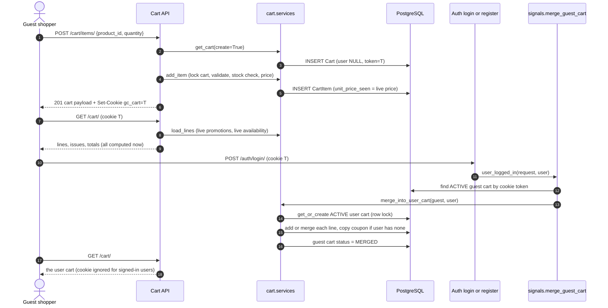
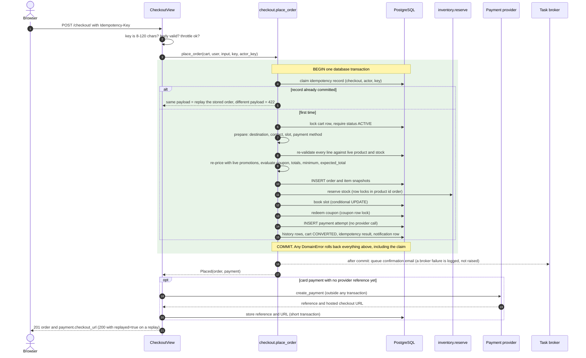
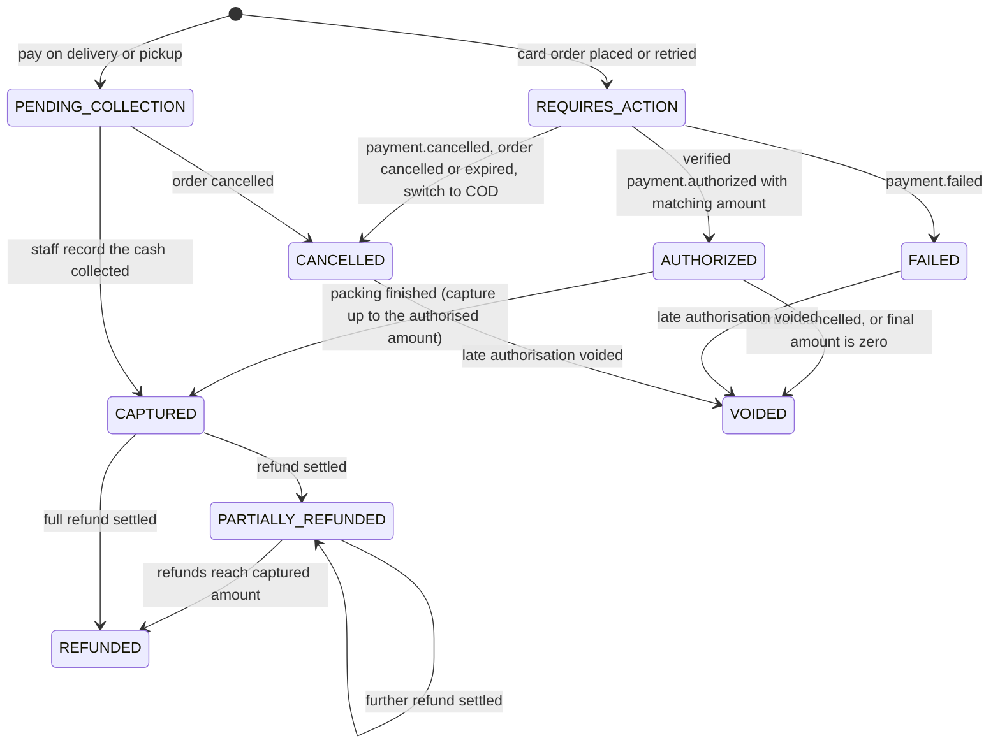
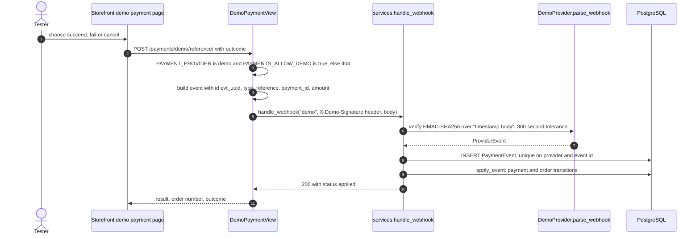
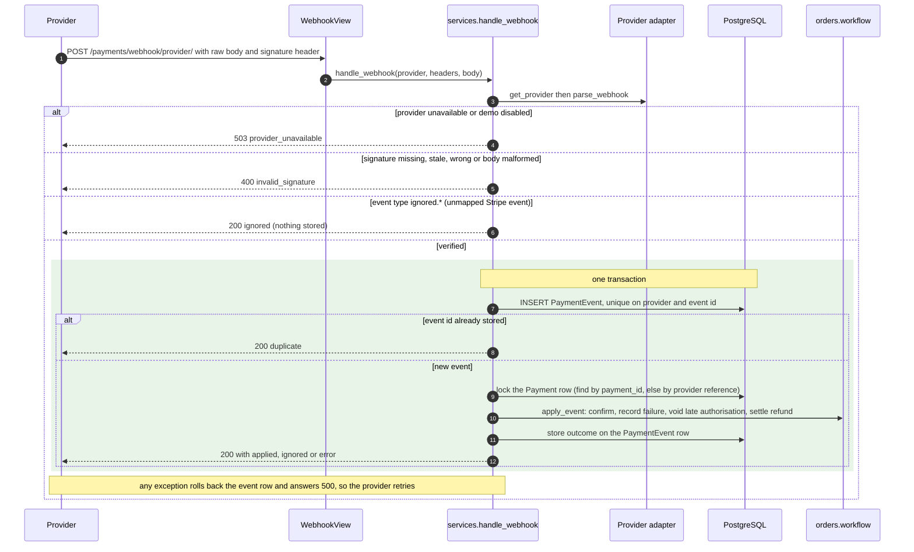
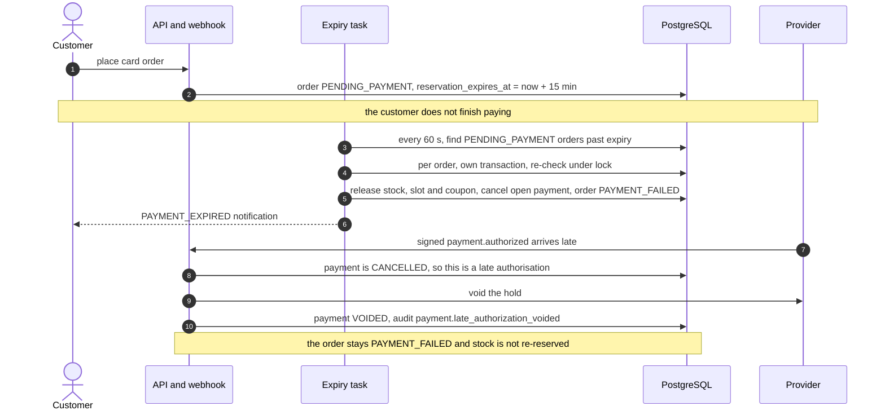
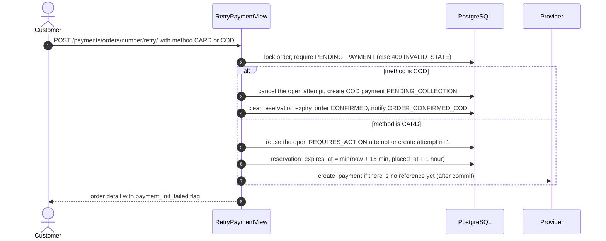
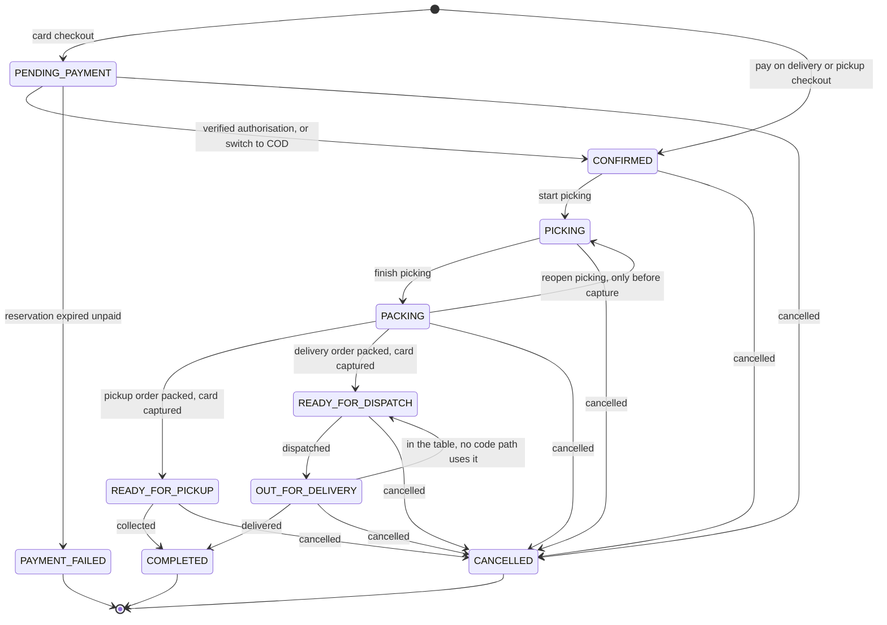
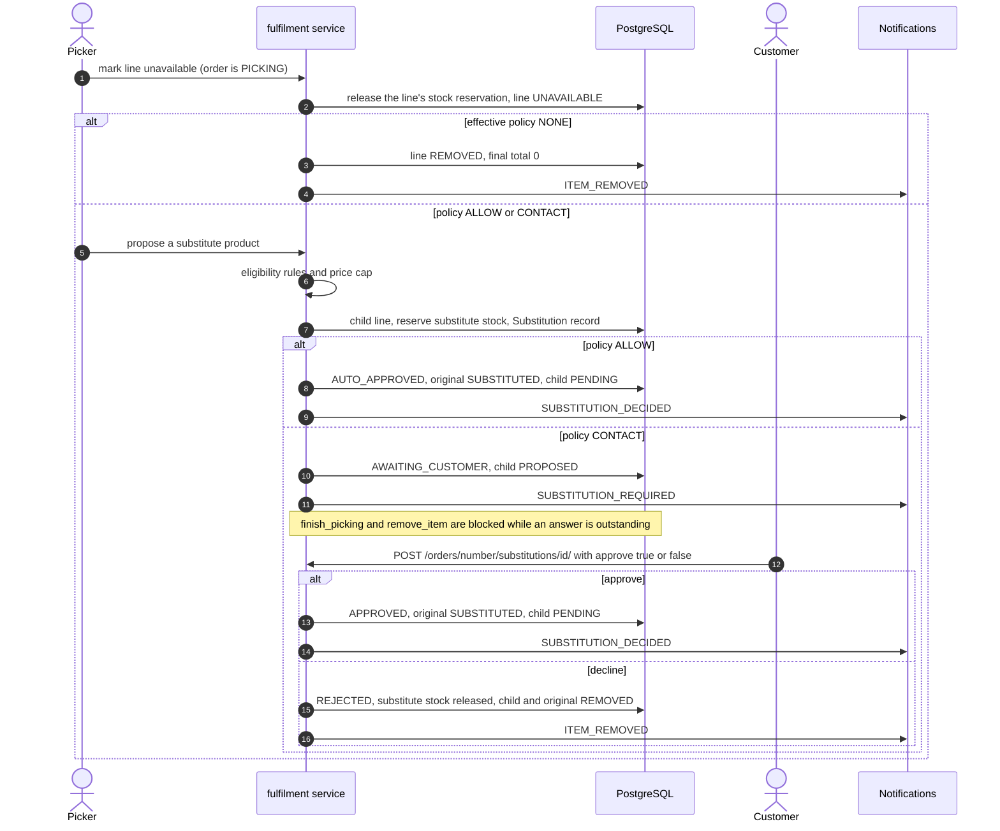
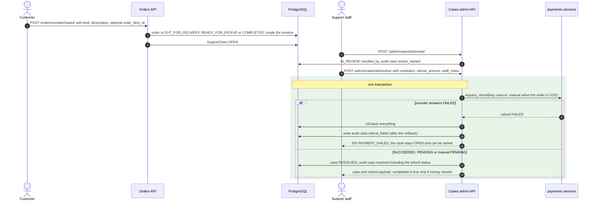

# Commerce Workflows

> Scope: how a basket becomes a paid, fulfilled and (if necessary) refunded order, as implemented in
> `backend/apps/cart`, `promotions`, `stores`, `orders`, `payments` and `notifications`.
> Stock, purchasing, picking mechanics and delivery-slot generation are in the companion document
> [`inventory-and-fulfilment.md`](inventory-and-fulfilment.md). Product vision and rules of intent are in
> [`implementation-plan.md`](implementation-plan.md); where the code differs from the plan, this document follows the code and says so.

## 0. How to read this document

**Evidence.** Every statement was read from source in the repository at commit `47ded60` (2026-10-12). `file:line` citations refer to that commit; other workstreams were committing while this was written, so if lines have drifted, the function or test name is the stable reference. Where a test asserts a behaviour, the test is named as
`file::Class::test_name` (file shortcuts below). Three markers are used:

* **Not tested** – the behaviour exists in code but no test in `backend/tests/` asserts it.
* **Not implemented** – the behaviour is described somewhere (plan, docstring, UI wording) but the code does not do it.
* **Unverified** – read from code only and not exercised by anyone, including this document's author.

**What "tested" means here.** The author did not run the test suite (it needs the shared PostgreSQL database). A named test proves a
behaviour only in the sense that the test exists and asserts it; this document makes no claim about whether CI is green.

**File shortcuts used for tests**

| Shortcut | Path under `backend/tests/` |
|---|---|
| `test_cart.py` | `cart/test_cart.py` |
| `test_checkout.py` | `orders/test_checkout.py` |
| `test_fulfilment.py` | `orders/test_fulfilment.py` |
| `test_orders_admin.py` | `admin/test_orders_admin.py` |
| `test_cases_admin.py` | `admin/test_cases_admin.py` |
| `test_reports_admin.py` | `admin/test_reports_admin.py` |
| `test_stores_admin.py` | `admin/test_stores_admin.py` |
| `test_settings_audit_admin.py` | `admin/test_settings_audit_admin.py` |
| `test_catalog.py` | `catalog/test_catalog.py` |
| `test_inventory.py` | `inventory/test_inventory.py` |
| `test_degraded_dependencies.py` | `resilience/test_degraded_dependencies.py` (added by another workstream while this document was written; not run) |
| `test_route_sweep.py` | `security/test_route_sweep.py` (same caveat) |

**Conventions that apply everywhere**

* Money is `Decimal` with 2 places, quantities `Decimal` with 3 places; floats are rejected (`apps/core/money.py`, `to_decimal`).
* Every API error has one shape: `{"error": {"code", "message", "details", "request_id"}}` (`apps/core/exceptions.py`). Business-rule failures are
  `DomainError(code, message, status_code, details)`; the default `status_code` is **400**, so the status is stated per case below.
* Services run in explicit transactions (`ATOMIC_REQUESTS = False`, `config/settings/base.py`). A `DomainError` raised inside a service's
  `transaction.atomic()` rolls back everything that service wrote.
* "Staff capability" names (`orders.fulfil`, `orders.manage`, …) come from the role matrix in `apps/core/rbac.py`.

---

## 1. Cart

### 1.1 Data model

| Model | Fields that matter | Constraints |
|---|---|---|
| `Cart` | `user` (null for guests), `token` (UUID, unique), `branch` (null), `coupon_code`, `substitution_policy` (`ALLOW`/`CONTACT`/`NONE`), `status` (`ACTIVE`/`CONVERTED`/`MERGED`), `notices` (JSON list of strings) | `uniq_active_cart_per_user`: at most one `ACTIVE` cart per user |
| `CartItem` | `cart`, `product`, `quantity` (10,3), `substitution_pref` (`INHERIT`/`ALLOW`/`NONE`), `unit_price_seen` | unique `(cart, product)`; CHECK `quantity > 0` |

A cart stores **no price**. `unit_price_seen` is only the price the customer last saw, kept so a later change can be explained (§1.6).

### 1.2 Guest cart cookie

| Property | Value (`apps/cart/services.py`: `get_cart`, `attach_cookie`) |
|---|---|
| Cookie name | `gc_cart` (`CART_COOKIE`) |
| Value | the cart's `token` (UUID) |
| Flags | `HttpOnly`, `SameSite=Lax`, `Secure` when `request.is_secure()` |
| Max-age | 30 days (`CART_COOKIE_MAX_AGE`) |
| Set when | any cart response for a cart with `user IS NULL` |
| Lookup | `token = cookie AND user IS NULL AND status = ACTIVE`; a malformed value is ignored, not an error |
| Created when | only on a write (`create=True`); a `GET /cart/` with no cookie creates nothing |

Tests: `test_cart.py::TestGuestCart::test_guest_cart_persists_through_cookie` (cookie is `HttpOnly`),
`::test_empty_cart_without_cookie_creates_nothing`, `::test_garbage_cookie_is_ignored`,
`::TestLoginMergeAndIsolation::test_user_cannot_see_another_users_cart` (a user's cart cannot be reached by presenting its token as a guest),
`::test_cart_writes_require_csrf_even_for_guests` (`CSRFSessionAuthentication` enforces CSRF on anonymous writes).

**Not implemented:** no job expires or deletes old guest carts; the cookie ages out in the browser, the rows stay.

### 1.3 Add, merge on login, re-price



**Merge rules** (`merge_into_user_cart`, triggered by Django's `user_logged_in` signal, so login **and** registration both merge):

| Case | Result |
|---|---|
| Guest product not purchasable now (`status != ACTIVE` or `is_available = false`) | skipped |
| Product already in the user cart | quantities add; capped at `qty_max` when one exists; then `validate_quantity` (step/min rules) |
| Summed quantity fails `validate_quantity` | falls back to the user's existing quantity (or the guest quantity when the user had none) |
| Stock | **not checked** at merge; shortages surface as `REDUCED_AVAILABILITY` / `OUT_OF_STOCK` on the next read |
| Coupon | guest coupon code copied only if the user cart has none |
| Guest cart afterwards | `status = MERGED`; the `gc_cart` cookie is not cleared, but a merged cart is never found again (lookup requires `ACTIVE`) |

Tests: `test_cart.py::TestLoginMergeAndIsolation::test_guest_basket_merges_into_account_basket_on_login` (4 + 2 apples clipped to `qty_max` 5),
`::test_registration_also_merges_the_guest_basket`. **Not tested:** coupon carry-over, non-purchasable products skipped, the
fallback when the summed quantity is invalid.

### 1.4 Server-side re-pricing

* `GET /cart/`, every cart mutation response, `/checkout/quote/` and `POST /checkout/` all price lines through the same functions
  (`cart.pricing.price_items` + `compute_totals`). The browser sends only `product_id` and `quantity`; anything else in the body is ignored.
* Cart reads use the **live** promotion index (`load_index(use_cache=False)`) and live availability; only catalogue browsing uses the 30-second promotion cache.
* `unit_price_seen` is written at add/set time; it is compared with the current effective unit price on each read.

Tests: `test_cart.py::TestGuestCart::test_client_cannot_inject_prices`, `test_checkout.py::TestServerIsAuthoritative::test_client_supplied_prices_are_ignored`.

**Branch used for availability.** Cart availability is computed for `cart.branch_id` (set with `PATCH /cart/ {"branch_id": …}`), else the default
branch. Checkout recomputes availability for the branch that serves the address (delivery zone) or the chosen pickup store. The two can differ,
in which case a cart that looked fine can fail checkout with `CART_CHANGED`. **Not tested.**

### 1.5 Quantity rules (`pricing.validate_quantity`)

Rejected with `INVALID_QUANTITY` (HTTP 400): not a finite number, `<= 0`, more than 3 decimal places, fractional for a unit that does not allow
fractions, below `qty_min` or not `qty_min + k·qty_step`, above `qty_max`. `add_item` validates the **added** amount loosely (positive, step-aligned) and the
**resulting total** fully. `set_quantity` re-checks stock only when the quantity grows; `0` deletes the line. A basket holds at most 100 lines (`MAX_LINES`).
Tests: `test_cart.py::TestQuantityRules::*`.

### 1.6 Issue detection

`cart.services.detect_issues` runs on every read. The first four are mutually exclusive (evaluated in this order); `PRICE_CHANGED` can accompany any of them.

| Code | Blocking | Raised when | `POST /cart/fix/` does | Test |
|---|---|---|---|---|
| `UNAVAILABLE` | yes | product not purchasable (`status != ACTIVE` or `is_available = false`) | removes the line ("No longer available") | detection: `test_cart.py::TestChangesAreExplained::test_product_deactivated_after_adding`; the fix path for this code is **not tested** |
| `OUT_OF_STOCK` | yes | availability status `OUT_OF_STOCK` (available quantity below `qty_min`) | removes the line | `::test_stock_drop_blocks_checkout_and_fix_explains_what_changed` |
| `REDUCED_AVAILABILITY` | yes | `max_orderable` is lower than the line quantity; `max_orderable` is the available quantity floored to the product's step and capped by `qty_max` | reduces the quantity to `max_orderable` (removes the line if that would be below `qty_min`) | same test |
| `INVALID_QUANTITY` | yes | the stored quantity no longer satisfies `validate_quantity` (rules edited after the item was added) | removes the line ("its ordering rules changed, please add it again") | **Not tested** |
| `PRICE_CHANGED` | **no** | `unit_price_seen` differs from the current effective unit price (`from`/`to` are reported) | nothing; `POST /cart/acknowledge/` sets `unit_price_seen` to the current price and clears `notices` | `::test_price_change_is_surfaced_until_acknowledged` |

* `can_checkout = lines exist AND no blocking issue`.
* Nothing is changed by a `GET`. `fix` and `acknowledge` are explicit customer actions; `fix` writes what it did into `Cart.notices` (replacing earlier
  notices) and returns it in the payload.
* A price change never blocks checkout. The protection against being charged a total the customer has not seen is the optional `expected_total`
  check (§3.6).
* `detect_issues` uses `product.is_purchasable`, which does not look at the category. `add_item` and checkout also require `category.is_active`, so a
  product whose category was deactivated after it was added shows no cart issue and then fails at checkout with `CART_CHANGED` (`PRODUCT_UNAVAILABLE`). **Not tested.**

### 1.7 Reorder (`POST /cart/reorder/<order number>/`)

Signed-in only; the order must belong to the caller (anything else is `404 NOT_FOUND`, `test_cart.py::TestReorder::test_reorder_revalidates_price_and_stock`).
For every order line that is **not** a substitute line (`substitute_for IS NULL`; so the originally ordered product is re-added, never what it was
substituted with):

1. The product must be purchasable now, otherwise the line is **skipped** with the error message.
2. Wanted quantity is the line's `ordered_qty` (not the picked quantity), capped at `qty_max`.
3. If it cannot be ordered at all, **skipped** ("Out of stock right now"). If wanted exceeds `max_orderable`, the quantity is reduced and the line is listed under
   `adjusted` ("Limited stock").
4. The quantity is added to any existing cart line and the sum is validated; a validation error **skips** the line.
5. `unit_price_seen` is today's price. Prices, promotions and stock from the original order are never reused.

The response carries `reorder: {added, adjusted, skipped}`. A line that was reduced appears in **both** `adjusted` and `added` (the code appends to `added`
after adjusting). Lines that were removed or unavailable in the original order are re-added like any other. Substitution preferences, the order's policy and its coupon are **not** copied.

### 1.8 Shopping list to cart

`POST /lists/<id>/add-to-cart/` calls `add_item` per list line with the same validation as manual adds; lines that fail are returned under
`list_result.skipped` with the reason, the rest are added. Test: `test_cart.py::TestFavoritesComparisonLists::test_shopping_lists_are_private_and_move_to_cart_with_validation`.

---

## 2. Pricing, promotions and coupons

All pricing lives in `apps/cart/pricing.py` (`price_items`, `compute_totals`), `apps/promotions/engine.py` (automatic promotions) and
`apps/promotions/coupons.py` (codes). Cart view, checkout quote and order creation call the same functions.

### 2.1 Order of evaluation

| Stage | What happens | Where |
|---|---|---|
| 1. Shelf price | `product.price × quantity`; `price` is per **one sale unit** | `price_items` |
| 2. Automatic promotion | at most one promotion per line; gives the line total and the effective unit price | `engine.best_application` |
| 3. Subtotal | sum of line totals **after** promotions, **before** coupon | `Totals.subtotal` |
| 4. Coupon | computed on the post-promotion line totals of eligible lines; shares are allocated to lines (`coupon_share`) | `coupons.evaluate_coupon` |
| 5. After coupon | `subtotal − coupon_discount` | `compute_totals` |
| 6. Delivery fee | the **slot's** fee; waived by a free-delivery coupon or by the zone's threshold (compared with the after-coupon amount) | `compute_totals` |
| 7. Tax | per line on `line_total − coupon_share` | `compute_totals` |
| 8. Total | `after_coupon + fee` (+ tax when prices exclude tax); never below 0 | `Totals.total` |
| 9. Authorised amount | `total + weighed-item buffer` (§4.6) | `Totals.authorized_amount` |

### 2.2 Automatic promotions

| Item | Behaviour |
|---|---|
| Kinds | `PERCENT_OFF` (0 < percent ≤ 100), `AMOUNT_OFF` (per unit), `MULTIBUY` (N ≥ 2 for a fixed price). DB CHECK constraints enforce the ranges (`Promotion.Meta`). |
| Scope | `PRODUCTS`, `CATEGORIES` (matches the product's category **or its parent**), `BRANDS`. |
| Active | `is_active`, `starts_at ≤ now`, `ends_at` null or `> now`. |
| Stacking | **Never.** For each line the candidate that yields the **lowest line total for that quantity** wins. Ties go to the lowest promotion id. |
| No saving | A promotion whose line total is not strictly lower than the shelf total is discarded. |
| Freshness | Catalogue pages use a 30-second cached index; cart, quote and checkout use `load_index(use_cache=False)`. |

Formulas (`engine.apply_promo`, all rounding via `money()`):

* Percent: `unit = money(price × (100 − p) / 100)`, `line = money(unit × qty)`.
* Amount off: `unit = max(money(price − amount), 0)`, `line = money(unit × qty)`.
* Multibuy: `groups = floor(qty / N)`, `line = money(groups × multibuy_price + (qty − groups × N) × price)`, displayed `unit = money(line / qty)`.

Tests: `test_cart.py::TestPromotionsInCart::test_percent_and_multibuy_totals_are_exact` (1.25 kg at 3.00 with 20 % off → unit 2.40, line 3.00; 4 loaves with
"3 for 12.00" → 16.50; subtotal 19.50; savings 2.25). Catalogue display: `test_catalog.py::TestFilters::test_on_offer_filter_and_effective_price`,
`::test_category_promotion_covers_child_categories`, `::test_expired_and_inactive_promotions_do_not_apply`, `::test_promotion_that_does_not_save_money_is_ignored`.

**Not tested:** two competing promotions on one product, the tie-break, `AMOUNT_OFF` and `BRANDS` in basket pricing. The test named
`test_multibuy_label_and_best_promotion_wins` creates only one promotion.
**Docstring mismatch:** `engine.py` says ties go to "lowest `priority`, then id", but `Promotion` has no `priority` field; the code orders by id only.

### 2.3 Coupons

One code per cart (`Cart.coupon_code`). `evaluate_coupon` applies these checks **in this order**; every failure is `INVALID_COUPON`, HTTP 400, with a customer-readable message.

| # | Check | Notes |
|---|---|---|
| 1 | Code exists | case-insensitive; stored upper-case and trimmed (`Coupon.save`); unique ignoring case |
| 2 | `is_active` | |
| 3 | `starts_at ≤ now` | |
| 4 | `ends_at` null or `> now` | |
| 5 | `used_count < usage_limit` (if set) | total redemptions |
| 6 | prior **ACTIVE** redemptions by this user **or this email** `< per_customer_limit` (default 1) | a guest has no email in the cart view, so this check is effectively skipped until checkout, where the contact email is used. For guests the limit is keyed on a typed email address. |
| 7 | `first_order_only`: no order for this user/email other than `CANCELLED`/`PAYMENT_FAILED` | |
| 8 | `min_order_value ≤` basket | basket = sum of **all** post-promotion line totals (not only eligible lines); message reports the shortfall |
| 9 | `FREE_DELIVERY`: refused for `PICKUP` | returns here with no discount; scope and exclusions are not consulted |
| 10 | Eligible lines | scope `ALL` / `PRODUCTS` / `CATEGORIES` (category or its parent) minus `excluded_products`; and, when `exclude_discounted_items` (default **true**), minus lines that already carry an automatic promotion. No eligible line → "doesn't apply to the items in your basket" |
| 11 | Discount | `PERCENT`: `money(eligible × value / 100)`; `FIXED`: `money(value)`; then `min(discount, max_discount)` if set; then `min(discount, eligible)` |
| 12 | Allocation | the discount is split across eligible lines proportionally to line total, in whole cents, largest remainder first, so the shares add up to the discount exactly (`_allocate`) |

Consequences: a coupon can never exceed what it applies to, so `total` cannot go negative from it (`Totals.total` is additionally floored at 0).
A coupon and a promotion only combine on a line when `exclude_discounted_items` is turned off.

**At the cart**: the code is validated when applied (`POST /cart/coupon/`, throttled at 20/min) and re-validated on every read. A code that becomes invalid is
shown as `coupon.valid = false` with the reason and a 0 discount; it is not silently removed. **At checkout** it is validated again with the contact email;
an invalid code fails the order with `INVALID_COUPON` (400) until the customer removes it.

**Redemption** (`coupons.redeem`, inside the checkout transaction): locks the coupon row, re-checks active/dates/usage limit/per-customer limit, increments
`used_count`, writes one `CouponRedemption` (one-to-one with the order, amount = discount). **Release** (`void_redemption`, called when an order is cancelled
or its payment window expires): redemption becomes `VOID` and `used_count` drops by one (not below 0); a voided redemption no longer counts toward the per-customer limit.

Tests: `test_cart.py::TestCoupons::*` (percent, invalid reasons, unknown code, fixed capped at eligible, `max_discount`, scope and discounted-item exclusion,
per-customer and first-order limits, free delivery, expiry after applying, removal, exact allocation);
`test_checkout.py::TestServerIsAuthoritative::test_coupon_must_still_be_valid_at_checkout`, `::test_coupon_discount_and_redemption_are_stored_on_the_order`,
`::TestConcurrency::test_coupon_usage_limit_holds_under_concurrency`, and the release tests in §5.
**Not tested:** `CATEGORIES` scope (the test named `…category_scope…` uses `PRODUCTS`), `excluded_products`, `exclude_discounted_items = false`,
first-order and per-customer checks for guests by email, `FREE_DELIVERY` refused for pickup at checkout, `redeem` refusing at the lock.

### 2.4 Delivery fee, free delivery, minimum order

* **Fee** = `DeliverySlot.fee` of the chosen slot, not the zone's `delivery_fee` read live. The slot fee is copied from the template (`SlotTemplate.fee`) or the zone at
  generation time; changing a zone's fee later updates future slots that have no template override (`stores/admin_api.py: ZoneSerializer.update`,
  `test_stores_admin.py::TestZonesAndSlots::test_changing_the_zone_fee_updates_future_slots_without_their_own_override`).
* **Free delivery** when the coupon is `FREE_DELIVERY`, or the zone has `free_delivery_threshold` and `after_coupon ≥ threshold`. Only applies if the fee is above 0.
  The quote reports `delivery_fee_before_free` and `free_delivery`. Pickup orders have no zone, so no threshold.
  Tests: `test_checkout.py::TestServerIsAuthoritative::test_free_delivery_threshold_applies`, `::TestHappyPath::test_pickup_order_has_no_address_or_delivery_fee`.
* **Minimum order** = `max(StoreSettings.min_order_value, zone.min_order_value)` compared with the **subtotal** (after promotions, before coupon). Failure:
  `409 MIN_ORDER_NOT_MET` with `details.minimum` and `details.shortfall`. Test: `test_checkout.py::TestServerIsAuthoritative::test_minimum_order_is_enforced_with_a_helpful_message`.

### 2.5 Tax

| Setting | Effect |
|---|---|
| `Product.tax_rate` (percent, default 0) | per-line rate |
| `StoreSettings.prices_include_tax` (default **true**) | inclusive: tax is extracted, `money(base × r / (100 + r))`, and **not** added to the total. Exclusive: `money(base × r / 100)` is added. |

* `base` is the line total after its coupon share. Each line's tax is rounded, then summed.
* The delivery fee is not taxed (no tax is computed on it).
* The quote reports `tax_included` (inclusive) or `tax_added` (exclusive); the order stores `tax_total`. After picking, `fulfilment.finalize_totals` recomputes tax with the same formula on final amounts.
* **Not tested:** no test asserts a tax amount in either mode; the demo catalogue uses `tax_rate = 0`.

### 2.6 Rounding rules

| Where | Rule |
|---|---|
| `money()` | quantise to 0.01, `ROUND_HALF_UP` |
| `qty()` | quantise to 0.001, `ROUND_HALF_UP` |
| Floats | rejected (`TypeError`) by `to_decimal` |
| Percent / amount-off promotion | the **unit price is rounded to cents first**, then multiplied by the quantity and rounded again |
| Multibuy | one rounding of the whole line; displayed unit price = `money(line / qty)` |
| Percent coupon | `money(eligible × value / 100)`; shares allocated in cents (largest remainder), test `test_cart.py::TestCoupons::test_allocation_shares_sum_exactly` |
| Tax | per line, then summed |
| Weighed lines after picking | `money(effective unit price × picked weight)`; the weight itself is quantised to 0.001 |

### 2.7 Worked numbers (taken from tests)

| Case | Calculation | Source |
|---|---|---|
| Plain card order | 4 × 2.50 = 10.00; slot fee 4.00 → total 14.00; no weighed lines so `max_charge` = 14.00 | `test_checkout.py::TestHappyPath::test_card_checkout_reserves_stock_books_slot_and_waits_for_verified_payment` |
| Weighed line | 1.5 kg × 12.00 = 18.00 estimated; + 4.00 fee = 22.00; buffer 10 % × 18.00 = 1.80; authorised 23.80 | `::TestServerIsAuthoritative::test_weighed_items_show_estimate_and_max_charge` |
| Coupon on a basket | 2 kg × 3.00 + 4 × 4.50 = 24.00; 10 % off = 2.40 → estimated total 21.60 | `test_cart.py::TestCoupons::test_percent_coupon_applies_and_shows_in_totals` |
| Coupon capped | 50 % requested, `max_discount` 5.00 → 5.00 | `::test_max_discount_cap` |
| Fixed coupon larger than basket | 50.00 on a 4.50 basket → 4.50, total 0.00 | `::test_fixed_discount_never_exceeds_eligible_subtotal` |

---

## 3. The checkout transaction

Code: `apps/orders/checkout.py` (`prepare`, `quote`, `place_order`), `apps/orders/views.py` (`CheckoutQuoteView`, `CheckoutView`).

### 3.1 Endpoints

| Endpoint | Purpose | Notes |
|---|---|---|
| `POST /api/v1/checkout/quote/` | Price the basket for a destination/slot/payment method | read-only; calls `prepare()`; no locks, no side effects |
| `POST /api/v1/checkout/` | Place the order | requires `Idempotency-Key` (8–120 characters); throttle scope `checkout` (30/min); CSRF enforced even for guests |

Request body (`CheckoutInput`): `fulfilment_type` (`DELIVERY`/`PICKUP`), `slot_id`, `payment_method` (`CARD` default / `COD`), `branch_id` (pickup), `address_id` **or** `address`,
`contact` (`name`, `email`, `phone`), `substitution_policy` (defaults to the cart's), `customer_note` (max 500), `expected_total`, `save_address`.
The browser keeps one idempotency key per distinct request body and sends the last quoted total as `expected_total` (`frontend/src/components/checkout/checkout-view.tsx`).

### 3.2 Sequence



### 3.3 Order of operations and what each failure returns

Steps 1–17 run inside the single `transaction.atomic()` in `place_order`. The provider call (step 19) happens after it.

| # | Step | Failure → HTTP / `error.code` |
|---|---|---|
| 0 | View: header and body | missing or out-of-range key → 400 `IDEMPOTENCY_KEY_REQUIRED`; bad body → 400 `VALIDATION_ERROR`; throttled → 429 `RATE_LIMITED` |
| 1 | **Claim idempotency record** `(scope "checkout", actor_key, key)` | existing record with another payload hash → 422 `IDEMPOTENCY_CONFLICT`; existing record with the same hash → replay (§3.5) |
| 2 | Cart exists, row-locked (`SELECT … FOR UPDATE`), `status = ACTIVE` | 409 `CART_EMPTY` |
| 3 | Cart has lines | 409 `CART_EMPTY` |
| 4 | **Coverage**: pickup → active branch with `offers_pickup`; delivery → saved address (must belong to the user) or inline address, then `require_zone` (postcode prefix or area match, lowest `priority` wins) | 400 `VALIDATION_ERROR` (no pickup store, no address, saved address while signed out); 404 `NOT_FOUND` (address owned by someone else); 400 `ADDRESS_NOT_SERVICEABLE` |
| 5 | **Contact**: signed-in users default to profile values; guests need name, email, phone | 403 `GUEST_CHECKOUT_DISABLED`; 400 `VALIDATION_ERROR` with `details["contact.<field>"]` |
| 6 | **Slot**: right kind, branch and (delivery) zone; open; `remaining > 0`; starts after `now + branch.prep_minutes` | 409 `DELIVERY_SLOT_UNAVAILABLE` (all cases) |
| 7 | **Payment method** allowed: card needs `card_payments_enabled` and a configured provider; COD needs `cash_on_delivery_enabled` | 503 `PAYMENT_PROVIDER_UNAVAILABLE` (card); 400 `VALIDATION_ERROR` (COD disabled) |
| 8 | **Re-validate each line** against live product (purchasable, category active), quantity rules, available stock for the serving branch | 409 `CART_CHANGED`, `details.items[]` each with `code` = `PRODUCT_UNAVAILABLE` / `INVALID_QUANTITY` / `INSUFFICIENT_STOCK` |
| 9 | **Re-price** with the live promotion index; **evaluate the coupon** with the contact email and fulfilment type | 400 `INVALID_COUPON` |
| 10 | Totals; **minimum order** | 409 `MIN_ORDER_NOT_MET` |
| 11 | **`expected_total`** (only if supplied) equals the server's `total` | 409 `CART_CHANGED` with `details.expected_total`, `details.current_total`, `details.quote` (a full fresh quote) |
| 12 | **Snapshots**: `Order` (contact, shipping address copy, slot window, totals, coupon, `authorized_amount`, status, `checkout_key`) and one `OrderItem` per line (name, SKU, image, unit, tax rate, base and effective unit price, promotion label/kind/params, ordered quantity, estimated line total, coupon share, substitution preference). Order numbers are random (`OR-yymmdd-xxxxx`); up to 5 retries on a number collision | 500 `INTERNAL_ERROR` after 5 collisions |
| 13 | **Reserve stock** (`inventory.reserve`): `StockLevel` rows locked in product-id order, FEFO batch plan evaluated **as of the slot's date** (batches no longer sellable on delivery day are skipped), all-or-nothing | 409 `INSUFFICIENT_STOCK` with `details.items[]` listing every short line |
| 14 | **Book the slot** (`stores.book_slot`): `UPDATE … WHERE is_open AND booked < capacity SET booked = booked + 1` | **400** `DELIVERY_SLOT_UNAVAILABLE` (see note) |
| 15 | **Redeem coupon** under a coupon row lock | 400 `INVALID_COUPON` |
| 16 | **Create the payment attempt** row (COD: `PENDING_COLLECTION`; card: `REQUIRES_ACTION`, amount = `authorized_amount`). No external call | 503 `PAYMENT_PROVIDER_UNAVAILABLE` |
| 17 | History rows; optional address save; cart → `CONVERTED`; idempotency record gets `resource_id = order.number`; in-app `Notification`; email queued for after commit | — |
| 18 | **COMMIT** | |
| 19 | **After commit** (view): for a card payment without a provider reference, `payments.init_with_provider` calls the provider and stores `provider_reference` + `checkout_url` in a short transaction | `ProviderError` → still `201`, body has `payment_init_failed: true`; the order is `PENDING_PAYMENT` and the customer retries (§4.8) |

Initial state: card orders `PENDING_PAYMENT` with `reservation_expires_at = now + RESERVATION_TTL_MINUTES` (15); COD orders `CONFIRMED` immediately
(`confirmed_at` set, no expiry, payment `PENDING_COLLECTION`).

**Note on step 14.** `_check_slot` (step 6) answers 409, but when the pre-check passes and the atomic `UPDATE` then loses the race, `book_slot` raises the same
code with the `DomainError` default status, **400** (`stores/services.py`, three raises). The code is stable; the HTTP status differs between the two paths.
`test_checkout.py::TestConcurrency::test_last_slot_place_is_won_by_exactly_one_checkout` asserts the code only.

**Provider calls inside transactions.** Only `create_payment` is made after commit. `capture` (at end of packing), `void` (on cancel) and `refund` are called from services that
are themselves inside a database transaction (§4.6, §4.9).

### 3.4 Quote versus place

`quote()` and `place_order()` share `prepare()`, so the figures shown are produced by the code that later charges. The quote response (`quote_payload`) includes
line items, `subtotal`, `promo_savings`, coupon, `delivery_fee`, `delivery_fee_before_free`, `free_delivery`, `tax_included`/`tax_added`, `total`, `max_charge`
(= authorised amount), `weight_buffer`, `has_weighed_items`, the slot and the tolerance percentage.

### 3.5 Idempotency

| Aspect | Behaviour (`IdempotencyRecord`, `place_order`) |
|---|---|
| Key identity | `(scope = "checkout", actor_key, key)`, unique. `actor_key` = `user:<id>` for signed-in users, `guest:<gc_cart cookie value>` for guests. The order's own globally unique `Order.checkout_key` is stored as the SHA-256 hex digest of `actor_key|key`, so two different shoppers who happen to send the same client-generated key each get their own order (`checkout.py: order_key`) |
| Payload hash | SHA-256 of `fulfilment_type, slot, payment_method, branch_id, address_id, address, contact, substitution_policy, customer_note, expected_total`. **Not included:** cart contents, coupon code, `save_address` |
| Same key, same hash | **Replay**: the stored order is returned with **HTTP 200** and `replayed: true`. Nothing is re-validated, re-priced, re-reserved or re-charged. If the payment still has no provider reference the view retries `init_with_provider` |
| Same key, different hash | `422 IDEMPOTENCY_CONFLICT`; nothing changes |
| Concurrent duplicates | the second request blocks on the unique index until the first commits, then replays |
| Failed attempt | the claim is part of the rolled-back transaction, so the key is **not** burned |
| Replay after the cart was converted | works: the claim is checked before the cart is looked up |
| Retention | `core.tasks.cleanup_idempotency_keys` deletes records older than 7 days (daily). `Order.checkout_key` is unique forever (`uniq_order_checkout_key`, partial: non-null values only), so the **same shopper** reusing the same key more than 7 days later would pass the claim and then fail on that constraint as an unhandled `IntegrityError` (500). The browser generates a new key per distinct body, so this is unlikely in practice. **Not tested** |

Tests: `test_checkout.py::TestIdempotency::test_same_key_returns_same_order_without_side_effects`, `::test_same_key_with_different_details_is_rejected`,
`::test_idempotency_key_is_required`, `::test_failed_attempt_does_not_burn_the_key`, `::TestConcurrency::test_double_click_double_submit_creates_one_order` (6 threads,
exactly one 201, the rest 200, one order, one payment, stock reserved once, slot booked once),
`test_degraded_dependencies.py::test_idempotent_replay_after_a_broker_failure_returns_the_same_order`,
`test_checkout.py::TestIdempotencyScope::test_two_shoppers_sending_the_same_client_key_each_get_their_own_order` (two clients, same key, two `201` responses, two different order numbers).

### 3.6 `expected_total`

Optional. When present it is compared with the server's `total` (the **estimated** total including delivery and tax; not the authorised amount). A mismatch is a `409 CART_CHANGED`
that carries the fresh quote, and nothing is persisted (`test_checkout.py::TestServerIsAuthoritative::test_stale_expected_total_returns_409_with_fresh_quote`
asserts no order and no reserved stock). When omitted the server accepts whatever total it computes; the browser always sends it.

### 3.7 Other checks asserted by tests

| Behaviour | Test |
|---|---|
| Client-supplied prices and totals are ignored | `test_checkout.py::TestServerIsAuthoritative::test_client_supplied_prices_are_ignored` |
| Stale stock is reported per item | `test_checkout.py::TestValidation::test_items_sold_out_after_adding_are_reported_per_item` |
| Slot must match branch, zone and kind; full, closed and too-soon slots are refused | `test_checkout.py::TestValidation::test_slot_must_match_branch_zone_and_kind`, `test_checkout.py::TestValidation::test_full_slot_closed_slot_and_slot_too_soon` |
| Address ownership, coverage by postcode or area name | `test_checkout.py::TestValidation::test_address_must_belong_to_the_customer`, `test_checkout.py::TestValidation::test_unserviceable_address`, `test_checkout.py::TestValidation::test_coverage_by_area_name_works_too` |
| Guest contact required; guest checkout can be disabled | `test_checkout.py::TestValidation::test_guest_must_supply_contact_details`, `test_checkout.py::TestValidation::test_guest_checkout_can_be_disabled` |
| Empty basket | `test_checkout.py::TestValidation::test_empty_basket` |
| Reservation, slot booking, cart conversion, snapshots, invariants | `test_checkout.py::TestHappyPath::test_card_checkout_reserves_stock_books_slot_and_waits_for_verified_payment` |
| Concurrency: last slot place, stock oversell, coupon usage limit | `test_checkout.py::TestConcurrency::test_last_slot_place_is_won_by_exactly_one_checkout`, `test_checkout.py::TestConcurrency::test_stock_cannot_be_oversold_across_concurrent_checkouts`, `test_checkout.py::TestConcurrency::test_coupon_usage_limit_holds_under_concurrency` |

**Not tested:** `payment_init_failed` (provider unavailable at step 19), the 5-attempt order-number collision loop, `MIN_ORDER_NOT_MET` from the store-wide minimum (only the zone minimum is exercised),
the `INSUFFICIENT_STOCK` raised by `reserve` itself in a non-concurrent setting (the concurrent test accepts either `CART_CHANGED` or `INSUFFICIENT_STOCK`).

---

## 4. Payments

Code: `apps/payments/{models,services,views,admin_api}.py`, `apps/payments/providers/{base,demo,stripe_provider}.py`, plus `apps/orders/workflow.py` for the order side.

### 4.1 Provider abstraction

Providers translate between our domain and a payment service. **They never touch the database**; `payments/services.py` owns every state change.

| Method (`PaymentProvider`) | Contract |
|---|---|
| `create_payment(payment)` → `CreateResult(reference, checkout_url)` | start a hosted payment for `payment.amount`; may raise `ProviderError` |
| `capture(payment, amount)` | capture `amount ≤ payment.amount` from an authorised payment; `ProviderError` on failure |
| `void(payment)` | release an uncaptured authorisation |
| `cancel_checkout(payment)` | optional, best effort (used when abandoning an unpaid attempt) |
| `refund(payment, amount, idempotency_key)` → `RefundResult(status, refund_id, message)` | `status` is `SUCCEEDED`, `PENDING` or `FAILED` |
| `parse_webhook(headers, body)` → `ProviderEvent` | verify the signature and translate the body; raise `InvalidSignature` if it cannot be trusted |

`get_provider(name)` returns `DemoProvider()` for `demo`, `StripeProvider()` for `stripe`, and raises `ProviderError("No payment provider is configured.")` for anything else
(including `unconfigured`, which production settings use to fail closed, and `cod`, which has no adapter). `Provider.COD` exists only as a value on `Payment.provider`.

Database guarantees on `Payment`: unique `(provider, provider_reference)` when set; **at most one open payment per order** (`uniq_open_payment_per_order`: states `REQUIRES_ACTION`, `AUTHORIZED`,
`PENDING_COLLECTION`); `amount ≥ 0`; `captured_amount ≤ amount`; `refunded_amount ≤ captured_amount`. `PaymentEvent` is unique on `(provider, event_id)`; `Refund` is unique on `(payment, idempotency_key)`.

### 4.2 Payment states



`Order.payment_status` mirrors the open or latest payment (`ORDER_PAYMENT_STATUS` in `payments/services.py`): `REQUIRES_ACTION`/`CANCELLED` → `UNPAID`, `AUTHORIZED` → `AUTHORIZED`,
`CAPTURED` → `PAID`, `PENDING_COLLECTION` → `PENDING_COLLECTION`, `FAILED` → `FAILED`, `VOIDED` → `VOIDED`, `PARTIALLY_REFUNDED`, `REFUNDED`.
A failed attempt is a dead end for that `Payment` row: a retry creates a **new** row with `attempt = n + 1`.

### 4.3 Demo adapter

**What it is.** A simulated card processor for demonstrations and tests. It never moves money. Its "hosted page" is the storefront route `/pay/demo/<reference>`, where a tester
chooses *succeed*, *fail* or *cancel*.

**Why it goes through the real webhook path.** The backend turns the tester's choice into a *signed* provider event and feeds it to the same `services.handle_webhook` a real provider would hit,
so signature verification, replay tolerance, de-duplication, amount checks and state transitions are exercised for real. The redirect back to the storefront is never treated as payment.



**Why it is isolated.** It must be impossible to run a store whose "card payments" are simulated by accident. Defences, from the innermost out:

| Layer | Where | Effect |
|---|---|---|
| Adapter constructor | `providers/demo.py: DemoProvider.__init__` | raises `ProviderError` unless `PAYMENTS_ALLOW_DEMO`; so every create/capture/void/refund and the `demo` webhook route fail closed (webhook → 503) |
| Production settings | `config/settings/prod.py` | if `PAYMENT_PROVIDER` is `demo` (the default) and `PAYMENTS_ALLOW_DEMO` is not true, `PAYMENT_PROVIDER` becomes `unconfigured`; `card_provider_name()` then returns `None` and card checkout answers 503 `PAYMENT_PROVIDER_UNAVAILABLE` |
| Demo page API | `payments/views.py: _demo_enabled` | `404` unless `PAYMENT_PROVIDER == "demo"` **and** `PAYMENTS_ALLOW_DEMO` |
| Labelling | `Payment.is_demo`; order detail `payment.mode = "demo"`; `/api/v1/store/` exposes `payment.mode` | the storefront labels demo payments as such |
| Defaults | `PAYMENTS_ALLOW_DEMO` is `false` in `base.py` and in `docker-compose.yml`; `true` in `dev.py`, `test.py` and in `.env.example` (which `make env` copies, so the local compose stack **does** run the demo adapter) | |

Tests: `test_checkout.py::TestValidation::test_demo_adapter_is_inert_unless_explicitly_allowed`, `::test_card_refused_when_no_provider_is_configured`,
`::TestWebhookSecurity::test_unknown_provider_and_demo_endpoint_disabled_in_non_demo_mode`. **Not tested:** the `prod.py` rewrite to `unconfigured`.

**Limits of the demo path.** The demo page endpoint has no authentication; the unguessable `demo_pi_<20 hex>` reference is the only gate. That is acceptable for a demonstration and is why
it must stay off in production. The webhook secret is `PAYMENT_WEBHOOK_SECRET`; nothing validates at start-up that it is non-empty (`base.py` defaults it to `""`).

### 4.4 Stripe adapter

**Status, stated plainly: the Stripe adapter has not been exercised against a live or sandbox Stripe account in this repository, and no automated test touches it.**
`grep -ri stripe backend/tests` returns nothing. The module docstring (`stripe_provider.py`, lines 3–7) and `implementation-plan.md` §7 say signature verification is
"exercised in tests" with network calls "stubbed at the SDK boundary"; no such tests exist in the repository at the time of writing.

What the code does (Stripe SDK 12.x, read from source):

| Operation | Implementation |
|---|---|
| `create_payment` | `checkout.Session.create(mode="payment")` with one line item named `Order <number> (maximum authorised amount)` for `payment.amount`, `payment_intent_data.capture_method = "manual"`, metadata `payment_id` and `order_number`, `client_reference_id = order.number`, `customer_email`, success/cancel URLs on the storefront, idempotency key `payment-<id>-create` |
| `capture` | looks up the session's PaymentIntent, `PaymentIntent.capture(amount_to_capture=…)`, idempotency key `payment-<id>-capture-<minor units>` |
| `void` | `PaymentIntent.cancel`, key `payment-<id>-void` |
| `cancel_checkout` | `checkout.Session.expire`; errors ignored |
| `refund` | `Refund.create(payment_intent=…, amount=…)`, key `refund-<payment id>-<our key>`; Stripe `succeeded` → `SUCCEEDED`, `pending` → `PENDING`, anything else or any `StripeError` → `FAILED` |
| `parse_webhook` | `Webhook.construct_event(body, Stripe-Signature, STRIPE_WEBHOOK_SECRET)`; maps `payment_intent.amount_capturable_updated` → `payment.authorized` (with `amount_capturable`), `payment_intent.payment_failed` → `payment.failed`, `payment_intent.canceled` and `checkout.session.expired` → `payment.cancelled`, `charge.refunded` → `refund.succeeded`; every other type → `ignored.<type>` (answered 200, nothing stored) |
| Amounts | `to_minor`/`from_minor` handle zero-decimal (e.g. JPY) and three-decimal (e.g. KWD) currencies |
| Guard | constructor raises `ProviderError` if `STRIPE_SECRET_KEY` is empty |

What is and is not covered by tests:

| Area | Covered? |
|---|---|
| Provider-agnostic service logic (dedupe, amount check, state changes, late authorisation, refunds) | Yes, but only through the **demo** provider (`test_checkout.py::TestWebhookSecurity`, `::TestPaymentFailureAndRecovery`, `test_fulfilment.py::TestRefundsAndComplaints`) |
| Session creation parameters, idempotency keys, metadata | No |
| Event-type mapping and `amount_capturable` handling in `parse_webhook` | No |
| Signature verification with the SDK's `construct_event` | No |
| `capture`, `void`, `cancel_checkout`, `refund` calls and their error mapping | No |
| `to_minor` / `from_minor` for zero- and three-decimal currencies | No |

Observations from reading the code, none verified against Stripe:

1. `charge.refunded` becomes `refund.succeeded` with `reference = <charge id>` and no `refund_id`; `_apply_refund_event` looks up `Refund.provider_refund_id`, which holds the `re_…` id from `Refund.create`.
   A refund that Stripe reports as `pending` therefore cannot be settled by the webhook (it would be recorded as "no matching refund").
2. Webhook lookup relies on `metadata.payment_id` being present on the event object; `create_payment` sets it on both the PaymentIntent and the session, but nothing tests that Stripe delivers it on each mapped event type.
3. `STRIPE_WEBHOOK_SECRET` defaults to `""` and nothing refuses an empty value; an empty secret would make the HMAC check forgeable.
4. `PaymentProvider.is_live` is assigned (`sk_live_` prefix) but never read.

**Before enabling Stripe:** add sandbox keys; run the full card flow end to end (authorise, capture a lower weighed amount, void, partial refund, duplicate and out-of-order webhooks); write the tests the
docstring claims; correct observation 1; add a start-up check for the webhook secret; then switch to live keys.

### 4.5 Pay on delivery / pickup (COD)

* Checkout creates a `Payment(provider = cod, state = PENDING_COLLECTION, amount = authorized_amount)` and the order is `CONFIRMED` at once. No provider is involved.
* Collection is recorded by staff when completing the order (`fulfilment.complete` → `payments.mark_cod_collected`): the amount must equal the amount due (`final_total`, else `total`), otherwise
  `400 VALIDATION_ERROR` with `details.due`. The payment becomes `CAPTURED`; the optional `reference` is stored in `provider_reference` if empty.
* Refunds on COD are always **manual** (§4.9).
* A customer can also *switch* an unpaid card order to COD (§4.8).

Tests: `test_checkout.py::TestHappyPath::test_cash_on_delivery_confirms_immediately_with_pending_collection`,
`test_fulfilment.py::TestVariableWeightProduce::test_cod_final_total_must_match_the_amount_collected`, `test_orders_admin.py::TestFulfilmentThroughTheApi::test_full_cod_delivery_via_endpoints`.

### 4.6 Authorisation versus capture; the weighed-item buffer

| Moment | What happens |
|---|---|
| Checkout | nothing is charged. `Payment.amount` (the hold) = `Order.authorized_amount` = estimated total + weighed-item buffer |
| Customer pays on the provider's page | the provider **authorises** (holds) `Payment.amount`. A verified event moves the payment to `AUTHORIZED` and the order to `CONFIRMED` |
| Picking | weights recorded (§6.1); no money moves |
| End of picking (`finish_picking`) | `final_total = min(recomputed total, authorized_amount)` is stored (`finalize_totals`) |
| **End of packing (`finish_packing`)** | card orders are **captured**: `capture_for_order` captures `min(final_total, payment.amount)`; payment → `CAPTURED`, order `payment_status` → `PAID`, audit `payment.captured`. If the final amount is 0 the hold is voided. Capture happens here, before dispatch, not at handover |
| Handover (`complete`) | COD only: staff enter the collected amount (§4.5). Nothing is captured for card orders at this point |
| Cancellation | an uncaptured hold is voided; captured money is refunded in full (§5.3) |

**Buffer.** `variable_weight_buffer = money(Σ line_total of is_variable_weight lines × StoreSettings.weight_tolerance_percent / 100)` (default 10.00 %, validators 0–50), computed on the post-promotion,
pre-coupon line totals. Example: 18.00 of weighed cheese → buffer 1.80; the quote shows `total` 22.00 and `max_charge` 23.80. **Capture is capped at the authorised amount** in three places:
`finalize_totals` (`min(total, authorized_amount)`), `capture_for_order` (`min(amount, payment.amount)`), and the database (`payment_captured_le_amount`).
The tolerance used when picking is read from settings **at pick time** (§6.1); only the order-level cap, not the tolerance, guarantees the capture never exceeds the hold if the setting is raised after checkout.

A provider error during capture raises `502 PAYMENT_FAILED`; because `finish_packing` is one transaction, the order stays in `PACKING`. **Not tested.** Capture, void and refund calls are made while the
service's database transaction is open; if the transaction later rolls back, the provider may already have acted. The Stripe adapter passes idempotency keys for that reason (unverified against Stripe); the demo provider has no external state.

Tests: `test_fulfilment.py::TestVariableWeightProduce::test_estimate_authorisation_and_policy_are_visible_to_the_customer_up_front`,
`::test_capture_is_the_final_amount_and_never_exceeds_authorisation` (the captured amount lands exactly on the 28.80 authorised amount; the case where the computed total would exceed it is **not tested**).

### 4.7 Webhook verification, de-duplication, application



The webhook view has no authentication classes and no throttle (the signature is the authentication, so CSRF does not apply).

| Condition | HTTP | `status` | `PaymentEvent` row |
|---|---|---|---|
| Unknown provider, or demo adapter disabled | 503 | `provider_unavailable` | none |
| Signature missing/malformed, timestamp outside ±300 s, HMAC mismatch, body malformed | 400 | `invalid_signature` | none |
| Event type `ignored.*` | 200 | `ignored` | none |
| `(provider, event_id)` already stored | 200 | `duplicate` | existing row untouched |
| Applied | 200 | `applied` | `APPLIED` |
| Ignored by the rules below | 200 | `ignored` | `IGNORED` |
| Authorised amount differs from `Payment.amount` | 200 | `error` | `ERROR`; order **not** confirmed, stays `PENDING_PAYMENT` |
| Exception while applying | 500 | `error` | none (rolled back) |

(`EventOutcome.DUPLICATE` exists as a value but is never written: duplicates are detected by the unique index and no row is stored.)

`apply_event` rules (`payments/services.py`):

| Event | Payment state at arrival | Result |
|---|---|---|
| `payment.authorized` | already `AUTHORIZED`/`CAPTURED`/`PARTIALLY_REFUNDED`/`REFUNDED` | ignored ("already authorised") |
| `payment.authorized` | `REQUIRES_ACTION` and order `PENDING_PAYMENT`, amount differs | `ERROR`, nothing confirmed |
| `payment.authorized` | `REQUIRES_ACTION` and order `PENDING_PAYMENT`, amount equal (or absent) | payment `AUTHORIZED`; `confirm_after_payment`: order `CONFIRMED`, `reservation_expires_at` cleared, `PAYMENT_CONFIRMED` notification |
| `payment.authorized` | anything else (`FAILED`, `CANCELLED`, `VOIDED`, or the order is no longer `PENDING_PAYMENT`) | **late authorisation**: `provider.void`, payment `VOIDED`, audit `payment.late_authorization_voided` |
| `payment.failed` / `payment.cancelled` | `REQUIRES_ACTION` | payment `FAILED`/`CANCELLED` with code and message; order stays `PENDING_PAYMENT`, `payment_status` `FAILED`/`UNPAID`, history entry and `PAYMENT_FAILED` notification |
| `payment.failed` / `payment.cancelled` | any other state | ignored ("payment already …"); an authorised or confirmed order can never be un-confirmed by a failure event |
| `refund.succeeded` / `refund.failed` | refund `PENDING` | refund settled (`_complete_refund`) or `FAILED` |
| anything else, or no matching payment/refund | | ignored |

Tests: `test_checkout.py::TestWebhookSecurity::*` (bad signature, malformed, stale timestamp, tampered body, amount mismatch, unknown payment, unknown provider, rollback so the provider retry works),
`::TestHappyPath::test_verified_webhook_confirms_exactly_once`, `::TestPaymentFailureAndRecovery::test_failure_event_after_authorisation_cannot_unconfirm_an_order`.
**Not tested:** the `refund.*` webhook path (`_apply_refund_event`), a concurrent delivery of the same event id, a webhook arriving while the order is being cancelled.

### 4.8 Expiry, late authorisation, retry, switching to COD



* **Reservation expiry.** `orders.tasks.release_expired_reservations` (Celery beat, every 60 s) selects `PENDING_PAYMENT` orders with `reservation_expires_at < now`; each is handled by
  `workflow.expire_unpaid` in its own transaction and re-checked under the order lock, so overlapping runs and a payment arriving at the same moment are safe. `_unwind` releases the stock reservation,
  returns any committed stock, frees the slot place, voids the coupon redemption and cancels/voids open payments; the order becomes `PAYMENT_FAILED` and `PAYMENT_EXPIRED` is sent.
  COD orders have no expiry. A **declined** payment does not release anything: the order stays `PENDING_PAYMENT` (with `payment_status = FAILED`) until it is paid, switched to COD, cancelled or expires.
  Tests: `test_checkout.py::TestPaymentFailureAndRecovery::test_expired_reservation_releases_everything_and_late_payment_is_voided` (also asserts the task is idempotent: second run releases 0).
* **Late authorisation.** Always voided, as above. **Not implemented:** `implementation-plan.md` §6 says a late payment "re-attempts reservation, else voids"; the code never re-attempts the reservation.
* **Retry** (`POST /payments/orders/<number>/retry/`, owner or tracking-token holder, CSRF enforced):



  Stock, slot and coupon stay reserved across retries; only the payment row changes (test: `level(milk).reserved == 4` and `slot.booked == 1` after a fail-retry-succeed sequence).
  The 1-hour cap on `reservation_expires_at` and `payment_init_failed` on retry are **not tested**.
  Tests: `test_checkout.py::TestPaymentFailureAndRecovery::test_failed_payment_then_retry_then_success` (attempt 2; a duplicate success for the same attempt is ignored; one order, two payment rows, one `AUTHORIZED`),
  `::test_cancelled_at_provider_then_switch_to_pay_on_delivery`.

### 4.9 Refunds

Entry point `payments.services.request_refund(order, amount, reason, actor, idempotency_key, support_case=None, manual=False)`:

1. If a refund with the same idempotency key already exists **on this order**, return it (looked up by `(order, key)` before anything else, so a retry still works after the order has been fully refunded).
   No second refund and no provider call. If the retry carries a **different amount** than the stored refund, `_same_refund_or_conflict` raises `422 IDEMPOTENCY_CONFLICT` instead of silently answering with the old figure. The same check is applied to the later `(payment, key)` lookup in step 2.
2. Otherwise lock the order's latest `CAPTURED`/`PARTIALLY_REFUNDED` payment. None → `409 REFUND_NOT_ALLOWED` ("Only payments that have been collected can be refunded"): authorised-but-uncaptured and unpaid orders cannot be refunded.
3. `amount > 0` (else 400 `VALIDATION_ERROR`) and `amount ≤ captured − refunded − Σ PENDING refunds` (else `409 REFUND_NOT_ALLOWED` with `details.refundable`). Pending manual refunds count against the limit.
4. Create the `Refund`: `MANUAL` if `manual` was requested or the payment is COD, otherwise `PROVIDER`. Audit `refund.requested`.
5. **Manual**: stays `PENDING` until staff hand over the money and call `complete_manual_refund(refund, reference)`: a non-blank reference is required (at most 120 characters), then `SUCCEEDED`, `refunded_amount` increases, payment `PARTIALLY_REFUNDED`/`REFUNDED`, `REFUND_UPDATED` notification, audit `refund.manual_completed`.
6. **Provider**: `provider.refund(...)`.
   * `SUCCEEDED` → completed immediately (demo provider; returns a deterministic id from `payment id + key`).
   * `FAILED` → refund `FAILED` with the provider's message.
   * `PENDING` → waits for a `refund.succeeded`/`refund.failed` webhook, matched on `provider_refund_id`.
   * `ProviderError` (unreachable) → refund stays `PENDING` with `failure_message "Provider unreachable: …"`.

A payment's `refunded_amount` and state change **only** when the provider confirms or staff confirm the cash. Idempotency keys in use: staff API – client supplied (8–120 chars); support case – `case-<case id>`; cancellation – `cancel-<order number>`.

| Staff action | Endpoint | Capability |
|---|---|---|
| Request a refund | `POST /api/v1/admin/orders/<number>/refund/` `{amount, reason, idempotency_key, manual}` | `orders.refund` (store manager, customer support, admin) |
| Confirm a manual refund | `POST /api/v1/admin/orders/<number>/refunds/<id>/complete/` `{reference}` | `orders.refund` |
| Resolve a support case with money | `POST /api/v1/admin/cases/<id>/resolve/` | `support.manage` (§7) |

Tests: `test_fulfilment.py::TestRefundsAndComplaints::test_partial_then_full_refund_updates_the_ledger_truthfully`, `::test_refund_retry_with_same_key_is_not_a_second_refund`, `::test_cannot_refund_more_than_was_collected`,
`::test_provider_failure_never_marks_a_refund_as_done`, `::test_pay_on_delivery_refunds_are_manual_and_need_a_reference`, `::test_unpaid_orders_cannot_be_refunded`,
`test_orders_admin.py::TestListsQueueAndDetail::test_refund_endpoints_are_idempotent_and_manual_cod_refunds_need_confirmation`, `::test_retry_of_a_full_refund_returns_the_same_refund_instead_of_an_error` (its last assertion: the same key with amount `1.00` answers `422 IDEMPOTENCY_CONFLICT`).

**Gap: a provider refund left `PENDING` by an outage is never re-driven.** Retrying `request_refund` with the same key returns the existing row without calling the provider (`services.py`, step 1),
there is no scheduled job, and the webhook cannot match it because no `provider_refund_id` was recorded. The test comment at `test_fulfilment.py` ("provider call is repeated safely") describes behaviour the
code does not have. The daily reconciliation report lists such refunds as `REFUND_PENDING`, which is the only signal.

### 4.10 Reconciliation report

`GET /api/v1/admin/finance/reconciliation/?date=YYYY-MM-DD` (`finance.read`, branch-scoped) is read-only. It totals captures and completed refunds for the day by provider/method and lists discrepancies:
`CAPTURE_MISMATCH` (captured amount ≠ final total), `COMPLETED_WITHOUT_CAPTURE`, `REFUND_PENDING`, `STALE_AUTHORISATION` (an authorisation still open on a completed, cancelled or failed order).
It repairs nothing. Tests: `test_reports_admin.py::TestFinance::test_reconciliation_is_clean_then_flags_discrepancies`, `::test_pending_manual_refund_shows_up_as_a_discrepancy_until_confirmed`.

---

## 5. Order lifecycle

Code: `apps/orders/workflow.py` (state machine, cancellation, expiry), `apps/orders/fulfilment.py` (picking to handover), `apps/orders/serializers.py` (what the customer sees).

### 5.1 State machine

Statuses change **only** through `workflow.transition()`, which locks the order row, checks the transition table and the fulfilment type, stamps a timestamp, and writes an `OrderStatusHistory` row.
No endpoint accepts a status string (`test_checkout.py::TestStateMachine::test_no_api_accepts_an_arbitrary_status`, `test_orders_admin.py::TestFulfilmentThroughTheApi::test_no_endpoint_accepts_a_raw_status`).



* Pickup orders may use `READY_FOR_PICKUP` but not `READY_FOR_DISPATCH`/`OUT_FOR_DELIVERY`; delivery orders the reverse (`FULFILMENT_ONLY`). A wrong move is `409 INVALID_ORDER_TRANSITION` with `details.allowed`.
* Terminal: `COMPLETED`, `CANCELLED`, `PAYMENT_FAILED`.
* `PAYMENT_FAILED` is reached **only** by the unpaid-reservation expiry. A declined payment leaves the order `PENDING_PAYMENT` (§4.8).
* Tests: `test_checkout.py::TestStateMachine::test_delivery_order_transitions` (11 parametrised cases), `::test_pickup_and_delivery_specific_states_are_not_interchangeable`,
  `test_orders_admin.py::TestFulfilmentThroughTheApi::test_invalid_transitions_explain_what_is_allowed`, `test_fulfilment.py::TestFullFulfilment::test_confirmed_to_completed_with_consistent_stock_money_and_history`
  (asserts the exact sequence of statuses), `::test_pickup_order_goes_ready_for_pickup_then_completed`.
* **Not tested:** `reopen_picking`, and the `OUT_FOR_DELIVERY → READY_FOR_DISPATCH` edge (permitted by the table; nothing calls it).

### 5.2 Transitions: who, how, what the customer is told

"Timeline text" is `public_note`, shown to the customer. Notifications are in-app records plus email (§5.4).

| Move | Trigger | Who may trigger it | Notification | Timeline text |
|---|---|---|---|---|
| (new) → `PENDING_PAYMENT` | `POST /checkout/` with card | any shopper | `ORDER_PLACED` | "Order placed" |
| (new) → `CONFIRMED` | `POST /checkout/` with COD | any shopper | `ORDER_CONFIRMED_COD` | "Order placed", then "Order confirmed — you'll pay on delivery/pickup" |
| `PENDING_PAYMENT` → `CONFIRMED` | verified `payment.authorized` event | the provider (signature) | `PAYMENT_CONFIRMED` | "Payment received — order confirmed" |
| `PENDING_PAYMENT` → `CONFIRMED` | switch to COD (`/payments/orders/<n>/retry/`) | order owner or token holder | `ORDER_CONFIRMED_COD` | "Order confirmed — you'll pay on delivery/pickup" |
| `PENDING_PAYMENT` → `PAYMENT_FAILED` | reservation expiry task | system | `PAYMENT_EXPIRED` | "Payment wasn't completed in time — items released" |
| no status change | payment declined / cancelled event | provider | `PAYMENT_FAILED` | "Your payment didn't go through — you can try again." / "Payment was cancelled — you can try again." |
| `PENDING_PAYMENT`, `CONFIRMED` → `CANCELLED` | `POST /orders/<n>/cancel/` | order owner or token holder, or staff with `orders.manage` | `ORDER_CANCELLED` | "Order cancelled" |
| any later non-terminal → `CANCELLED` | `POST /admin/orders/<n>/cancel/` | staff with `orders.manage` only | `ORDER_CANCELLED` | "Order cancelled" |
| `CONFIRMED` → `PICKING` | `start-picking` (also assigns the order to the actor) | `orders.fulfil` | `PICKING_STARTED` | "We've started picking your order" |
| `PICKING` → `PACKING` | `finish-picking` (all lines resolved, no substitution awaiting) | `orders.fulfil` | none | "Picked — now packing your order" |
| `PICKING` → `CANCELLED` | `finish-picking` when no line could be supplied | system action by the picker | `ORDER_CANCELLED` | "Order cancelled" (reason "None of the items could be supplied") |
| `PACKING` → `PICKING` | `reopen-picking` (only while no payment is `CAPTURED`) | `orders.fulfil` | none | none (internal note) |
| `PACKING` → `READY_FOR_PICKUP` / `READY_FOR_DISPATCH` | `finish-packing`; **captures the card** | `orders.fulfil` | `ORDER_READY_PICKUP` / `ORDER_READY_DISPATCH` (both quote the final total) | "Packed and ready" / "Packed — ready for dispatch" |
| `READY_FOR_DISPATCH` → `OUT_FOR_DELIVERY` | `dispatch` | `orders.fulfil` | `OUT_FOR_DELIVERY` | "Out for delivery" |
| `READY_FOR_PICKUP` / `OUT_FOR_DELIVERY` → `COMPLETED` | `complete` (COD: collected amount required) | `orders.fulfil` | `ORDER_COMPLETED` | "Collected — thank you!" / "Delivered — thank you!" |

Roles: `orders.fulfil` = fulfilment staff, store manager, admin. `orders.manage` = store manager, customer support, admin (customer support cannot pick or pack).
All staff routes are branch-scoped; another branch's order is a 404 (`test_orders_admin.py::TestAccessAndScoping::*`). Every anonymous or customer request to every admin route is refused
(`test_route_sweep.py`, enumerates the URL configuration).

### 5.3 Cancellation rules per state

`workflow.cancel_order` (one transaction). A reason is required: a customer who omits it gets "Cancelled by customer", any explicitly blank reason (customer or staff) is `400 VALIDATION_ERROR`. Terminal orders answer `409 INVALID_ORDER_TRANSITION`.

| Order state | Customer | Staff (`orders.manage`) |
|---|---|---|
| `PENDING_PAYMENT` | yes | yes |
| `CONFIRMED` | yes | yes |
| `PICKING`, `PACKING`, `READY_FOR_*`, `OUT_FOR_DELIVERY` | **no**: `409` "We've already started preparing this order, so it can't be cancelled online. Please contact us and we'll help." | yes |
| `COMPLETED`, `CANCELLED`, `PAYMENT_FAILED` | no (409) | no (409) |

Cancelling unwinds, in this order (`_unwind`, then refund, then the transition): release unpicked stock reservations → return picked stock to the shelf (`RETURN` movements) →
free the delivery-slot place → void the coupon redemption → void open payments (an uncaptured card hold becomes `VOIDED`; an unpaid attempt or a COD record becomes `CANCELLED`) →
if a payment was already captured, refund the remainder in full through `request_refund` (key `cancel-<number>`; a provider outage leaves that refund `PENDING`) → `CANCELLED`, `cancel_reason`, `cancelled_by`, audit `order.cancelled`, `ORDER_CANCELLED`.

Tests: `test_checkout.py::TestCancellation::test_customer_can_cancel_before_picking_and_everything_is_released` (hold voided, stock/slot/coupon back to 0, second cancel is 409),
`::test_customer_cannot_cancel_once_picking_started`, `::test_unpaid_card_order_can_be_cancelled`, `test_fulfilment.py::TestFullFulfilment::test_staff_cancel_after_picking_returns_stock_and_refunds_captured_money`.
**Not tested:** cancelling a COD order after dispatch, cancelling while a provider refund is unreachable.

### 5.4 What the customer sees

`GET /orders/<number>/` (owner by session, or `?token=` / `X-Order-Token` for guests; everything else is a `404`, never a `403`; `test_checkout.py::TestOrderAccess::*`).
Guests can also look an order up with number + email (`POST /orders/track/`, throttle 20/min).

* `status`, `status_label`, `status_summary` (e.g. "Confirmed — we'll start picking soon"), `is_terminal`.
* **`timeline`**: the `OrderStatusHistory` rows whose `public_note` is non-empty, in order, labelled with that note. Internal `note` text (weights, overrides, who) is never included.
* `items` with ordered quantity, picked quantity, estimated and final line totals and (for weighed items) the note "Priced by weight: the final price uses the weight we actually pick."
* `totals`: estimate, `max_charge`, `final_total` once known, `amount_due`, `difference`.
* `payment`: state, mode (`demo`/`stripe`/`cod`), amounts, `checkout_url` while action is required, `can_retry`, `failure_message`, `expires_at`.
* `pending_substitutions`, `can_cancel` (`PENDING_PAYMENT`/`CONFIRMED`), `can_report_problem`, `cases`, `refunds` ("Refund issued" / "Refund pending" / "Refund could not be completed — we'll contact you").

Quirk: for COD orders the first history row is `"" → CONFIRMED` and a second synthetic row `PENDING_PAYMENT → CONFIRMED` is added although the order was never `PENDING_PAYMENT`
(`checkout.py`, history rows after the payment attempt). Both carry public notes, so the customer sees two entries.

### 5.5 Notifications

`notifications.services.notify_order(order, kind, **detail)` writes a `Notification` row (always, in-app) and, unless a signed-in customer has turned `notify_order_emails` off, queues an email to `order.contact_email`
after the surrounding transaction commits. Guests always get email. Channel values are honest: `EMAIL_QUEUED` (recorded before the broker is touched) → `EMAIL_SENT`, or `EMAIL_LOGGED` when the mail backend is console/locmem/dummy/file
(nothing delivered externally), or `EMAIL_FAILED`; opted-out customers stay `IN_APP`. A broker failure at enqueue time is logged and swallowed (`core/async_utils.py`), and the beat task `requeue_stalled_emails` (every 10 minutes)
re-queues emails still `EMAIL_QUEUED` after 10 minutes and `EMAIL_FAILED` ones for up to 24 hours. *This notification outbox code was being changed by another workstream while this document was written; re-check it before relying on the details.*

| Kind | Emitted by |
|---|---|
| `ORDER_PLACED` | checkout, card order |
| `ORDER_CONFIRMED_COD` | checkout (COD); switch to COD |
| `PAYMENT_CONFIRMED` | verified authorisation (`confirm_after_payment`) |
| `PAYMENT_FAILED` | payment declined or cancelled event while the order is `PENDING_PAYMENT` |
| `PAYMENT_EXPIRED` | reservation expiry |
| `PICKING_STARTED` | `start_picking` |
| `SUBSTITUTION_REQUIRED` | substitute proposed under the "contact me" policy |
| `SUBSTITUTION_DECIDED` | substitute applied automatically (policy "allow"), or the customer approved |
| `ITEM_REMOVED` | an unavailable item removed (policy "no substitutes", staff removal, declined substitute) |
| `ORDER_READY_PICKUP`, `ORDER_READY_DISPATCH` | `finish_packing` |
| `OUT_FOR_DELIVERY` | `dispatch` |
| `ORDER_COMPLETED` | `complete` |
| `ORDER_CANCELLED` | `cancel_order` (also the automatic cancel when nothing could be supplied) |
| `REFUND_UPDATED` | a refund reaching `SUCCEEDED` (provider confirmation or manual completion) |
| `SLOT_CHANGED` | **never** (template defined; no code path emits it and there is no way to move an order to another slot) |

No notification is sent for: finishing picking, support-case decisions, a refund that is requested but still pending.

Tests: `test_checkout.py::TestNotifications::test_in_app_notification_and_honest_email_channel`, `::test_registered_customer_can_opt_out_of_email_not_in_app`,
`test_fulfilment.py::TestFullFulfilment::test_confirmed_to_completed_with_consistent_stock_money_and_history` (asserts six kinds), `test_degraded_dependencies.py::test_order_is_still_placed_when_the_task_broker_is_down`,
`::test_email_lost_to_a_broker_outage_is_recorded_as_queued_and_later_requeued` (added by the other workstream; not run).

---

## 6. Variable weight and substitutions

Code: `apps/orders/fulfilment.py` (`pick_item`, `finalize_totals`, `propose_substitution`, `decide_substitution`, `substitution_eligibility`), `apps/cart/pricing.py` (authorisation buffer),
`apps/inventory/services.py` (`commit_pick`). Settings: `StoreSettings.weight_tolerance_percent` (default 10.00, allowed 0–50) and `StoreSettings.substitution_price_cap` (default on).

### 6.1 Weighed items

A product is weighed when `is_variable_weight` is set (only allowed on weight units, `Product.clean`). The customer orders an *expected* weight; the picker records the *actual* weight.

**Pick outcomes** (`pick_item`; order must be `PICKING`, line `PENDING`; `low = qty(ordered × (1 − tol))`, `high = qty(ordered × (1 + tol))`):

| Weight recorded | Result | Charged for |
|---|---|---|
| `0` | treated as "unavailable" (§6.2) | nothing |
| `< low` | line `SHORT` (flag only; no approval needed, it is cheaper for the customer) | the picked weight |
| `low … high` | line `PICKED` | the picked weight |
| `> high`, no override | `422 WEIGHT_OUT_OF_TOLERANCE`, `details {ordered, max_allowed}`; nothing is recorded, no stock moves | n/a |
| `> high`, `override = true` | accepted only for a user with `orders.manage` (checked in the API view, not in the service; else `403 FORBIDDEN`); the **actual** weight is committed to stock and recorded as `picked_qty`; audit `order.weight_override`; internal note "manager override — charged for X" | **`high`** (the store absorbs the excess) |

Counted (non-weighed) lines: fractional picks of whole-unit products are rejected; picking more than ordered is `400 INVALID_QUANTITY`; fewer is `SHORT`.

**Final price of a line**: `line_total_final = money(effective unit price × charged quantity)`. For multibuy lines the promotion snapshot stored on the order line is re-applied to the charged quantity (so groups are recomputed).
The customer sees ordered quantity, picked quantity, estimated and final totals side by side; the order page tells them the price follows the weight picked.

**Order total** (`finalize_totals`, run by `finish_picking`):

* Lines `REMOVED` or `SUBSTITUTED` contribute nothing. Every other line contributes `line_total_final` (or its estimate if never picked).
* Coupon shares shrink with the line: `share = money(coupon_share × min(1, final / estimated))`; discounts follow delivered items and can only get smaller.
* Tax is recomputed per line with the same inclusive/exclusive rule as at checkout.
* `total = subtotal − coupon shares + delivery fee (+ tax if exclusive)`; **`final_total = min(total, authorized_amount)`**.
* The delivery fee, free-delivery status and minimum order are **not** re-evaluated after picking. `Order.promo_savings` is not recomputed either (it stays at the checkout figure).

Numbers asserted by tests (cheese 12.00/kg, 1.5 kg ordered; 2 × milk at 2.50; delivery 4.00 → estimate 27.00, authorised 28.80):

| Picked cheese | Line | Order final | Test |
|---|---|---|---|
| 1.62 kg (8 % over) | 19.44 | 28.44 (≤ 28.80) | `test_fulfilment.py::TestVariableWeightProduce::test_final_price_follows_the_picked_weight_within_tolerance` |
| 1.65 kg (limit) | 19.80 | 28.80, captured 28.80 | `test_fulfilment.py::TestVariableWeightProduce::test_capture_is_the_final_amount_and_never_exceeds_authorisation` |
| 1.9 kg, picker | refused, `max 1.65` | unchanged | `test_fulfilment.py::TestVariableWeightProduce::test_weight_beyond_tolerance_is_refused_with_an_explanation`; API: `test_orders_admin.py::TestFulfilmentThroughTheApi::test_weight_tolerance_and_manager_override` |
| 1.9 kg, manager override | 19.80 (charged 1.65 kg), stock −1.9 kg | | `test_fulfilment.py::TestVariableWeightProduce::test_manager_override_is_capped_at_tolerance_and_audited` |
| 1.2 kg | `SHORT`, 14.40 | 23.40 | `test_fulfilment.py::TestVariableWeightProduce::test_underweight_is_cheaper_and_flagged_short` |
| COD, 1.62 kg of 1.5 kg ordered | | collected amount must be 23.44, not the 18.00 estimate | `test_fulfilment.py::TestVariableWeightProduce::test_cod_final_total_must_match_the_amount_collected` |

The ledger records the weight actually taken (`SALE` movement of −1.62; `test_fulfilment.py::TestVariableWeightProduce::test_stock_ledger_records_the_actual_weight`). Weighed lines are reserved at the **ordered** quantity (no buffer); a heavier pick draws the
difference from free stock and fails with `INSUFFICIENT_STOCK` if there is none (`test_fulfilment.py::TestVariableWeightProduce::test_picking_more_than_free_stock_fails_cleanly`). The docstring of `inventory.commit_pick` says weighed lines are reserved "with the tolerance buffer"; the code in
`checkout.place_order` reserves `ln.quantity` only.

**Limits of the guarantee.** The hard cap is the order-level `min(total, authorized_amount)`, not the per-line tolerance. The tolerance used at pick time is today's setting, not the value at checkout. If it was raised after
the order was placed, a pick can exceed the authorised amount on one line and the store absorbs the difference through the cap. **Not tested:** a computed total above the authorised amount, a changed tolerance between checkout and pick,
multibuy repricing on short picks, tax recomputation.

### 6.2 Unavailable items and the three policies

The customer chooses an order-level policy (cart `substitution_policy`, or `substitution_policy` in the checkout request): **`ALLOW`** (default), **`CONTACT`** ("contact me before substituting"), **`NONE`** ("no substitutes, refund unavailable items").
Each line may override it (`INHERIT`/`ALLOW`/`NONE`). Effective policy for a line (`effective_policy`):

| Line preference | Order policy | Effective |
|---|---|---|
| `NONE` | any | `NONE` |
| `ALLOW` | `NONE` | `ALLOW` |
| `ALLOW` | `ALLOW` or `CONTACT` | the order policy (so `CONTACT` still asks) |
| `INHERIT` | any | the order policy |

Flow (picker marks a line unavailable, `mark_unavailable`: order `PICKING`, line `PENDING`; releases that line's stock reservation first):



Rules the diagram leaves out:

* `NONE`: proposing a substitute is `409 SUBSTITUTION_NOT_ALLOWED` (or `INVALID_STATE` when the line was already auto-removed). A removed line has `line_total_final = 0`, so it is left out of the final total; the card was only authorised, so the customer is charged the smaller final amount and nothing needs refunding.
  If **no** line can be supplied, `finish_picking` cancels the order instead of packing it ("None of the items could be supplied"; the card hold is voided, nothing is charged).
* `ALLOW`/`CONTACT`: after "unavailable", the line stays `UNAVAILABLE` and `finish_picking` refuses (`INVALID_STATE`) until staff either propose a substitute or call `remove` (`remove_item`; refused with `SUBSTITUTION_REQUIRES_APPROVAL` while a proposal is awaiting).
* A substitute can be proposed only for an `UNAVAILABLE` line and only once (`INVALID_STATE` if one is awaiting/approved/auto-approved). The child line is created with preference `NONE` (it cannot be substituted again), and its stock is reserved at proposal time, before the customer answers.
* The customer answers on the order page (`pending_substitutions` shows original, substitute, quantity, list price, charged price, reason). The answer is accepted while the order is `PICKING` or `CONFIRMED`, once only (`409 INVALID_STATE` on a second answer), only by the order's owner or token holder (others get `404`).
* Staff can record the answer on the customer's behalf (`POST /admin/orders/<n>/substitutions/<id>/decide/`, `orders.manage`) but **must** supply a note (e.g. "phoned 10:42"); it is written to the order history as "recorded by staff on the customer's behalf".
* Under `CONTACT` an unanswered proposal blocks packing indefinitely. **Not implemented:** reminders, auto-expiry or a default answer; staff must record a phone decision or the customer must answer.
* A recorded pick cannot be undone: `pick_item` refuses a line that is not `PENDING`, and `reopen_picking` only changes the order status. **Not implemented:** correcting a mis-weighed or mistakenly picked line.

Tests: `test_fulfilment.py::TestSubstitutionPolicies::*` (all ten), `test_orders_admin.py::TestFulfilmentThroughTheApi::test_substitution_flow`, `::test_no_substitutes_policy_blocks_the_proposal_endpoint`.

### 6.3 Which substitutes are allowed (`substitution_eligibility`)

Checked in this order; the first failure supplies the reason shown to staff (`409 SUBSTITUTION_NOT_ALLOWED`):

| # | Rule |
|---|---|
| 1 | not the same product |
| 2 | candidate is `ACTIVE` and `is_available` |
| 3 | same measure kind (count / weight / volume) |
| 4 | same category (exact `category_id`; there is no mapping table) |
| 5 | every **verified** claim of the original (vegan, vegetarian, gluten-free, lactose-free, sugar-free, halal, kosher, organic, fairtrade, locally grown) is also a verified claim of the candidate; unverified claims count for nothing |
| 6 | the candidate's allergens are a subset of the original's |
| 7 | if the original's allergen information is complete, the candidate's must be complete too |
| 8 | if the original's allergen information is not complete, the candidate may list no allergens |
| 9 | when both have net content and units, candidate size / original size (base units) is between 0.7 and 1.3 |
| 10 | the candidate can be ordered at the order's branch for the substitute quantity |

The substitute quantity is the original's ordered quantity when both use the same sale unit, otherwise the candidate's `qty_min` (or the quantity staff supply), then validated against the candidate's own quantity rules.
`candidate_substitutes` offers up to 8 eligible products from the 40 cheapest in the same category.
Differences from `implementation-plan.md` §6: "same leaf category (or explicit mapping)" is implemented as exact category only; "dietary-tag superset" is implemented as all verified claims (broader than dietary tags); rules 7–9 are additions.
Tests: `test_fulfilment.py::TestSubstitutionEligibility::*` (baseline, verified vegan claim, allergens, stock/category/kind, size) and `TestSubstitutionPolicies::test_candidate_list_only_contains_eligible_products`.
**Not tested:** rule 8, claims other than vegan, the 0.7–1.3 upper bound, rule 10 for a different sale unit.

### 6.4 "The customer never pays more than the original"

At proposal time (`propose_substitution`), with `substitution_price_cap` on (default):

```
list_total     = price of the substitute for the substitute quantity, after its own promotions
charged_total  = min(list_total, original line_total_estimated)
charged_unit   = money(charged_total / substitute quantity)
child line     = ordered quantity × charged_unit
```

So a dearer substitute costs the original's line total (the store absorbs the difference), and a cheaper one passes the saving on. `Substitution` records `list_unit_price`, `charged_unit_price` and
`price_difference = list_total − original estimate`. The order page says "You pay the lower of the two prices" while the setting is on. The final picked weight/quantity of the child is then priced at `charged_unit`.

Numbers from tests (original 3 × 3.00 = 9.00): a 4.20 substitute is charged 3.00 per unit (list 4.20, difference 3.60, order final 9.00 + 4.00 delivery); a 2.40 substitute is charged 2.40 (final 7.20 + 4.00).
Tests: `test_fulfilment.py::TestSubstitutionPolicies::test_allow_policy_substitutes_immediately_and_never_costs_more`, `::test_cheaper_substitute_passes_the_saving_on`, `::test_contact_me_policy_waits_for_the_customer_and_blocks_packing`
(customer approves, final 11.20), `::test_customer_can_decline_and_is_not_charged_for_the_item`.

Caveats: the rule is a store setting (`substitution_price_cap`); when switched off the substitute is charged at its list price (still bounded by the order-level `authorized_amount` cap). The cap uses the original's **estimate**, and
rounding the charged unit price to cents can move the child line total by a cent or so either way. A weighed substitute picked above its ordered weight is charged for that weight at `charged_unit`. **Not tested:** the setting turned off, rounding cases, weighed substitutes.

---

## 7. Support cases, partial refunds, stock and audit trail

Code: `apps/orders/support.py` (customer side), `apps/orders/admin_cases.py` (staff side), `apps/payments/services.py` (money), `apps/inventory/services.py: return_committed_items`.

### 7.1 Support cases



**Customer side** (`support.open_case`; owner or tracking-token holder):

* Allowed only when the order is `OUT_FOR_DELIVERY`, `READY_FOR_PICKUP` or `COMPLETED` (else `409 INVALID_STATE`). For `COMPLETED` orders the complaint must arrive within `StoreSettings.complaint_window_hours` (default 24) of `completed_at`;
  the other two states have no `completed_at`, so no window applies yet.
* Kinds: missing, damaged, incorrect, weight/price query, late, other. An `order_item_id`, if given, must belong to that order (`400 VALIDATION_ERROR`). Several cases per order are allowed.
* The customer's view of a case shows id, kind, description, status, resolution, refund amount and timestamps.

Tests: `test_fulfilment.py::TestRefundsAndComplaints::test_customer_can_report_a_problem_within_the_window_for_their_own_order` (case opens `OPEN`; foreign item 400; another customer 404),
`::test_complaints_are_closed_after_the_window_and_before_receipt`.

**Staff side** (`/api/v1/admin/cases/`; read needs `orders.read`, every change needs `support.manage` = store manager, customer support, admin; scoped to the order's branch, other branches are 404):

| Action | Rule |
|---|---|
| `review` | `OPEN → IN_REVIEW`, records `handled_by`; someone else's review cannot be taken over (409) but anyone may resolve |
| `resolve` | `resolution` is `NONE`, `REFUND`, `REPLACEMENT` or `GOODWILL`. `REFUND`/`GOODWILL` need `refund_amount > 0`; `NONE`/`REPLACEMENT` must not carry an amount. Case becomes `RESOLVED` |
| `reject` | `staff_notes` required; case becomes `REJECTED` with resolution `NONE`. A `resolve` request whose body says `"status": "REJECTED"` is routed to `reject` |
| After `RESOLVED`/`REJECTED` | immutable: further review/resolve/reject → `409 INVALID_STATE`. Cases cannot be created, edited or deleted through this API (405) |

Tests: `test_cases_admin.py::TestAccess::*`, `::TestScopingAndListing::*`, `::TestReview::*`, `::TestResolveWithRefund::*`, `::TestResolveWithoutRefund::*`, `::TestReject::*`, `::TestImmutability::*`.

What these actions do **not** do:

* `REPLACEMENT` records a resolution only. **Not implemented:** creating a replacement order or credit.
* The rejection reason is stored in `staff_notes`, and the API message says "the customer is told this reason", but no customer-facing serializer exposes `staff_notes` and no notification is sent for a case decision.
  **Not implemented:** telling the customer the outcome or the reason (they can see `status` and `resolution` on the order page).
* A resolved case with a refund left `PENDING` (provider unreachable, or COD manual refund) stays `RESOLVED`; the refund then has to be completed or chased outside the case (§4.9).

### 7.2 Partial refunds

A case refund is an ordinary `request_refund` (rules and failure modes in §4.9) with these specifics:

| Situation | Behaviour | Test |
|---|---|---|
| Card order, provider confirms | refund `SUCCEEDED`, payment `PARTIALLY_REFUNDED` (or `REFUNDED` at the full captured amount), order `payment_status` follows, `REFUND_UPDATED` sent | `test_cases_admin.py::TestResolveWithRefund::test_card_refund_that_really_succeeded_is_reported_as_completed`, `::test_goodwill_for_the_full_amount_refunds_the_order` |
| COD order | refund is `MANUAL` and `PENDING`; response says "NOT yet paid out"; `refunded_amount` unchanged until `refunds/<id>/complete/` with a receipt reference | `::test_cash_on_delivery_refunds_are_pending_until_someone_hands_over_the_money` |
| Provider unreachable | refund `PENDING` with "Provider unreachable"; case `RESOLVED`; response says it has NOT been issued | `::test_a_provider_outage_leaves_the_refund_pending_and_says_so` |
| Provider rejects | whole resolve rolled back; `502 PAYMENT_FAILED`; case `OPEN`; audit `case.refund_failed`; same request works later | `::test_a_refund_the_provider_rejects_leaves_the_case_open_and_retryable` |
| More than refundable | `409 REFUND_NOT_ALLOWED`, `details.refundable`; earlier refunds and pending manual refunds reduce the limit | `::test_cannot_refund_more_than_what_is_still_refundable`, `::test_earlier_refunds_on_the_same_order_shrink_the_limit`, `::test_pending_manual_refunds_also_count_against_the_limit` |
| Payment not collected yet | `409 REFUND_NOT_ALLOWED` | `::test_money_cannot_move_before_the_payment_was_collected` |

Each case can refund once: the key is `case-<case id>` and a resolved case cannot be resolved again. Refund amounts are capped by what was **captured**, never by the order total.

### 7.3 Stock and returns

* A support case or refund **does not touch stock**. There is no returns workflow: no return authorisation, no "put back on the shelf" step, no restock decision. Fresh groceries are not returnable under the plan.
* The only code that returns stock is `inventory.return_committed_items(order, actor)`, called from `workflow._unwind` when an order is **cancelled** (or expires) after picking has committed stock.
  For every `COMMITTED` allocation of the order it adds the quantity back to the batch (re-activating a `DEPLETED` batch) and to `StockLevel.on_hand`, writes a `RETURN` ledger movement ("Order cancelled after picking", referencing the order number), and marks the allocation `RELEASED`.
  Reservations that were never picked are released separately by `release_order`.
* Test: `test_fulfilment.py::TestFullFulfilment::test_staff_cancel_after_picking_returns_stock_and_refunds_captured_money` (on-hand back to 30, one `RETURN` movement, invariants clean).
  **Not tested:** returning batch-tracked stock, returning a partly picked order.

### 7.4 Audit trail

| Record | Written by | Content |
|---|---|---|
| `OrderStatusHistory` | every `transition()` and `add_history()` | from/to status, actor user and label, internal `note`, customer-visible `public_note`, timestamp. Pick details, overrides, substitutions, assignments and staff decisions are added as notes without a status change |
| `AuditLog` (append-only; `save`/`delete` of an existing row raise) | `audit.record()` | actor, action, target type/id, summary, optional before/after snapshots, IP, request id |
| `PaymentEvent` | webhook handler | every verified provider event, with outcome (`APPLIED`/`IGNORED`/`ERROR`) and error text; payload is scrubbed to type, reference, payment id, amount |
| `Refund` | `request_refund` | amount, reason, method, status, `requested_by`, linked case, provider refund id or manual `reference`, failure message, `completed_at` |
| `StockMovement` (append-only ledger) | inventory services | one row per change to on-hand stock, including `SALE` per picked batch and `RETURN` |
| `SupportCase` | admin cases API | `handled_by`, `resolved_at`, staff notes, resolution, refund amount |

`AuditLog` actions written by the flows in this document: `order.cancelled`, `order.weight_override`, `payment.captured`, `payment.released` (hold voided or attempt abandoned), `payment.cod_collected`,
`payment.late_authorization_voided`, `refund.requested`, `refund.api`, `refund.manual_completed`, `case.review_started`, `case.resolved`, `case.rejected`, `case.refund_failed`.
Immutability of `AuditLog` and `StockMovement` is enforced in the model's `save`/`delete`; bulk `QuerySet.update/delete` and direct SQL bypass it (there is no database trigger).
A provider-confirmed refund that completes through a webhook writes no `AuditLog` row of its own (the `PaymentEvent` and `Refund` rows are the record).
Tests: `test_cases_admin.py::TestReview::test_review_assigns_the_handler_and_is_audited`, `::TestImmutability::*`, `test_fulfilment.py::TestVariableWeightProduce::test_manager_override_is_capped_at_tolerance_and_audited`,
`test_settings_audit_admin.py::TestAuditLog::test_the_log_is_strictly_read_only`.

---

## 8. Guarantees: enforcement and proof

"Proven by" lists tests that exist and assert the guarantee; the author has not run them (see §0). "Gap" says what the listed tests do not cover.
Concurrency tests carry `@pytest.mark.concurrency` and need real transactions on PostgreSQL.

| # | Guarantee | Enforced by | Proven by | Gap |
|---|---|---|---|---|
| 1 | **A card order is never confirmed without a verified provider event** | `payments.services.apply_event` is the only caller of `workflow.confirm_after_payment`; signature check in `parse_webhook`; no endpoint accepts a status (`workflow.transition` only). The one other route to `CONFIRMED` is the customer switching to pay-on-delivery, which needs no payment by design | `test_checkout.py::TestHappyPath::test_redirect_alone_never_confirms_the_order`; `test_checkout.py::TestWebhookSecurity::test_bad_signature_is_rejected_and_changes_nothing`, `::test_missing_or_malformed_signature`, `::test_stale_timestamp_is_rejected_replay_protection`, `::test_tampered_body_is_rejected`, `::test_amount_mismatch_never_confirms`; `test_checkout.py::TestStateMachine::test_no_api_accepts_an_arbitrary_status`; `test_orders_admin.py::TestFulfilmentThroughTheApi::test_no_endpoint_accepts_a_raw_status` | "Verified" means signed with the shared secret. Stripe verification is untested (§4.4); an empty secret is not rejected; in demo mode anyone holding the payment reference can produce a valid event through the demo page |
| 2 | **An order can't be created twice from one click or one retry** | `IdempotencyRecord` unique `(scope, actor_key, key)` claimed first in `place_order`; payload hash; `Order.checkout_key` (SHA-256 of `actor_key|key`) unique; browser keeps one key per distinct body | `test_checkout.py::TestIdempotency::*`; `test_checkout.py::TestConcurrency::test_double_click_double_submit_creates_one_order`; `test_degraded_dependencies.py::test_idempotent_replay_after_a_broker_failure_returns_the_same_order`; `test_checkout.py::TestIdempotencyScope::test_two_shoppers_sending_the_same_client_key_each_get_their_own_order` | The same shopper reusing a key after the 7-day record cleanup (§3.5) |
| 3 | **A failed checkout leaves nothing behind** (no order, stock, slot place, coupon use, or consumed key) | one `transaction.atomic()` covers claim, order, reservation, slot, coupon, payment row | `test_checkout.py::TestIdempotency::test_failed_attempt_does_not_burn_the_key`; `test_checkout.py::TestServerIsAuthoritative::test_stale_expected_total_returns_409_with_fresh_quote`; `test_checkout.py::TestConcurrency::test_last_slot_place_is_won_by_exactly_one_checkout` (losers that got past the pre-check had reserved stock before losing the slot; afterwards `reserved == 1` and one order) | |
| 4 | **The browser cannot set prices, totals or discounts** | `prepare()` reads only ids, quantities and choices; `expected_total` is compared, never used | `test_checkout.py::TestServerIsAuthoritative::test_client_supplied_prices_are_ignored`; `test_cart.py::TestGuestCart::test_client_cannot_inject_prices` | |
| 5 | **A shopper is not charged a total they have not seen** | optional `expected_total` → `409 CART_CHANGED` with a fresh quote | `test_checkout.py::TestServerIsAuthoritative::test_stale_expected_total_returns_409_with_fresh_quote` | the field is optional; only the shipped storefront always sends it |
| 6 | **Stock can't be oversold** | `inventory.reserve` under `StockLevel` row locks in product-id order; DB CHECK `reserved ≤ on_hand` | `test_inventory.py::TestConcurrency::test_twenty_shoppers_race_for_five_units_only_five_win`, `::test_batch_tracked_race_never_over_allocates_a_batch`; `test_checkout.py::TestConcurrency::test_stock_cannot_be_oversold_across_concurrent_checkouts`; `test_inventory.py::TestPlainStock::test_overselling_is_refused_and_reports_every_short_line`, `::test_db_constraints_back_up_the_service` | details in the inventory document |
| 7 | **A delivery slot can't be overbooked** | `stores.book_slot` conditional `UPDATE … WHERE booked < capacity`; CHECK `slot_not_overbooked`; admin cannot lower capacity below bookings | `test_checkout.py::TestConcurrency::test_last_slot_place_is_won_by_exactly_one_checkout`; `test_checkout.py::TestValidation::test_full_slot_closed_slot_and_slot_too_soon`; `test_stores_admin.py::TestZonesAndSlots::test_capacity_cannot_drop_below_bookings_and_booked_slots_cannot_be_deleted` | the CHECK constraint has no direct test |
| 8 | **A coupon can't exceed its usage limits** | `coupons.redeem` row lock inside the checkout transaction; `void_redemption` gives the use back | `test_checkout.py::TestConcurrency::test_coupon_usage_limit_holds_under_concurrency`; `test_cart.py::TestCoupons::test_per_customer_limit_and_first_order_only`; release: `test_checkout.py::TestCancellation::test_customer_can_cancel_before_picking_and_everything_is_released`, `test_checkout.py::TestPaymentFailureAndRecovery::test_expired_reservation_releases_everything_and_late_payment_is_voided` | guests' per-customer limit is keyed on a typed email |
| 9 | **A discount can't exceed what it applies to, and totals can't go negative** | `min(discount, eligible)`, `max_discount`, `Totals.total` floored at 0; cent-exact allocation | `test_cart.py::TestCoupons::test_fixed_discount_never_exceeds_eligible_subtotal`, `::test_max_discount_cap`, `::test_allocation_shares_sum_exactly` | |
| 10 | **A provider event is applied at most once** | `PaymentEvent` unique `(provider, event_id)`; event row and side effects share one transaction | `test_checkout.py::TestHappyPath::test_verified_webhook_confirms_exactly_once`; `test_checkout.py::TestWebhookSecurity::test_processing_failure_rolls_back_the_event_so_the_provider_retry_works` | two simultaneous deliveries of the same event are not tested |
| 11 | **A failure or duplicate event can't undo a confirmed order** | state guards in `apply_event` | `test_checkout.py::TestPaymentFailureAndRecovery::test_failure_event_after_authorisation_cannot_unconfirm_an_order`; duplicates in guarantee 10 | |
| 12 | **The amount captured never exceeds the amount authorised** | `finalize_totals` (`min(total, authorized_amount)`), `capture_for_order` (`min(amount, payment.amount)`), CHECK `payment_captured_le_amount` | `test_fulfilment.py::TestVariableWeightProduce::test_capture_is_the_final_amount_and_never_exceeds_authorisation` | the test lands exactly on the cap; the case where the cap actually reduces the amount is not exercised |
| 13 | **A late payment never leaves a hold behind** | late-authorisation branch of `apply_event` voids it | `test_checkout.py::TestPaymentFailureAndRecovery::test_expired_reservation_releases_everything_and_late_payment_is_voided` | the order is not revived and stock is not re-reserved (by design of the code; the plan promised a re-attempt) |
| 14 | **Unpaid card orders release stock, slot and coupon** | `release_expired_reservations` → `expire_unpaid` → `_unwind`, idempotent, re-checks under lock | same test (second run releases 0, invariants clean) | the task schedule itself (60 s beat) is configuration, not tested |
| 15 | **Order status changes only through the state machine** | `TRANSITIONS`, `FULFILMENT_ONLY`, `transition()` | `test_checkout.py::TestStateMachine::test_delivery_order_transitions`, `::test_pickup_and_delivery_specific_states_are_not_interchangeable`; `test_orders_admin.py::TestFulfilmentThroughTheApi::test_invalid_transitions_explain_what_is_allowed` | |
| 16 | **Customers can't cancel once preparation has started** | `CUSTOMER_CANCELLABLE` check in `cancel_order` | `test_checkout.py::TestCancellation::test_customer_cannot_cancel_once_picking_started` | |
| 17 | **Cancellation gives everything back and refunds captured money** | `_unwind` + refund of the captured remainder | `test_checkout.py::TestCancellation::*`; `test_fulfilment.py::TestFullFulfilment::test_staff_cancel_after_picking_returns_stock_and_refunds_captured_money` | |
| 18 | **A customer can read and change only their own orders and carts** | owner-or-token lookup (404 otherwise); guest carts found by token only when `user IS NULL`; CSRF on all writes | `test_checkout.py::TestOrderAccess::*`; `test_cart.py::TestLoginMergeAndIsolation::test_user_cannot_see_another_users_cart`, `::test_cart_writes_require_csrf_even_for_guests`; `test_fulfilment.py::TestSubstitutionPolicies::test_other_customers_cannot_answer_for_you` | |
| 19 | **Staff routes refuse anonymous visitors and customers, and staff only reach their branches** | `IsStaffUser`, `HasCapability`, `scope_by_branch` | `test_route_sweep.py` (every admin route, both identities); `test_orders_admin.py::TestAccessAndScoping::*`; `test_cases_admin.py::TestScopingAndListing::test_staff_only_see_cases_from_their_branches` | |
| 20 | **A weighed item is not charged beyond the tolerance, nor the order beyond the authorisation** | `pick_item` tolerance and override rules; `final_total` cap | `test_fulfilment.py::TestVariableWeightProduce::*` (final price, refusal beyond tolerance, capped override, underweight) | see guarantee 12; tolerance is read at pick time |
| 21 | **A substitute never costs more than the original (cap on)** | `charged_total = min(list_total, original estimate)` | `test_fulfilment.py::TestSubstitutionPolicies::test_allow_policy_substitutes_immediately_and_never_costs_more`, `::test_cheaper_substitute_passes_the_saving_on` | cap switched off, cent rounding |
| 22 | **The customer's substitution choice is honoured** | `effective_policy`; `NONE` blocks proposals; `CONTACT` blocks packing until answered | `test_fulfilment.py::TestSubstitutionPolicies::*`; `test_orders_admin.py::TestFulfilmentThroughTheApi::test_substitution_flow` | no timeout on an unanswered proposal |
| 23 | **Substitutes respect allergens and verified claims** | `substitution_eligibility` | `test_fulfilment.py::TestSubstitutionEligibility::*` | only the vegan claim and one allergen are exercised |
| 24 | **COD collection equals the amount due** | `mark_cod_collected` | `test_fulfilment.py::TestVariableWeightProduce::test_cod_final_total_must_match_the_amount_collected`; `test_orders_admin.py::TestFulfilmentThroughTheApi::test_full_cod_delivery_via_endpoints` | |
| 25 | **A refund is idempotent, bounded by what was captured, and never recorded as done before the money moved** | `Refund` unique `(payment, key)` plus the `(order, key)` pre-check; a replay with another amount is `422 IDEMPOTENCY_CONFLICT`; `_refundable`; manual refunds need a reference | `test_fulfilment.py::TestRefundsAndComplaints::*`; `test_cases_admin.py::TestResolveWithRefund::*`; `test_orders_admin.py::TestListsQueueAndDetail::test_refund_endpoints_are_idempotent_and_manual_cod_refunds_need_confirmation`, `::test_retry_of_a_full_refund_returns_the_same_refund_instead_of_an_error` | a refund left `PENDING` by a provider outage is never re-driven (§4.9) |
| 26 | **A merged cart respects product limits** | `merge_into_user_cart` clamps and validates | `test_cart.py::TestLoginMergeAndIsolation::test_guest_basket_merges_into_account_basket_on_login` | |
| 27 | **The demo payment adapter cannot run unless explicitly allowed** | constructor guard, `prod.py`, `_demo_enabled` | `test_checkout.py::TestValidation::test_demo_adapter_is_inert_unless_explicitly_allowed`, `::test_card_refused_when_no_provider_is_configured`, `test_checkout.py::TestWebhookSecurity::test_unknown_provider_and_demo_endpoint_disabled_in_non_demo_mode` | the `prod.py` rewrite is untested |
| 28 | **Order placement survives Redis or broker outages** | cache wrapper ignores Redis errors; email enqueue after commit with failures logged; outbox sweeper | `test_degraded_dependencies.py::test_cart_and_card_checkout_work_without_redis`, `::test_order_is_still_placed_when_the_task_broker_is_down`, `::test_email_lost_to_a_broker_outage_is_recorded_as_queued_and_later_requeued` | added by another workstream during this write-up; not run by the author |
| 29 | **Audit rows can't be altered through the API** | `AuditLog.save/delete` raise; admin viewset is read-only | `test_settings_audit_admin.py::TestAuditLog::test_the_log_is_strictly_read_only` | bulk ORM updates and SQL bypass it |

---

## 9. Not implemented / not tested

Everything here is a statement about the working tree of 2026-10-12. Items change as the code does; re-check before relying on them.

### 9.1 Not implemented (described somewhere, absent in the code)

| Item | Where it is described | What the code does |
|---|---|---|
| Automated tests and a sandbox run for the Stripe adapter | `stripe_provider.py` lines 3–7 ("exercised in tests … stubbed at the SDK boundary"), `implementation-plan.md` §7 | no test references Stripe; never run against Stripe (§4.4) |
| A late card authorisation "re-attempts reservation, else voids" | `implementation-plan.md` §6 | always voids; the order stays `PAYMENT_FAILED` and stock is not re-reserved (§4.8) |
| Replacement orders, returns, restocking from a case | `CaseResolution.REPLACEMENT`; plan §6 "Cancellation/returns" | `REPLACEMENT` is a label; stock is returned only on cancellation (§7.1, §7.3) |
| Telling the customer the outcome or reason of a support case | `admin_cases.py:148` ("the customer is told this reason") | `staff_notes` is not in any customer response; no notification kind exists for cases (§7.1) |
| Moving an order to another slot; the `SLOT_CHANGED` notification | template `notifications/services.py:55`; closure error text `stores/admin_api.py:142` ("Move or cancel those orders") | nothing emits `SLOT_CHANGED` and no endpoint changes an order's slot; cancelling is the only way out |
| A timeout, reminder or default answer for a "contact me" substitution | policy text | an unanswered proposal blocks packing until staff record the answer (§6.2) |
| Correcting a recorded pick (re-weigh, un-pick) | | `pick_item` only accepts `PENDING` lines; `reopen_picking` changes the order status but not the lines (§6.2) |
| Re-driving a provider refund left `PENDING` after an outage | test comment `tests/orders/test_fulfilment.py:589-590` ("provider call is repeated safely … retry job") | a same-key retry returns the existing row without calling the provider; no job exists (§4.9) |
| Settling a Stripe refund that Stripe reports as `pending` | | the `charge.refunded` mapping cannot match a `Refund` (§4.4) |
| Expiry or cleanup of old carts | | rows remain; only the browser cookie expires (§1.2) |
| Start-up refusal of empty `PAYMENT_WEBHOOK_SECRET` / `STRIPE_WEBHOOK_SECRET` | | both default to `""` (`config/settings/base.py`) and are accepted |
| Automatic reconciliation | plan §4 lists "reconciliation" | a read-only report (§4.10) |
| Re-evaluating the delivery fee, free-delivery threshold and minimum order after picking | | fixed at checkout; `finalize_totals` recomputes lines, coupon shares and tax only (§6.1) |
| `OUT_FOR_DELIVERY → READY_FOR_DISPATCH` | present in `TRANSITIONS` | no code path performs it (§5.1) |

### 9.2 Not tested (behaviour exists, no test asserts it)

* **Cart**: merge carrying a coupon, merge skipping non-purchasable products, merge fallback when the sum is invalid; the `INVALID_QUANTITY` issue and its fix; the `UNAVAILABLE` fix; cart-branch versus checkout-branch availability;
  a category deactivated after adding; reorder when quantities are reduced for `qty_max`.
* **Pricing**: two competing promotions and the tie-break; `AMOUNT_OFF` and brand-scoped promotions in basket pricing; coupons with `CATEGORIES` scope, `excluded_products`, `exclude_discounted_items = false`;
  `FREE_DELIVERY` refused for pickup at checkout; guest first-order and per-customer limits by email; **tax in either mode**; the store-wide minimum order value.
* **Checkout**: provider unreachable after commit (`payment_init_failed`); the order-number collision retry; key reuse after the 7-day cleanup; the `cleanup_idempotency_keys` task; `reserve` raising `INSUFFICIENT_STOCK` without concurrency.
* **Payments**: everything specific to Stripe (§4.4); the `refund.succeeded`/`refund.failed` webhook path; duplicate events delivered concurrently; a webhook racing a cancellation; provider errors from `capture` or `void`;
  the `prod.py` rewrite to `unconfigured`; the one-hour cap on a retried reservation window; `payment_init_failed` on retry; cancelling an order while a provider refund is unreachable.
* **Lifecycle**: `reopen_picking`; cancelling a COD order after dispatch; the `finish_picking` path where nothing could be supplied is tested only for the "no substitutes" policy.
* **Weights and substitutions**: a computed total above the authorised amount (the cap in action); a tolerance changed between checkout and pick; multibuy repricing on short picks; the substitution price cap switched off; cent rounding of the charged unit price;
  weighed substitutes; eligibility rule 8 (original's allergen data incomplete), claims other than vegan, the upper size bound.
* **Support**: batch-tracked stock returns on cancellation; returning a partly picked order.

### 9.3 Code that looks wrong or inconsistent (needs a decision, none verified by running it)

| # | Observation | Where | Effect |
|---|---|---|---|
| 1 | Losing the slot race returns the code `DELIVERY_SLOT_UNAVAILABLE` with HTTP **400**; the pre-check returns the same code with **409** | `stores/services.py:136,141,147` versus `orders/checkout.py:163-177` | clients that branch on status rather than code see two statuses |
| 2 | Promotion tie-break documented as "lowest `priority`, then id"; there is no `priority` field | `promotions/engine.py:5` | docstring only; the code orders by id |
| 3 | `commit_pick` docstring says weighed lines are reserved with the tolerance buffer; checkout reserves the ordered quantity only | `inventory/services.py:238` versus `orders/checkout.py:462-465` | a heavier pick needs free stock (tested) |
| 4 | Stripe `charge.refunded` is mapped with the charge id as `reference` and no `refund_id`; refunds are matched on the `re_…` id | `payments/providers/stripe_provider.py:144,152`; `payments/services.py:222` | Stripe-pending refunds would never settle |
| 5 | A test comment says a same-key retry "repeats" the provider call and that the refund settles via "the provider event / retry job"; `request_refund` returns the existing row early, no retry job exists, and no provider refund id was recorded for an event to match | `tests/orders/test_fulfilment.py:589-590`; `payments/services.py:363,376,406` | provider-outage refunds stay `PENDING` |
| 6 | The cart treats a product in an inactive category as purchasable; add-to-cart and checkout do not | `cart/services.py:236` versus `orders/checkout.py:221` | no warning in the cart, then `CART_CHANGED` at checkout |
| 7 | COD orders get a history row `"" → CONFIRMED` and then a second `PENDING_PAYMENT → CONFIRMED` for a state the order never had | `orders/checkout.py:471-486` | duplicated timeline entry; status-change reports double count |
| 8 | A reorder line reduced for stock appears in both `adjusted` and `added` | `cart/services.py:404,422` | a client summing both lists double counts |
| 9 | Unused or never-written members: `EventOutcome.DUPLICATE`, `PaymentProvider.is_live` (set, never read), `prepare(…, lock=…)` | `payments/models.py:78`; `providers/base.py:43`, `stripe_provider.py:60`; `orders/checkout.py:181` | dead code |
| 10 | The Stripe module docstring asserts tests that do not exist | `payments/providers/stripe_provider.py:3-7` | misleading to a reader deciding whether to enable Stripe |
| 11 | Empty webhook secrets are accepted | `config/settings/base.py` (`PAYMENT_WEBHOOK_SECRET`, `STRIPE_WEBHOOK_SECRET` default `""`); `providers/demo.py:30,67`; `providers/stripe_provider.py` (`parse_webhook`) | an empty key makes the signature check forgeable |
| 12 | The charged unit price of a substitute is rounded half-up to cents and multiplied back, so the child line can differ from the capped total by about a cent per unit | `orders/fulfilment.py:365,381` | the "never more than the original" rule can be exceeded by a cent or two |
