# Orchard Row — Data Model

Every table, constraint and index in the PostgreSQL schema, the invariants that hold it together, and the state
machines that move rows through their lives. Companion to `docs/architecture.md` (how the system is built) and
`docs/implementation-plan.md` (what is being built and why).

**Where the facts come from.** Models: `backend/apps/*/models.py`. Constraint and index names, definitions and
foreign keys in the tables below are **generated from the migration state** (`backend/apps/*/migrations`) by
rendering the schema editor's DDL offline — no database was queried. The same offline comparison of models against
migrations found one validator-only difference (see [§11](#11-not-implemented--known-gaps)); there is no schema difference. State machines are copied from the code that
enforces them (`apps/orders/workflow.py`, `apps/payments/services.py`, `apps/purchasing/services.py`,
`apps/inventory/services.py`, `apps/orders/fulfilment.py`). The test suite was not run; tests are cited as `file::test_name` (class prefixes
omitted) where they exercise a rule. Things that are planned but absent, and places where code and plan disagree, are listed in
[§11](#11-not-implemented--known-gaps).

## Contents

1. [Conventions and how to read `\d+`](#1-conventions-and-how-to-read-d)
2. [Entity-relationship diagrams](#2-entity-relationship-diagrams)
3. [Model reference](#3-model-reference)
   ([core](#31-core) · [accounts](#32-accounts) · [stores](#33-stores) · [catalog](#34-catalog) ·
   [inventory](#35-inventory) · [purchasing](#36-purchasing) · [promotions](#37-promotions) · [cart](#38-cart) ·
   [orders](#39-orders) · [payments](#310-payments) · [content](#311-content) · [notifications](#312-notifications) ·
   [auto M2M tables](#313-auto-created-many-to-many-tables))
4. [Invariants: database versus services](#4-invariants-database-versus-services)
5. [Snapshotting rules](#5-snapshotting-rules)
6. [Immutability and append-only rules](#6-immutability-and-append-only-rules)
7. [State machines](#7-state-machines)
8. [Migrations](#8-migrations)
9. [Verifying the schema with `psql`](#9-verifying-the-schema-with-psql)
10. [Appendix: every foreign key](#10-appendix-every-foreign-key)
11. [Not implemented / known gaps](#11-not-implemented--known-gaps)

---

## 1. Conventions and how to read `\d+`

**Engine.** PostgreSQL 16 (Compose and CI). `uniq_slot` uses `NULLS NOT DISTINCT`, which needs PostgreSQL 15 or newer.
Only the PostgreSQL backend is supported (`database_from_url` hard-codes it).

**Extensions** (created by `catalog/migrations/0001_initial.py`): `pg_trgm` (used: trigram GIN index and similarity
search) and `unaccent` (installed, but no query uses it). Both are "trusted" extensions in PostgreSQL 13+, so the
database owner can create them without superuser rights.

**Tables.** 67 tables belong to the project apps (10 of them are auto-created many-to-many link tables),
plus Django's own `django_migrations`, `django_content_type`, `django_session`, `django_admin_log`, `auth_permission`,
`auth_group` and `auth_group_permissions`. Table names are Django's defaults: `<app>_<model>` in lower case. The
`loyalty` and `reports` apps own no tables.

**Primary keys** are `bigint GENERATED BY DEFAULT AS IDENTITY` (`DEFAULT_AUTO_FIELD = BigAutoField`). Models based on
`TimeStampedModel` (`apps/core/models.py`) carry `created_at` (set once) and `updated_at` (set on every save), both
`timestamptz`. `USE_TZ = True`, so instants are stored in UTC. Wall-clock values that belong to a place rather than an
instant (`DeliverySlot.date/start_time/end_time`, `BranchHours.opens/closes`) are naive `date`/`time` interpreted in the
branch's timezone (`Branch.timezone`, else `StoreSettings.timezone`).

**Enumerations are `varchar` columns.** Django `choices` are validated by serializers and services; the database has
**no CHECK** on the allowed values. Every status, kind and role column can hold any string up to its length as far as
PostgreSQL is concerned.

**Foreign keys are `DEFERRABLE INITIALLY DEFERRED` and have no `ON DELETE` clause** (PostgreSQL default `NO ACTION`).
The `CASCADE`, `PROTECT` and `SET_NULL` shown throughout this document are **Django's `on_delete`**, emulated in Python
by the ORM's deletion collector. A delete issued through the ORM behaves as described; a raw `DELETE` in `psql` does not
cascade or null anything and fails with a foreign-key violation at commit if a referencing row exists.

**Decimal precision.** The plan states "money `(12,2)`, quantities `(12,3)`"; the schema is more specific:

| Precision | Used for |
|---|---|
| `numeric(10,2)` | Unit prices and per-unit or small amounts: `Product.price`, `OrderItem.base_unit_price`/`unit_price`, `CartItem.unit_price_seen`, `Substitution.list_unit_price`/`charged_unit_price`, `Order.delivery_fee`, coupon `value`/`max_discount`/`min_order_value`, promotion `amount_off`/`multibuy_price`, `CouponRedemption.amount`, `SupportCase.refund_amount`, `DeliveryZone.free_delivery_threshold`/`min_order_value`, `StoreSettings.min_order_value` |
| `numeric(12,2)` | Order and payment totals: `Order.subtotal`/`promo_savings`/`coupon_discount`/`tax_total`/`total`/`authorized_amount`/`final_total`, `OrderItem.line_total_estimated`/`coupon_share`/`line_total_final`, `Substitution.price_difference`, `Payment.amount`/`captured_amount`/`refunded_amount`, `Refund.amount` |
| `numeric(8,2)` | Delivery fees: `DeliveryZone.delivery_fee`, `SlotTemplate.fee`, `DeliverySlot.fee` |
| `numeric(10,4)` | Costs: `Batch.unit_cost`, `StockMovement.unit_cost`, `PurchaseOrderLine.unit_cost`, `SupplierProduct.unit_cost` |
| `numeric(10,3)` | Customer-facing quantities and rules: `Product.qty_min`/`qty_step`/`qty_max`/`net_content`, `CartItem.quantity`, `ShoppingListItem.quantity`, `OrderItem.ordered_qty`/`picked_qty`, `Substitution.qty` |
| `numeric(12,3)` | Stock quantities: `StockLevel.*`, `Batch.qty_*`, `StockMovement.qty_delta`/`on_hand_after`, `Allocation.qty`, `PurchaseOrderLine.qty_*`, `GoodsReceiptLine.qty_*` |
| `numeric(12,6)` | `SaleUnit.to_base` (conversion factor to kg / L / 1) |
| `numeric(5,2)` | Percentages: `Product.tax_rate`, `OrderItem.tax_rate`, `Promotion.percent`, `StoreSettings.weight_tolerance_percent` |
| `numeric(3,2)` | `Product.rating_avg` |

No money or quantity column is a float, and the API renders decimals as strings (`docs/architecture.md` §6.1). The only
floats in the code are derived display ratios: the period-over-period percentage change in `apps/reports/queries.py` and
"days of cover" in the replenishment suggestions (`apps/purchasing/services.py`).

**Reading `\d+ <table>`.** Django creates three different kinds of object, and `\d+` lists them in different places:

| Django declaration | PostgreSQL object | Shows up in `\d+` under |
|---|---|---|
| `CheckConstraint` | `CONSTRAINT name CHECK (...)` | "Check constraints" |
| `UniqueConstraint(fields=[...])` without a condition | `CONSTRAINT name UNIQUE (...)` | "Indexes" as `... UNIQUE CONSTRAINT, btree (...)` |
| `UniqueConstraint(condition=...)` or with an expression (`Lower(...)`) | `CREATE UNIQUE INDEX name ... [WHERE ...]` — **an index, not a constraint** | "Indexes" as `UNIQUE, btree (...) WHERE ...` |
| `Meta.indexes` | `CREATE INDEX name` | "Indexes" |

So the partial and case-insensitive uniqueness rules (`uniq_default_branch`, `uniq_user_email_ci`, …) will **not** appear
in `pg_constraint`; look for them in `pg_indexes`.

Automatically named objects that are not repeated in every table below:

* `<table>_pkey` primary key; `<table>_<column>_key` for a column declared `unique=True` (the generated table below lists
  each as "UNIQUE (column)").
* For every foreign-key column a btree index `<table>_<column>_<8 hex>` and a constraint
  `<table>_<column>_<8 hex>_fk_<referenced>`; the full list is in [§10](#10-appendix-every-foreign-key). The three
  one-to-one columns (`NutritionFact.product`, `Substitution.substitute_item`, `CouponRedemption.order`) are covered by
  their unique constraint and have no separate index.
* For every `varchar`/`text` column that is unique or indexed, a `<index name>_like` index with `varchar_pattern_ops`
  (Django creates it for `LIKE`/`startswith` queries).
* Columns of Django's `PositiveIntegerField`/`PositiveSmallIntegerField` carry an anonymous `CHECK (col >= 0)` that
  PostgreSQL names `<table>_<column>_check` (listed as "CHECK (implicit, Positive*Field)").

**Special column types.** `jsonb`: `Cart.notices`, `OrderItem.promo_params`, `AuditLog.before`/`after`,
`PaymentEvent.payload`. `inet`: `AuditLog.ip_address`. `uuid`: `Cart.token`. `integer[]`: every `image_widths`.
`varchar[]`: `DeliveryZone.postcode_prefixes`, `DeliveryZone.areas`. `tsvector`: `Product.search_vector`.

---

## 2. Entity-relationship diagrams

Legend: crow's-foot notation, `||` exactly one, `o|` zero or one, `o{` zero or many; the label shows the Django
`on_delete`. `User` and `Branch` appear in several diagrams. Column lists in the boxes are the identifying and
load-bearing columns only; §3 has the rest. `money` is `numeric(…,2)`, `qty` is `numeric(…,3)`.
Foreign keys from rows to the staff member who acted on them (`picked_by`, `handled_by`, `decided_by`, `requested_by`,
`cancelled_by`, `assigned_to`, …) are omitted from the diagrams; [§10](#10-appendix-every-foreign-key) lists every foreign key.

### 2.1 Catalog

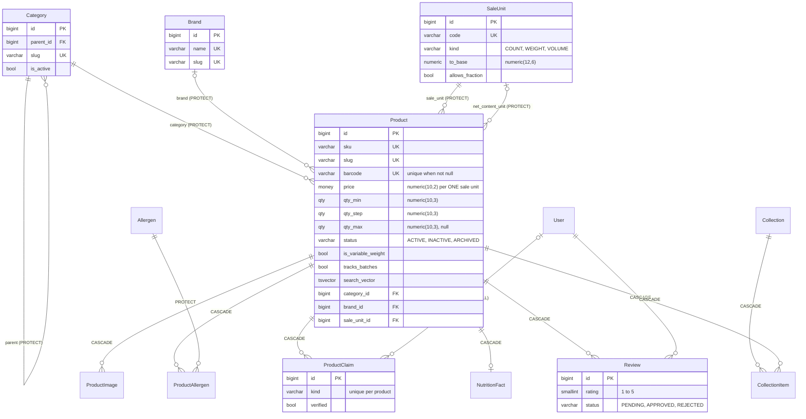

### 2.2 Inventory and purchasing

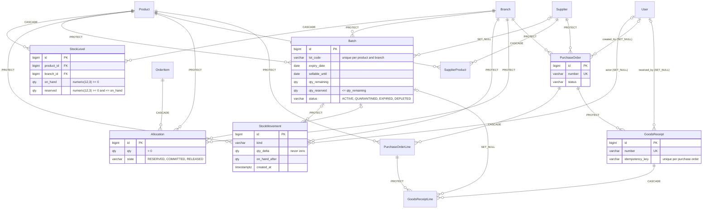

### 2.3 Stores and delivery

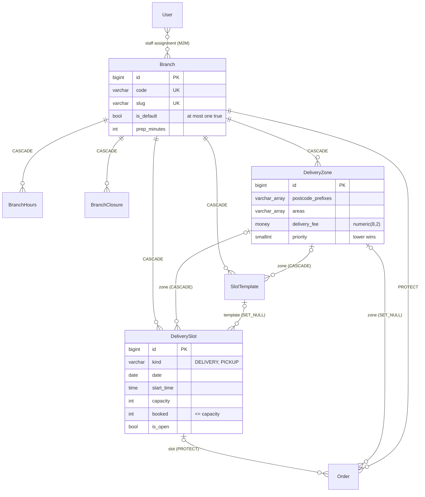

### 2.4 Cart, orders and payments

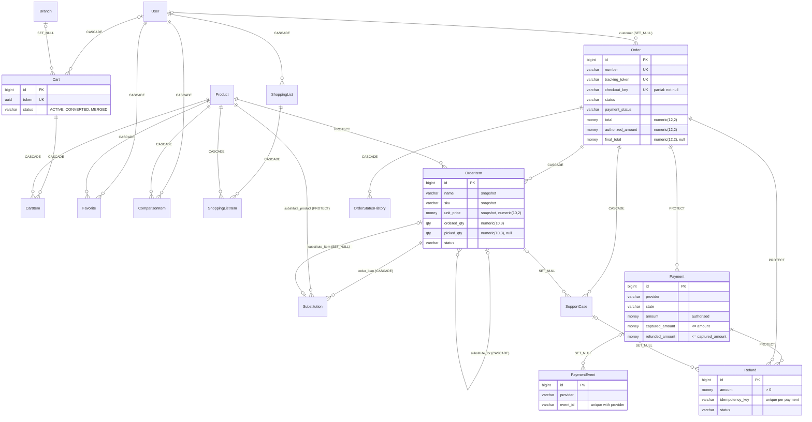

### 2.5 Accounts, core, promotions, content and notifications

```mermaid
erDiagram
    User ||--o{ Address : "CASCADE"
    User |o--o{ AuditLog : "actor (SET_NULL)"
    User |o--o{ Notification : "CASCADE"
    Order |o--o{ Notification : "CASCADE"
    User |o--o{ ContactMessage : "handled_by (SET_NULL)"
    Coupon ||--o{ CouponRedemption : "PROTECT"
    Order ||--o| CouponRedemption : "CASCADE"
    User |o--o{ CouponRedemption : "SET_NULL"
    Promotion }o--o{ Product : "M2M"
    Promotion }o--o{ Category : "M2M"
    Promotion }o--o{ Brand : "M2M"
    Coupon }o--o{ Product : "M2M products"
    Coupon }o--o{ Category : "M2M categories"
    Coupon }o--o{ Product : "M2M excluded_products"
    Article }o--o{ Product : "M2M"

    User {
        bigint id PK
        varchar email UK "also unique on lower(email)"
        varchar role
        bool is_active
        bool all_branches
    }
    StoreSettings {
        bigint id PK "always 1 by convention"
        varchar currency
        varchar timezone
        numeric weight_tolerance_percent "numeric(5,2)"
    }
    AuditLog {
        bigint id PK
        varchar action
        jsonb before
        jsonb after
        timestamptz created_at
    }
    IdempotencyRecord {
        bigint id PK
        varchar scope
        varchar actor_key
        varchar key "unique with scope and actor_key"
    }
    Promotion {
        bigint id PK
        varchar kind "PERCENT_OFF, AMOUNT_OFF, MULTIBUY"
        varchar scope
    }
    Coupon {
        bigint id PK
        varchar code "unique on lower(code)"
        int used_count
    }
    Banner {
        bigint id PK
        varchar placement
    }
    Page {
        bigint id PK
        varchar slug UK
    }
    Article {
        bigint id PK
        varchar slug UK
        varchar kind "RECIPE, GUIDE"
    }
    FAQ {
        bigint id PK
        varchar topic
    }
    NewsletterSubscriber {
        bigint id PK
        varchar email UK
        varchar token UK
    }
    ContactMessage {
        bigint id PK
        varchar status "NEW, HANDLED"
    }
    Notification {
        bigint id PK
        varchar kind
        varchar channel
    }
```

---

## 3. Model reference

Each entry gives purpose and the columns that carry meaning, then **every CHECK, UNIQUE constraint, unique index and
non-foreign-key index** by its real name, then the foreign keys. Columns not mentioned are plain text/flags named by what
they hold. "Service" means enforced in Python only; the full list is in [§4](#4-invariants-database-versus-services).

### 3.1 core

#### StoreSettings — `core_storesettings`

The singleton row (`pk = 1`) holding everything the business edits without a developer: identity (`name`, `legal_name`,
`tagline`, `logo`, `brand_primary`/`brand_accent` as `#RRGGBB`), contact details, `currency` (default `USD`), `locale`,
`timezone`, `prices_include_tax`, `tax_label`, and the policies the rest of the system reads:
`weight_tolerance_percent` (default 10.00; validated 0–50), `substitution_price_cap` (default true),
`complaint_window_hours` (default 24), `min_order_value`, `allow_guest_checkout`, `card_payments_enabled`,
`cash_on_delivery_enabled`, `demo_mode`, social URLs and `socials_are_placeholders`. Only `updated_at` (no `created_at`).

Singleton-ness is a convention: `save()` forces `pk = 1`, `delete()` raises `IntegrityError`, `load()` is cached for
300 s and bumps the `settings` cache namespace on every save. There is no database constraint, and no CHECK constraint
at all; range checks live in `apps/core/admin_views.py: SettingsSerializer`.

| Kind | Name | Definition |
|---|---|---|
| CHECK (implicit, Positive*Field) | `core_storesettings_complaint_window_hours_check` | `complaint_window_hours >= 0` |

#### AuditLog — `core_auditlog`

Append-only record of consequential staff and system actions: `actor` (nullable user), `actor_label` (the email, or
`system`, kept even if the user row later goes away), `action` (indexed, e.g. `product.price_changed`), `target_type`,
`target_id` (text, so any model fits), `summary`, `before`/`after` (`jsonb` snapshots), `ip_address` (`inet`),
`request_id`, `created_at` (indexed). Immutability is enforced in Python only ([§6](#6-immutability-and-append-only-rules)).

| Kind | Name | Definition |
|---|---|---|
| INDEX | `core_auditl_target__6c66b3_idx` | `(target_type, target_id)` |
| INDEX | `core_auditlog_action_978477aa` | `(action)` |
| INDEX | `core_auditlog_created_at_3d40b819` | `(created_at)` |

Foreign keys (Django `on_delete`; the database constraint itself has no `ON DELETE` clause): `actor_id` → `accounts_user` (SET_NULL, nullable).

#### IdempotencyRecord — `core_idempotencyrecord`

Remembers the outcome of an idempotent operation so a retry returns the same result. Today the only `scope` is
`checkout`. `actor_key` is `user:<id>` or `guest:<cart cookie>`; `request_hash` is the SHA-256 of the canonical request;
`resource_type`/`resource_id` point at the created order number. `IdempotencyRecord.claim()` is an insert-or-fetch: a
concurrent duplicate blocks on the unique index until the first transaction commits, then receives the committed row.
Rows older than 7 days are deleted by the `cleanup-idempotency-keys` beat task.

| Kind | Name | Definition |
|---|---|---|
| UNIQUE | `uniq_idempotency_key` | `(scope, actor_key, key)` |
| INDEX | `core_idempotencyrecord_created_at_d1986507` | `(created_at)` |

### 3.2 accounts

#### User — `accounts_user`

Email-login account (`USERNAME_FIELD = "email"`; Argon2 password hashes). `role` is one of nine values
(`apps/core/rbac.py`), default `CUSTOMER`. `branches` is the many-to-many of branches a branch-scoped staff member may see
(`accounts_user_branches`); `all_branches` lifts that restriction. `is_staff` (Django-admin access) is **derived** in
`save()`: true only for `SUPER_ADMIN`/`ADMIN` or a superuser. `save()` also lower-cases and strips the email.
`marketing_opt_in` and `notify_order_emails` are the customer's consent flags. `groups` and `user_permissions` come from
`PermissionsMixin` and are unused by the application's authorisation.

| Kind | Name | Definition |
|---|---|---|
| UNIQUE (column) | `accounts_user_email_key` | `(email)` |
| UNIQUE INDEX | `uniq_user_email_ci` | `((LOWER(email)))` |
| INDEX | `accounts_us_role_2b136f_idx` | `(role, is_active)` |
| INDEX | `accounts_user_role_57e97df0` | `(role)` |

#### Address — `accounts_address`

A customer's saved delivery address (recipient, phone, `line1`/`line2`, `city`, `area` — the district used for zone
matching — `postal_code`, delivery `instructions`). Ordered default-first. Checkout copies it into the order
([§5](#5-snapshotting-rules)), so editing or deleting an address never alters an order.

| Kind | Name | Definition |
|---|---|---|
| UNIQUE INDEX | `uniq_default_address_per_user` | `(user_id) WHERE is_default` |

Foreign keys (Django `on_delete`; the database constraint itself has no `ON DELETE` clause): `user_id` → `accounts_user` (CASCADE).

### 3.3 stores

#### Branch — `stores_branch`

A store that holds stock, takes pickups and serves delivery zones. `code` and `slug` are unique. `is_active`,
`offers_delivery`, `offers_pickup`, `prep_minutes` (default 120: minimum lead time before a slot can be booked),
`pickup_instructions`, `timezone` (blank = store timezone), `is_demo`.

`uniq_default_branch` guarantees **at most one** row with `is_default = true` (active or not). Nothing guarantees one
exists; `stores.services.default_branch()` returns the first *active* branch ordered by `-is_default, id`.

| Kind | Name | Definition |
|---|---|---|
| CHECK (implicit, Positive*Field) | `stores_branch_prep_minutes_check` | `prep_minutes >= 0` |
| UNIQUE (column) | `stores_branch_code_key` | `(code)` |
| UNIQUE (column) | `stores_branch_slug_key` | `(slug)` |
| UNIQUE INDEX | `uniq_default_branch` | `(is_default) WHERE is_default` |

#### BranchHours — `stores_branchhours`

Opening hours per `weekday` (0 = Monday … 6 = Sunday; the 0–6 range is a `choices` rule, the database only enforces
`>= 0`). Either `is_closed` or both `opens` and `closes` with `opens < closes`. A missing weekday row counts as closed
(`stores.services.is_open_on`).

| Kind | Name | Definition |
|---|---|---|
| CHECK | `hours_open_before_close` | `(is_closed OR (opens IS NOT NULL AND closes IS NOT NULL AND opens < (closes)))` |
| CHECK (implicit, Positive*Field) | `stores_branchhours_weekday_check` | `weekday >= 0` |
| UNIQUE | `uniq_branch_weekday` | `(branch_id, weekday)` |

Foreign keys (Django `on_delete`; the database constraint itself has no `ON DELETE` clause): `branch_id` → `stores_branch` (CASCADE).

#### BranchClosure — `stores_branchclosure`

A date on which a branch is closed (holiday, stocktake), unique per branch and date.

| Kind | Name | Definition |
|---|---|---|
| UNIQUE | `uniq_branch_closure_date` | `(branch_id, date)` |

Foreign keys (Django `on_delete`; the database constraint itself has no `ON DELETE` clause): `branch_id` → `stores_branch` (CASCADE).

#### DeliveryZone — `stores_deliveryzone`

Coverage and pricing rule of one branch. An address matches when its normalised postcode (spaces removed, upper-cased)
starts with any entry of `postcode_prefixes` (`varchar(16)[]`) or its lower-cased `area` equals an entry of `areas`
(`varchar(80)[]`). Zones are evaluated in `priority, name` order in Python (no array index) and the first match wins.
`delivery_fee`, `free_delivery_threshold` (null = never free), `min_order_value`, `is_active`.

| Kind | Name | Definition |
|---|---|---|
| CHECK | `zone_fee_nonneg` | `delivery_fee >= 0` |
| CHECK | `zone_min_nonneg` | `min_order_value >= 0` |
| CHECK (implicit, Positive*Field) | `stores_deliveryzone_priority_check` | `priority >= 0` |

Foreign keys (Django `on_delete`; the database constraint itself has no `ON DELETE` clause): `branch_id` → `stores_branch` (CASCADE).

#### SlotTemplate — `stores_slottemplate`

Weekly pattern from which concrete slots are generated: `branch`, optional `zone` (null for pickup), `kind`
(`DELIVERY`/`PICKUP`), `weekday`, `start_time`, `end_time`, `capacity`, optional `fee` (overrides the zone fee).

| Kind | Name | Definition |
|---|---|---|
| CHECK | `template_capacity_pos` | `capacity > 0` |
| CHECK | `template_start_before_end` | `start_time < (end_time)` |
| CHECK (implicit, Positive*Field) | `stores_slottemplate_weekday_check` | `weekday >= 0` |
| CHECK (implicit, Positive*Field) | `stores_slottemplate_capacity_check` | `capacity >= 0` |

Foreign keys (Django `on_delete`; the database constraint itself has no `ON DELETE` clause): `branch_id` → `stores_branch` (CASCADE); `zone_id` → `stores_deliveryzone` (CASCADE, nullable).

#### DeliverySlot — `stores_deliveryslot`

A bookable window: `branch`, `zone` (null for pickup), `kind`, `date`, `start_time`, `end_time`, `capacity`, `booked`,
`fee`, `is_open`, `template` (source, `SET_NULL`). `remaining = max(capacity - booked, 0)`. Orders keep a `PROTECT`
foreign key to the slot, so a slot that carries orders cannot be deleted through the ORM.

`uniq_slot` is `UNIQUE NULLS NOT DISTINCT (branch_id, zone_id, kind, date, start_time)`: because `zone_id` is null for
pickup slots, `NULLS NOT DISTINCT` makes two pickup slots at the same branch, date and start time collide as they should.
Booking is a conditional update (`UPDATE … SET booked = booked + 1 WHERE booked < capacity AND is_open`); the CHECK
`slot_not_overbooked` backs it.

| Kind | Name | Definition |
|---|---|---|
| CHECK | `slot_not_overbooked` | `booked <= (capacity)` |
| CHECK | `slot_start_before_end` | `start_time < (end_time)` |
| CHECK (implicit, Positive*Field) | `stores_deliveryslot_capacity_check` | `capacity >= 0` |
| CHECK (implicit, Positive*Field) | `stores_deliveryslot_booked_check` | `booked >= 0` |
| UNIQUE | `uniq_slot` | `NULLS NOT DISTINCT (branch_id, zone_id, kind, date, start_time)` |
| INDEX | `stores_deli_branch__3eb8d3_idx` | `(branch_id, kind, date)` |

Foreign keys (Django `on_delete`; the database constraint itself has no `ON DELETE` clause): `branch_id` → `stores_branch` (CASCADE); `zone_id` → `stores_deliveryzone` (CASCADE, nullable); `template_id` → `stores_slottemplate` (SET_NULL, nullable).

### 3.4 catalog

#### Category — `catalog_category`

Two-level taxonomy (department → category) through a self foreign key (`PROTECT`, so a parent with children cannot be
deleted). `slug` unique, `image` plus `image_widths`, `sort_order`, `is_active`, `show_on_home`. The database prevents only
a category being its own parent; the two-level limit is enforced by `Category.clean()` and the admin serializer
(`apps/catalog/admin_taxonomy.py: validate_parent`).

| Kind | Name | Definition |
|---|---|---|
| CHECK | `category_not_own_parent` | `NOT (parent_id = (id) AND parent_id IS NOT NULL)` |
| CHECK (implicit, Positive*Field) | `catalog_category_sort_order_check` | `sort_order >= 0` |
| UNIQUE (column) | `catalog_category_slug_key` | `(slug)` |

Foreign keys (Django `on_delete`; the database constraint itself has no `ON DELETE` clause): `parent_id` → `catalog_category` (PROTECT, nullable).

#### Brand — `catalog_brand`

`name` and `slug` unique, `description`, `is_active`, `is_demo`.

| Kind | Name | Definition |
|---|---|---|
| UNIQUE (column) | `catalog_brand_name_key` | `(name)` |
| UNIQUE (column) | `catalog_brand_slug_key` | `(slug)` |

#### SaleUnit — `catalog_saleunit`

How a product is sold and measured. `kind` is `COUNT`, `WEIGHT` or `VOLUME`; `to_base` converts the unit to the base
measure (kg for weight, L for volume, 1 for counts); `allows_fraction` says whether fractional quantities are legal.
Reference data, inserted by migration `0002_reference_data`: `each`, `pack`, `box`, `bundle`, `dozen` (×12), `kg`, `g`
(0.001), `100g` (0.1), `l`, `ml` (0.001). Referenced with `PROTECT` by products.

| Kind | Name | Definition |
|---|---|---|
| CHECK | `unit_factor_positive` | `to_base > 0` |
| UNIQUE (column) | `catalog_saleunit_code_key` | `(code)` |

#### Product — `catalog_product`

The sellable item. Columns that carry meaning:

* **Identity**: `sku` (≤ 32, unique), `slug` (≤ 140, unique), `barcode` (≤ 14, nullable, unique when set), `name`,
  `short_description`, `description`.
* **Classification**: `category` (`PROTECT`, required), `brand` (`PROTECT`, optional), `product_type`
  (`LOOSE_PRODUCE`, `PACKAGED`, `CHILLED`, `FROZEN`, `BAKERY`, `HOUSEHOLD`, `PREPARED`), `storage_type`
  (`AMBIENT`, `CHILLED`, `FROZEN`).
* **Selling**: `sale_unit` (`PROTECT`), `price` `numeric(10,2)` — the price of **one** sale unit — `tax_rate`,
  quantity rules `qty_min` / `qty_step` / `qty_max` (valid quantities are `qty_min + k × qty_step`, at most `qty_max`),
  `net_content` with `net_content_unit` (so a price per kg or per L can be derived for packaged goods),
  `is_variable_weight`.
* **Stock behaviour**: `stock_mode` (`TRACKED` or `MADE_TO_ORDER`: no stock rows), `tracks_batches` (lot and expiry
  capture, FEFO allocation), `is_perishable`, `sell_buffer_days` (default 1: a batch stops selling this many days before
  its expiry date).
* **Visibility**: `status` (`ACTIVE`/`INACTIVE`/`ARCHIVED`, indexed) and `is_available` (a manual hide switch). A product is
  purchasable only when `ACTIVE` and `is_available`.
* **Trust data**: `origin_country`, `origin_note`, `storage_instructions`, `ingredients`, `packaging`, `manufacturer`,
  `allergen_info_complete` (true only when allergen data was confirmed).
* **Derived, never edited by hand**: `popularity` (units ordered in the last 30 days; written by the `refresh-popularity`
  task, which leaves it unchanged when the window contains no sales at all), `rating_avg`/`rating_count` (approved reviews; written by a signal), `search_text` and `search_vector` (written by
  `catalog/search.py: rebuild_index`, triggered by `Product`/`Brand`/`Category` post-save signals).

Model-level rules that are **not** in the database (`Product.clean()`, called by the staff product serializer):
variable-weight requires a weight unit; `tracks_batches` requires `TRACKED` stock; `net_content` and `net_content_unit` are
set together; the net-content unit must be weight or volume.

Search indexes: `product_search_vector_gin` is a GIN index on the weighted `tsvector`; `product_name_trgm` is a GIN index
on `UPPER(name)` with `gin_trgm_ops`, used by `name_u__trigram_similar` in `apps/catalog/search.py`.

| Kind | Name | Definition |
|---|---|---|
| CHECK | `product_net_content_pos` | `(net_content IS NULL OR net_content > 0)` |
| CHECK | `product_price_nonneg` | `price >= 0` |
| CHECK | `product_qty_max_ge_min` | `(qty_max IS NULL OR qty_max >= (qty_min))` |
| CHECK | `product_qty_min_pos` | `qty_min > 0` |
| CHECK | `product_qty_step_pos` | `qty_step > 0` |
| CHECK (implicit, Positive*Field) | `catalog_product_sell_buffer_days_check` | `sell_buffer_days >= 0` |
| CHECK (implicit, Positive*Field) | `catalog_product_popularity_check` | `popularity >= 0` |
| CHECK (implicit, Positive*Field) | `catalog_product_rating_count_check` | `rating_count >= 0` |
| UNIQUE (column) | `catalog_product_sku_key` | `(sku)` |
| UNIQUE (column) | `catalog_product_slug_key` | `(slug)` |
| UNIQUE INDEX | `uniq_product_barcode` | `(barcode) WHERE barcode IS NOT NULL` |
| INDEX | `catalog_product_status_0fdef323` | `(status)` |
| INDEX | `product_name_trgm` | `USING gin ((UPPER(name)) gin_trgm_ops)` |
| INDEX | `product_search_vector_gin` | `USING gin (search_vector)` |
| INDEX | `product_status_category` | `(status, category_id)` |
| INDEX | `product_status_new` | `(status, created_at DESC)` |
| INDEX | `product_status_popular` | `(status, popularity DESC)` |

Foreign keys (Django `on_delete`; the database constraint itself has no `ON DELETE` clause): `brand_id` → `catalog_brand` (PROTECT, nullable); `category_id` → `catalog_category` (PROTECT); `net_content_unit_id` → `catalog_saleunit` (PROTECT, nullable); `sale_unit_id` → `catalog_saleunit` (PROTECT).

#### ProductImage — `catalog_productimage`

Ordered gallery image of a product. `image` is a path under `products/<product id>/<uuid>.webp` written by the upload
pipeline (`apps/catalog/images.py`: validate JPEG/PNG/WebP, strip metadata, normalise to WebP, longest edge ≤ 1600, make
320/640/1024-pixel variants); `image_widths` records which variants exist; `alt_text` is required.

| Kind | Name | Definition |
|---|---|---|
| CHECK (implicit, Positive*Field) | `catalog_productimage_sort_order_check` | `sort_order >= 0` |

Foreign keys (Django `on_delete`; the database constraint itself has no `ON DELETE` clause): `product_id` → `catalog_product` (CASCADE).

#### Allergen — `catalog_allergen`

Reference list (EU-14 style: gluten, crustaceans, eggs, fish, peanuts, soybeans, milk, tree-nuts, celery, mustard,
sesame, sulphites, lupin, molluscs), inserted by migration `0002_reference_data` and editable by staff.

| Kind | Name | Definition |
|---|---|---|
| UNIQUE (column) | `catalog_allergen_code_key` | `(code)` |

#### ProductAllergen — `catalog_productallergen`

Links a product to an allergen with a `level` of `CONTAINS` or `MAY_CONTAIN`. Unique per product and allergen.

| Kind | Name | Definition |
|---|---|---|
| UNIQUE | `uniq_product_allergen` | `(product_id, allergen_id)` |

Foreign keys (Django `on_delete`; the database constraint itself has no `ON DELETE` clause): `allergen_id` → `catalog_allergen` (PROTECT); `product_id` → `catalog_product` (CASCADE).

#### ProductClaim — `catalog_productclaim`

A dietary or quality claim (`VEGAN`, `VEGETARIAN`, `GLUTEN_FREE`, `LACTOSE_FREE`, `SUGAR_FREE`, `HALAL`, `KOSHER`,
`ORGANIC`, `FAIRTRADE`, `LOCALLY_GROWN`). Only rows with `verified = true` are ever shown or used for filtering or
substitution matching; `evidence` (certificate, label review, supplier statement), `verified_at` and `verified_by`
record who confirmed it.

| Kind | Name | Definition |
|---|---|---|
| UNIQUE | `uniq_product_claim` | `(product_id, kind)` |
| INDEX | `catalog_pro_kind_48797f_idx` | `(kind, verified)` |

Foreign keys (Django `on_delete`; the database constraint itself has no `ON DELETE` clause): `product_id` → `catalog_product` (CASCADE); `verified_by_id` → `accounts_user` (SET_NULL, nullable).

#### NutritionFact — `catalog_nutritionfact`

At most one per product (one-to-one). `basis` (default `per 100 g`), then nullable `energy_kcal`, `energy_kj`, `fat`,
`saturates`, `carbohydrate`, `sugars`, `fibre`, `protein`, `salt`, `source`, `is_demo`. A null value means "not provided",
and the storefront says so rather than showing zero.

| Kind | Name | Definition |
|---|---|---|
| UNIQUE (column) | `catalog_nutritionfact_product_id_key` | `(product_id)` |

Foreign keys (Django `on_delete`; the database constraint itself has no `ON DELETE` clause): `product_id` → `catalog_product` (CASCADE).

#### Review — `catalog_review`

A customer review: `rating` 1–5, `title`, `body`, `status` (`PENDING` on creation, then `APPROVED` or `REJECTED` by
moderation), `verified_purchase` (set true at creation because the API only accepts reviews from customers with a
`COMPLETED` order containing the product), `is_demo`. One review per user and product. Only `APPROVED` reviews feed
`Product.rating_avg`/`rating_count` (signal `review_changed`).

| Kind | Name | Definition |
|---|---|---|
| CHECK | `review_rating_1_5` | `(rating >= 1 AND rating <= 5)` |
| CHECK (implicit, Positive*Field) | `catalog_review_rating_check` | `rating >= 0` |
| UNIQUE | `uniq_review_per_user_product` | `(product_id, user_id)` |
| INDEX | `catalog_review_status_bed4ce13` | `(status)` |

Foreign keys (Django `on_delete`; the database constraint itself has no `ON DELETE` clause): `product_id` → `catalog_product` (CASCADE); `user_id` → `accounts_user` (CASCADE).

#### Collection — `catalog_collection`

A curated, optionally dated set of products (`starts_on`/`ends_on`, `show_on_home`, `sort_order`), linked through
`CollectionItem`.

| Kind | Name | Definition |
|---|---|---|
| CHECK (implicit, Positive*Field) | `catalog_collection_sort_order_check` | `sort_order >= 0` |
| UNIQUE (column) | `catalog_collection_slug_key` | `(slug)` |

#### CollectionItem — `catalog_collectionitem`

The through table: `collection`, `product`, `sort_order`; unique per pair.

| Kind | Name | Definition |
|---|---|---|
| CHECK (implicit, Positive*Field) | `catalog_collectionitem_sort_order_check` | `sort_order >= 0` |
| UNIQUE | `uniq_collection_product` | `(collection_id, product_id)` |

Foreign keys (Django `on_delete`; the database constraint itself has no `ON DELETE` clause): `collection_id` → `catalog_collection` (CASCADE); `product_id` → `catalog_product` (CASCADE).

### 3.5 inventory

#### StockLevel — `inventory_stocklevel`

Counted stock of one product at one branch: `on_hand`, `reserved`, `low_stock_threshold`, `reorder_quantity` (all
`numeric(12,3)`). Available = `on_hand − reserved`. Rows are created on first use (`lock_levels` inserts missing rows with
`ignore_conflicts` against the unique key); a missing row means zero stock; `MADE_TO_ORDER` products are skipped by reservation, so no row is created for them. For
batch-tracked products `on_hand` equals the sum of the batches' `qty_remaining` and `reserved` equals the sum of their
`qty_reserved` — a service-maintained invariant checked by `inventory.services.check_invariants()`, not by the database.

| Kind | Name | Definition |
|---|---|---|
| CHECK | `stock_on_hand_nonneg` | `on_hand >= 0` |
| CHECK | `stock_reserved_le_on_hand` | `reserved <= (on_hand)` |
| CHECK | `stock_reserved_nonneg` | `reserved >= 0` |
| UNIQUE | `uniq_stock_product_branch` | `(product_id, branch_id)` |
| INDEX | `inventory_s_branch__4a59fe_idx` | `(branch_id, product_id)` |

Foreign keys (Django `on_delete`; the database constraint itself has no `ON DELETE` clause): `branch_id` → `stores_branch` (CASCADE); `product_id` → `catalog_product` (CASCADE).

#### Batch — `inventory_batch`

A lot of a batch-tracked product at a branch: `lot_code`, `received_on`, `expiry_date`, `expiry_kind`
(`BEST_BEFORE`/`USE_BY`), `sellable_until` (= `expiry_date − Product.sell_buffer_days`; the last day it may be sold),
`qty_received`, `qty_remaining`, `qty_reserved`, `unit_cost` `numeric(10,4)`, `status`
(`ACTIVE`/`QUARANTINED`/`EXPIRED`/`DEPLETED`), `quality_status` (`PENDING`/`PASSED`/`FAILED`, default `PASSED`), `notes`,
`supplier` (`SET_NULL`). A batch is sellable when `status = ACTIVE`, `quality_status = PASSED` and `sellable_until` is null
or not past (`inventory.availability.sellable_batch_q`). Allocation order is FEFO (`sellable_until`, then `received_on`,
then `id`). `expiry_kind` is stored and displayed but does not change any rule: both kinds use the same
`sellable_until`.

| Kind | Name | Definition |
|---|---|---|
| CHECK | `batch_received_pos` | `qty_received > 0` |
| CHECK | `batch_remaining_nonneg` | `qty_remaining >= 0` |
| CHECK | `batch_reserved_le_remaining` | `qty_reserved <= (qty_remaining)` |
| CHECK | `batch_reserved_nonneg` | `qty_reserved >= 0` |
| UNIQUE | `uniq_batch_lot` | `(product_id, branch_id, lot_code)` |
| INDEX | `batch_expiry_idx` | `(branch_id, status, expiry_date)` |
| INDEX | `batch_fefo_idx` | `(product_id, branch_id, status, sellable_until)` |

Foreign keys (Django `on_delete`; the database constraint itself has no `ON DELETE` clause): `branch_id` → `stores_branch` (PROTECT); `product_id` → `catalog_product` (PROTECT); `supplier_id` → `purchasing_supplier` (SET_NULL, nullable).

#### StockMovement — `inventory_stockmovement`

The immutable ledger of every change to `on_hand`: `kind` (`RECEIPT`, `SALE`, `ADJUSTMENT`, `WASTE`, `TRANSFER_OUT`,
`TRANSFER_IN`, `RETURN`), signed `qty_delta` (never zero), `on_hand_after`, `unit_cost`, `reason_code`, `note`, `actor`,
a polymorphic reference `ref_type`/`ref_id` (for example `order` + order number, `receipt` + receipt number), `batch`,
`created_at`. For every stock level, the sum of `qty_delta` equals `on_hand` (`check_invariants`). Products, branches and
batches are `PROTECT`ed, so a product with history cannot be deleted. Reservations are **not** ledger entries (they move
`reserved`, not `on_hand`).

| Kind | Name | Definition |
|---|---|---|
| CHECK | `movement_nonzero` | `NOT (qty_delta = 0)` |
| INDEX | `inventory_s_product_46c4ea_idx` | `(product_id, branch_id, created_at DESC)` |
| INDEX | `inventory_s_ref_typ_daaa87_idx` | `(ref_type, ref_id)` |
| INDEX | `inventory_stockmovement_created_at_05b478ed` | `(created_at)` |
| INDEX | `inventory_stockmovement_kind_f05755ef` | `(kind)` |

Foreign keys (Django `on_delete`; the database constraint itself has no `ON DELETE` clause): `actor_id` → `accounts_user` (SET_NULL, nullable); `batch_id` → `inventory_batch` (PROTECT, nullable); `branch_id` → `stores_branch` (PROTECT); `product_id` → `catalog_product` (PROTECT).

#### Allocation — `inventory_allocation`

Stock set aside for one order line, optionally from one batch: `order_item` (`CASCADE`), `product`, `branch`, `batch`
(nullable), `qty`, `state` (`RESERVED` → `COMMITTED` or `RELEASED`). One order line can have several allocations (one per
batch it draws from). While `RESERVED` the quantity is included in `StockLevel.reserved` and `Batch.qty_reserved`.

| Kind | Name | Definition |
|---|---|---|
| CHECK | `allocation_qty_pos` | `qty > 0` |
| INDEX | `inventory_a_order_i_645f1e_idx` | `(order_item_id, state)` |
| INDEX | `inventory_allocation_state_92259d10` | `(state)` |

Foreign keys (Django `on_delete`; the database constraint itself has no `ON DELETE` clause): `branch_id` → `stores_branch` (PROTECT); `order_item_id` → `orders_orderitem` (CASCADE); `product_id` → `catalog_product` (PROTECT); `batch_id` → `inventory_batch` (PROTECT, nullable).

### 3.6 purchasing

#### Supplier — `purchasing_supplier`

`code` (unique), `name`, contact fields, `status` (`ACTIVE`, `ON_HOLD`, `INACTIVE`; only `ACTIVE` suppliers can receive new
purchase orders), `lead_time_days`, `notes`, `is_demo`.

| Kind | Name | Definition |
|---|---|---|
| CHECK (implicit, Positive*Field) | `purchasing_supplier_lead_time_days_check` | `lead_time_days >= 0` |
| UNIQUE (column) | `purchasing_supplier_code_key` | `(code)` |

#### SupplierProduct — `purchasing_supplierproduct`

What a supplier can supply: `supplier_sku`, `unit_cost` `numeric(10,4)`. Unique per supplier and product.

| Kind | Name | Definition |
|---|---|---|
| UNIQUE | `uniq_supplier_product` | `(supplier_id, product_id)` |

Foreign keys (Django `on_delete`; the database constraint itself has no `ON DELETE` clause): `product_id` → `catalog_product` (CASCADE); `supplier_id` → `purchasing_supplier` (CASCADE).

#### PurchaseOrder — `purchasing_purchaseorder`

`number` (unique, `PO-yymmdd-XXXX`), `supplier` and `branch` (`PROTECT`), `status` (indexed; [§7.6](#76-purchase-order)),
`expected_date`, `notes`, `created_by`, `submitted_at`, `is_demo`. Total cost is the sum of line `qty_ordered × unit_cost`
(a property, not a column).

| Kind | Name | Definition |
|---|---|---|
| UNIQUE (column) | `purchasing_purchaseorder_number_key` | `(number)` |
| INDEX | `purchasing_purchaseorder_status_542308f2` | `(status)` |

Foreign keys (Django `on_delete`; the database constraint itself has no `ON DELETE` clause): `branch_id` → `stores_branch` (PROTECT); `created_by_id` → `accounts_user` (SET_NULL, nullable); `supplier_id` → `purchasing_supplier` (PROTECT).

#### PurchaseOrderLine — `purchasing_purchaseorderline`

`product` (`PROTECT`), `qty_ordered`, `unit_cost`, running `qty_received` and `qty_rejected`. One line per product per
order.

| Kind | Name | Definition |
|---|---|---|
| CHECK | `po_line_cost_nonneg` | `unit_cost >= 0` |
| CHECK | `po_line_ordered_pos` | `qty_ordered > 0` |
| CHECK | `po_line_received_nonneg` | `(qty_received >= 0 AND qty_rejected >= 0)` |
| UNIQUE | `uniq_po_line_product` | `(purchase_order_id, product_id)` |

Foreign keys (Django `on_delete`; the database constraint itself has no `ON DELETE` clause): `product_id` → `catalog_product` (PROTECT); `purchase_order_id` → `purchasing_purchaseorder` (CASCADE).

#### GoodsReceipt — `purchasing_goodsreceipt`

One delivery against a purchase order: `number` (unique, `GR-yymmdd-XXXX`), `idempotency_key` (unique per purchase
order), `received_by`, `delivery_note`, `notes`. A repeat submission with the same key returns the stored receipt and
changes nothing.

| Kind | Name | Definition |
|---|---|---|
| UNIQUE (column) | `purchasing_goodsreceipt_number_key` | `(number)` |
| UNIQUE | `uniq_receipt_key` | `(purchase_order_id, idempotency_key)` |

Foreign keys (Django `on_delete`; the database constraint itself has no `ON DELETE` clause): `received_by_id` → `accounts_user` (SET_NULL, nullable); `purchase_order_id` → `purchasing_purchaseorder` (PROTECT).

#### GoodsReceiptLine — `purchasing_goodsreceiptline`

What was accepted and rejected for one purchase-order line, with `reject_reason`, `lot_code`, `expiry_date`, `expiry_kind`
(plain `varchar(12)`, default `BEST_BEFORE`) and the `batch` it created or topped up (`SET_NULL`).

| Kind | Name | Definition |
|---|---|---|
| CHECK | `receipt_line_nonneg` | `(qty_accepted >= 0 AND qty_rejected >= 0)` |

Foreign keys (Django `on_delete`; the database constraint itself has no `ON DELETE` clause): `batch_id` → `inventory_batch` (SET_NULL, nullable); `receipt_id` → `purchasing_goodsreceipt` (CASCADE); `po_line_id` → `purchasing_purchaseorderline` (PROTECT).

### 3.7 promotions

#### Promotion — `promotions_promotion`

An automatic price promotion. `kind`: `PERCENT_OFF` (uses `percent`), `AMOUNT_OFF` (`amount_off` per unit), `MULTIBUY`
(`multibuy_qty` for `multibuy_price`). `scope`: `PRODUCTS`, `CATEGORIES` or `BRANDS`, with the targets in the three
many-to-many tables ([§3.13](#313-auto-created-many-to-many-tables)). `label` is the badge text. Active between
`starts_at` and `ends_at`. Promotions never stack on one product: the lowest line total wins
(`promotions/engine.py: best_application`). The database checks each value column's range but **not** that the column
matching `kind` is present, nor that targets match `scope` (serializer rules).

| Kind | Name | Definition |
|---|---|---|
| CHECK | `promo_amount_pos` | `(amount_off IS NULL OR amount_off > 0)` |
| CHECK | `promo_dates_ordered` | `(ends_at IS NULL OR ends_at > (starts_at))` |
| CHECK | `promo_multibuy_price` | `(multibuy_price IS NULL OR multibuy_price >= 0)` |
| CHECK | `promo_multibuy_qty` | `(multibuy_qty IS NULL OR multibuy_qty >= 2)` |
| CHECK | `promo_percent_range` | `(percent IS NULL OR (percent > 0 AND percent <= 100))` |
| CHECK (implicit, Positive*Field) | `promotions_promotion_multibuy_qty_check` | `multibuy_qty >= 0` |
| INDEX | `promotions__is_acti_37078e_idx` | `(is_active, starts_at, ends_at)` |

#### Coupon — `promotions_coupon`

A code the customer enters. `code` is stored upper-case (`save()`) and is unique case-insensitively. `kind`: `PERCENT`,
`FIXED`, `FREE_DELIVERY`; `value`, `max_discount`, `min_order_value`, window, `usage_limit` (total redemptions),
`per_customer_limit` (default 1), `first_order_only`, `scope` (`ALL`, `CATEGORIES`, `PRODUCTS`) with M2M targets and an
excluded-products list, `exclude_discounted_items` (default true), `used_count`, `is_active`, `is_demo`. `used_count`
versus `usage_limit` is enforced under a row lock in `coupons.redeem`, not by a constraint.

| Kind | Name | Definition |
|---|---|---|
| CHECK | `coupon_min_nonneg` | `min_order_value >= 0` |
| CHECK | `coupon_percent_le_100` | `(NOT (kind = 'PERCENT') OR value <= 100)` |
| CHECK | `coupon_value_nonneg` | `value >= 0` |
| CHECK | `coupon_value_required` | `(kind = 'FREE_DELIVERY' OR value > 0)` |
| CHECK (implicit, Positive*Field) | `promotions_coupon_usage_limit_check` | `usage_limit >= 0` |
| CHECK (implicit, Positive*Field) | `promotions_coupon_per_customer_limit_check` | `per_customer_limit >= 0` |
| CHECK (implicit, Positive*Field) | `promotions_coupon_used_count_check` | `used_count >= 0` |
| UNIQUE INDEX | `uniq_coupon_code_ci` | `((LOWER(code)))` |

#### CouponRedemption — `promotions_couponredemption`

Records that an order used a coupon: `coupon` (`PROTECT`), `order` (one-to-one, `CASCADE` — an order has at most one
redemption), `user` (nullable), `email` (guests), `amount`, `status` (`ACTIVE`, or `VOID` when the order was cancelled or
expired and the use was given back).

| Kind | Name | Definition |
|---|---|---|
| UNIQUE (column) | `promotions_couponredemption_order_id_key` | `(order_id)` |
| INDEX | `promotions__coupon__46d0c3_idx` | `(coupon_id, user_id, status)` |
| INDEX | `promotions__coupon__6510d3_idx` | `(coupon_id, email, status)` |

Foreign keys (Django `on_delete`; the database constraint itself has no `ON DELETE` clause): `coupon_id` → `promotions_coupon` (PROTECT); `order_id` → `orders_order` (CASCADE); `user_id` → `accounts_user` (SET_NULL, nullable).

### 3.8 cart

#### Cart — `cart_cart`

A basket. Signed-in carts have a `user`; guest carts have none and are found by the `token` (`uuid`, unique) held in the
HttpOnly cookie `gc_cart`. `branch` (the store the shopper is browsing, `SET_NULL`), `coupon_code`, `substitution_policy`
(`ALLOW`, `CONTACT`, `NONE`), `status`, and `notices` (`jsonb` list of price or availability changes to show the
customer). A guest cart is merged into the user's cart at sign-in (the guest cart becomes `MERGED`); checkout marks the
cart `CONVERTED`. `uniq_active_cart_per_user` allows one `ACTIVE` cart per user; guest carts (user null) are not
constrained. Nothing purges abandoned carts ([§11](#11-not-implemented--known-gaps)).

| Kind | Name | Definition |
|---|---|---|
| UNIQUE (column) | `cart_cart_token_key` | `(token)` |
| UNIQUE INDEX | `uniq_active_cart_per_user` | `(user_id) WHERE (status = 'ACTIVE' AND user_id IS NOT NULL)` |
| INDEX | `cart_cart_status_39ba2f_idx` | `(status, updated_at)` |

Foreign keys (Django `on_delete`; the database constraint itself has no `ON DELETE` clause): `branch_id` → `stores_branch` (SET_NULL, nullable); `user_id` → `accounts_user` (CASCADE, nullable).

#### CartItem — `cart_cartitem`

`cart`, `product` (both `CASCADE`), `quantity` `numeric(10,3)` (> 0), `substitution_pref` (`INHERIT`, `ALLOW`, `NONE`),
`unit_price_seen` (the price last shown, used to explain changes). One line per product per cart. Never holds a price the
server trusts: totals are recomputed on every read and at checkout.

| Kind | Name | Definition |
|---|---|---|
| CHECK | `cart_item_qty_pos` | `quantity > 0` |
| UNIQUE | `uniq_cart_product` | `(cart_id, product_id)` |

Foreign keys (Django `on_delete`; the database constraint itself has no `ON DELETE` clause): `cart_id` → `cart_cart` (CASCADE); `product_id` → `catalog_product` (CASCADE).

#### Favorite — `cart_favorite`

A signed-in customer's wishlist entry. Unique per user and product.

| Kind | Name | Definition |
|---|---|---|
| UNIQUE | `uniq_favorite` | `(user_id, product_id)` |

Foreign keys (Django `on_delete`; the database constraint itself has no `ON DELETE` clause): `product_id` → `catalog_product` (CASCADE); `user_id` → `accounts_user` (CASCADE).

#### ComparisonItem — `cart_comparisonitem`

An entry in a signed-in customer's saved comparison list (the client limits it to 4). Unique per user and product.

| Kind | Name | Definition |
|---|---|---|
| UNIQUE | `uniq_comparison_item` | `(user_id, product_id)` |

Foreign keys (Django `on_delete`; the database constraint itself has no `ON DELETE` clause): `product_id` → `catalog_product` (CASCADE); `user_id` → `accounts_user` (CASCADE).

#### ShoppingList — `cart_shoppinglist`

A named list owned by a user; name unique per user.

| Kind | Name | Definition |
|---|---|---|
| UNIQUE | `uniq_list_name_per_user` | `(user_id, name)` |

Foreign keys (Django `on_delete`; the database constraint itself has no `ON DELETE` clause): `user_id` → `accounts_user` (CASCADE).

#### ShoppingListItem — `cart_shoppinglistitem`

`shopping_list`, `product`, `quantity` (> 0, default 1). Unique per list and product.

| Kind | Name | Definition |
|---|---|---|
| CHECK | `list_item_qty_pos` | `quantity > 0` |
| UNIQUE | `uniq_list_product` | `(shopping_list_id, product_id)` |

Foreign keys (Django `on_delete`; the database constraint itself has no `ON DELETE` clause): `product_id` → `catalog_product` (CASCADE); `shopping_list_id` → `cart_shoppinglist` (CASCADE).

### 3.9 orders

#### Order — `orders_order`

The order header; the largest table. Column groups:

* **Identity and access**: `number` (`OR-yymmdd-XXXXX`, random from an alphabet without `O`/`I`/`0`/`1`; unique; the
  insert is retried up to 5 times on collision), `tracking_token` (`secrets.token_urlsafe(24)`, unique — grants a guest
  access to the order), `customer` (nullable for guests, `SET_NULL`).
* **Contact snapshot**: `contact_name`, `contact_email` (indexed through `order_email_idx`), `contact_phone`.
* **Fulfilment**: `branch` (`PROTECT`), `fulfilment_type` (`DELIVERY`/`PICKUP`), `slot` (`PROTECT`), `zone` (`SET_NULL`),
  `slot_starts_at`/`slot_ends_at` (`timestamptz` copies, indexed), eight `ship_*` address columns (blank for pickup).
* **Policy and notes**: `substitution_policy`, `customer_note`, `currency`.
* **Money**: `subtotal`, `promo_savings`, `coupon_code`, `coupon_discount`, `delivery_fee`, `tax_total`, `total`
  (the estimate), `authorized_amount` (the most that may ever be charged: total plus the weighed-item buffer),
  `final_total` (null until picking finishes; always ≤ `authorized_amount` by service logic), `weights_finalized_at`.
* **State**: `status` ([§7.1](#71-order-status)), `payment_status` (a denormalised mirror of the current payment,
  [§7.3](#73-payment)), `payment_method` (`CARD`/`COD`).
* **Idempotency and reservation**: `checkout_key` (the `Idempotency-Key`; partial unique), `reservation_expires_at`
  (indexed; card orders only, cleared on confirmation).
* **Timeline**: `placed_at`, `confirmed_at`, `picking_started_at`, `packed_at`, `ready_at`, `dispatched_at`,
  `completed_at`, `cancelled_at`, `cancel_reason`, `cancelled_by`, `assigned_to`.
* `is_demo`.

`order_queue_idx` serves the staff queue (branch, status, slot time); `order_customer_idx` serves "my orders".

| Kind | Name | Definition |
|---|---|---|
| CHECK | `order_amounts_nonneg` | `(total >= 0 AND subtotal >= 0 AND delivery_fee >= 0)` |
| CHECK | `order_delivery_has_address` | `(fulfilment_type = 'PICKUP' OR ship_line1 > '')` |
| CHECK | `order_discount_nonneg` | `coupon_discount >= 0` |
| UNIQUE (column) | `orders_order_number_key` | `(number)` |
| UNIQUE (column) | `orders_order_tracking_token_key` | `(tracking_token)` |
| UNIQUE INDEX | `uniq_order_checkout_key` | `(checkout_key) WHERE checkout_key IS NOT NULL` |
| INDEX | `order_customer_idx` | `(customer_id, placed_at DESC)` |
| INDEX | `order_email_idx` | `(contact_email)` |
| INDEX | `order_queue_idx` | `(branch_id, status, slot_starts_at)` |
| INDEX | `orders_order_payment_status_d9b0ddfc` | `(payment_status)` |
| INDEX | `orders_order_placed_at_c2de8920` | `(placed_at)` |
| INDEX | `orders_order_reservation_expires_at_4e0916f0` | `(reservation_expires_at)` |
| INDEX | `orders_order_slot_starts_at_79e7b631` | `(slot_starts_at)` |
| INDEX | `orders_order_status_445594e5` | `(status)` |

Foreign keys (Django `on_delete`; the database constraint itself has no `ON DELETE` clause): `assigned_to_id` → `accounts_user` (SET_NULL, nullable); `branch_id` → `stores_branch` (PROTECT); `cancelled_by_id` → `accounts_user` (SET_NULL, nullable); `customer_id` → `accounts_user` (SET_NULL, nullable); `slot_id` → `stores_deliveryslot` (PROTECT, nullable); `zone_id` → `stores_deliveryzone` (SET_NULL, nullable).

#### OrderItem — `orders_orderitem`

One order line. **Snapshot columns** (`name`, `sku`, `image_path`, `unit_symbol`, `unit_name`, `is_variable_weight`,
`tax_rate`, `base_unit_price`, `unit_price`, `promo_label`, `promo_kind`, `promo_params`) are copied at purchase time
([§5](#5-snapshotting-rules)); `product` stays as a `PROTECT` foreign key so the line can still be traced. Quantities:
`ordered_qty`, `picked_qty` (null until picked). Money: `line_total_estimated`, `coupon_share`, `line_total_final`.
`substitution_pref`, `status` ([§7.2](#72-order-item-status)), `picker_note`, `picked_by`, `picked_at`.
`substitute_for` is a self foreign key (`CASCADE`): a substitute line points at the line it replaces.

| Kind | Name | Definition |
|---|---|---|
| CHECK | `orderitem_picked_nonneg` | `(picked_qty IS NULL OR picked_qty >= 0)` |
| CHECK | `orderitem_price_nonneg` | `(unit_price >= 0 AND line_total_estimated >= 0)` |
| CHECK | `orderitem_qty_pos` | `ordered_qty > 0` |
| INDEX | `orderitem_product_idx` | `(product_id, order_id)` |

Foreign keys (Django `on_delete`; the database constraint itself has no `ON DELETE` clause): `order_id` → `orders_order` (CASCADE); `picked_by_id` → `accounts_user` (SET_NULL, nullable); `product_id` → `catalog_product` (PROTECT); `substitute_for_id` → `orders_orderitem` (CASCADE, nullable).

#### OrderStatusHistory — `orders_orderstatushistory`

The order's timeline. `from_status` (blank for the first entry), `to_status`, `actor`/`actor_label`, `note` (internal,
staff only) and `public_note` (shown to the customer). Rows where `from_status = to_status` are annotations
(`workflow.add_history`: weights, substitutions, refunds). Written only by `workflow.transition`, `workflow.add_history`
and checkout; there is no update path.

_No CHECK, UNIQUE or composite-index objects beyond the primary key and foreign-key indexes._

Foreign keys (Django `on_delete`; the database constraint itself has no `ON DELETE` clause): `actor_id` → `accounts_user` (SET_NULL, nullable); `order_id` → `orders_order` (CASCADE).

#### Substitution — `orders_substitution`

A substitute proposed for an unavailable line: `order_item` (the original), `substitute_product` (`PROTECT`),
`substitute_item` (the new `OrderItem`, one-to-one, `SET_NULL`), `qty`, `list_unit_price` (the substitute's real price),
`charged_unit_price` (what the customer pays), `price_difference` (substitute minus original, line total), `status`
([§7.5](#75-substitution)), `policy_snapshot` (the effective policy at proposal time), `reason`, `proposed_by`,
`decided_by`, `decided_at`.

| Kind | Name | Definition |
|---|---|---|
| UNIQUE (column) | `orders_substitution_substitute_item_id_key` | `(substitute_item_id)` |
| INDEX | `orders_subs_status_d6063a_idx` | `(status)` |

Foreign keys (Django `on_delete`; the database constraint itself has no `ON DELETE` clause): `decided_by_id` → `accounts_user` (SET_NULL, nullable); `order_item_id` → `orders_orderitem` (CASCADE); `proposed_by_id` → `accounts_user` (SET_NULL, nullable); `substitute_item_id` → `orders_orderitem` (SET_NULL, nullable); `substitute_product_id` → `catalog_product` (PROTECT).

#### SupportCase — `orders_supportcase`

A customer complaint about a received order: `order`, optional `order_item`, `kind` (`MISSING`, `DAMAGED`, `INCORRECT`,
`WEIGHT`, `LATE`, `OTHER`), `description`, `status` (`OPEN` → `IN_REVIEW` → `RESOLVED`/`REJECTED`), `resolution`
(`NONE`, `REFUND`, `REPLACEMENT`, `GOODWILL`), `refund_amount`, `staff_notes`, `handled_by`, `resolved_at`. Customers may
open one once the order is out for delivery, ready for pickup or completed, and within `complaint_window_hours` of
`completed_at`.

| Kind | Name | Definition |
|---|---|---|
| CHECK | `case_refund_nonneg` | `refund_amount >= 0` |
| INDEX | `orders_supportcase_status_bbb35bc6` | `(status)` |

Foreign keys (Django `on_delete`; the database constraint itself has no `ON DELETE` clause): `customer_id` → `accounts_user` (SET_NULL, nullable); `handled_by_id` → `accounts_user` (SET_NULL, nullable); `order_id` → `orders_order` (CASCADE); `order_item_id` → `orders_orderitem` (SET_NULL, nullable).

### 3.10 payments

#### Payment — `payments_payment`

One payment attempt for an order (`PROTECT`). `provider` (`demo`, `stripe`, `cod`), `method` (`CARD`/`COD`, plain
`varchar(6)`), `state` ([§7.3](#73-payment)), `amount` (authorised / requested maximum), `captured_amount`,
`refunded_amount`, `currency`, `provider_reference` (the provider's id), `checkout_url`, `attempt` (1, 2, … per order),
`failure_code`/`failure_message`, `captured_at`, `is_demo`. A customer who retries after a failure gets a **new** row.
`idempotency_key` exists on the table but no code sets it (the provider calls derive their own keys); it is always blank.

| Kind | Name | Definition |
|---|---|---|
| CHECK | `payment_amount_nonneg` | `amount >= 0` |
| CHECK | `payment_captured_le_amount` | `captured_amount <= (amount)` |
| CHECK | `payment_refunded_le_captured` | `refunded_amount <= (captured_amount)` |
| CHECK (implicit, Positive*Field) | `payments_payment_attempt_check` | `attempt >= 0` |
| UNIQUE INDEX | `uniq_open_payment_per_order` | `(order_id) WHERE state IN ('REQUIRES_ACTION', 'AUTHORIZED', 'PENDING_COLLECTION')` |
| UNIQUE INDEX | `uniq_provider_reference` | `(provider, provider_reference) WHERE NOT (provider_reference = '')` |
| INDEX | `payments_pa_order_i_288dd3_idx` | `(order_id, created_at DESC)` |
| INDEX | `payments_payment_state_ea330c14` | `(state)` |

Foreign keys (Django `on_delete`; the database constraint itself has no `ON DELETE` clause): `order_id` → `orders_order` (PROTECT).

#### PaymentEvent — `payments_paymentevent`

The de-duplication ledger for provider notifications: `provider`, `event_id`, `event_type`, `payload` (`jsonb`: only the
scrubbed fields `type`, `reference`, `payment_id`, `amount`, never the raw body), `outcome` (`APPLIED`, `DUPLICATE`,
`IGNORED`, `ERROR`), `error`, `received_at`, `payment` (`SET_NULL`). Inserted in the same transaction as the side effects,
so a failed processing rolls the row back and the provider's retry is processed afresh.

| Kind | Name | Definition |
|---|---|---|
| UNIQUE | `uniq_payment_event` | `(provider, event_id)` |

Foreign keys (Django `on_delete`; the database constraint itself has no `ON DELETE` clause): `payment_id` → `payments_payment` (SET_NULL, nullable).

#### Refund — `payments_refund`

A refund against a captured payment: `payment` and `order` (`PROTECT`), `amount` (> 0), `reason`, `status` (`PENDING`,
`SUCCEEDED`, `FAILED`), `method` (`PROVIDER` or `MANUAL`), `provider_refund_id`, `idempotency_key`, `requested_by`,
`support_case`, `failure_message`, `completed_at`, `reference` (manual refund receipt). The sum of all refunds against a
payment staying within the captured amount is a service rule (`_refundable` also subtracts pending refunds); the database
only bounds `Payment.refunded_amount`.

| Kind | Name | Definition |
|---|---|---|
| CHECK | `refund_amount_pos` | `amount > 0` |
| UNIQUE | `uniq_refund_key` | `(payment_id, idempotency_key)` |
| INDEX | `payments_refund_status_0e47ccad` | `(status)` |

Foreign keys (Django `on_delete`; the database constraint itself has no `ON DELETE` clause): `order_id` → `orders_order` (PROTECT); `payment_id` → `payments_payment` (PROTECT); `requested_by_id` → `accounts_user` (SET_NULL, nullable); `support_case_id` → `orders_supportcase` (SET_NULL, nullable).

### 3.11 content

#### Banner — `content_banner`

Home-page banner: `placement` (`HERO`, `STRIP`, `PROMO`), `title`, `subtitle`, `image` + `image_widths`, `cta_label`,
`cta_link` (validated: a site path or an `https://` URL), `starts_at`/`ends_at`, `sort_order`, `is_active`.

| Kind | Name | Definition |
|---|---|---|
| CHECK (implicit, Positive*Field) | `content_banner_sort_order_check` | `sort_order >= 0` |

#### Page — `content_page`

Policy or information page: `slug` (unique), `title`, `summary`, `body` (Markdown, no HTML), `is_published`, `is_template`
(placeholder wording that a legal owner must review before launch).

| Kind | Name | Definition |
|---|---|---|
| UNIQUE (column) | `content_page_slug_key` | `(slug)` |

#### Article — `content_article`

Recipe or guide: `kind` (`RECIPE`/`GUIDE`), `slug` (unique), `title`, `summary`, `body` (Markdown), image, `servings`,
`total_minutes`, `published_at`, `is_published`, and related products through `content_article_products`.

| Kind | Name | Definition |
|---|---|---|
| CHECK (implicit, Positive*Field) | `content_article_servings_check` | `servings >= 0` |
| CHECK (implicit, Positive*Field) | `content_article_total_minutes_check` | `total_minutes >= 0` |
| UNIQUE (column) | `content_article_slug_key` | `(slug)` |

#### FAQ — `content_faq`

`question`, `answer`, `topic` (default `General`), `sort_order`, `is_published`.

| Kind | Name | Definition |
|---|---|---|
| CHECK (implicit, Positive*Field) | `content_faq_sort_order_check` | `sort_order >= 0` |

#### NewsletterSubscriber — `content_newslettersubscriber`

Double opt-in subscription: `email` (unique), `token` (unique; used in confirm and unsubscribe links), `confirmed_at`,
`unsubscribed_at`, `created_at`. Nobody is on the list until `confirmed_at` is set.

| Kind | Name | Definition |
|---|---|---|
| UNIQUE (column) | `content_newslettersubscriber_email_key` | `(email)` |
| UNIQUE (column) | `content_newslettersubscriber_token_key` | `(token)` |

#### ContactMessage — `content_contactmessage`

A message from the public contact form: `name`, `email`, `topic`, `message`, optional `order_number` (free text, not a
foreign key), `status` (`NEW` → `HANDLED`), `handled_by`, `handled_at`, `staff_note`.

| Kind | Name | Definition |
|---|---|---|
| INDEX | `content_contactmessage_created_at_7acfa460` | `(created_at)` |
| INDEX | `content_contactmessage_status_773ab8ff` | `(status)` |

Foreign keys (Django `on_delete`; the database constraint itself has no `ON DELETE` clause): `handled_by_id` → `accounts_user` (SET_NULL, nullable).

### 3.12 notifications

#### Notification — `notifications_notification`

A customer-facing message about an order. Always written in-app: `user` (null for guests) or `email` (guest recipient),
`kind`, `title`, `body`, `order`, `read_at`, and `channel`, which records the truth about email delivery: `IN_APP` (no
email wanted), `EMAIL_QUEUED` (recorded before the broker is touched), `EMAIL_SENT` (handed to a real mail backend),
`EMAIL_LOGGED` (written to console/locmem/file; nothing left the system) or `EMAIL_FAILED`. The `requeue-stalled-emails`
beat task re-queues `EMAIL_QUEUED` rows older than 10 minutes and retries `EMAIL_FAILED` rows for 24 hours.

| Kind | Name | Definition |
|---|---|---|
| INDEX | `notificatio_user_id_47e85c_idx` | `(user_id, read_at)` |
| INDEX | `notifications_notification_created_at_10160fdd` | `(created_at)` |
| INDEX | `notifications_notification_kind_1892a7d7` | `(kind)` |

Foreign keys (Django `on_delete`; the database constraint itself has no `ON DELETE` clause): `order_id` → `orders_order` (CASCADE, nullable); `user_id` → `accounts_user` (CASCADE, nullable).

### 3.13 Auto-created many-to-many tables

Each has `id bigint` and the two foreign-key columns, a unique constraint over the pair and an index per column.
`on_delete` is `CASCADE` on both sides.

| Table | Columns | Unique constraint |
|---|---|---|
| `accounts_user_branches` | user_id, branch_id | `accounts_user_branches_user_id_branch_id_1d77b88a_uniq` |
| `accounts_user_groups` | user_id, group_id | `accounts_user_groups_user_id_group_id_59c0b32f_uniq` |
| `accounts_user_user_permissions` | user_id, permission_id | `accounts_user_user_permi_user_id_permission_id_2ab516c2_uniq` |
| `content_article_products` | article_id, product_id | `content_article_products_article_id_product_id_8a928023_uniq` |
| `promotions_coupon_categories` | coupon_id, category_id | `promotions_coupon_catego_coupon_id_category_id_83d0688a_uniq` |
| `promotions_coupon_excluded_products` | coupon_id, product_id | `promotions_coupon_exclud_coupon_id_product_id_54389bcf_uniq` |
| `promotions_coupon_products` | coupon_id, product_id | `promotions_coupon_products_coupon_id_product_id_38cdbfce_uniq` |
| `promotions_promotion_brands` | promotion_id, brand_id | `promotions_promotion_brands_promotion_id_brand_id_c7d0431e_uniq` |
| `promotions_promotion_categories` | promotion_id, category_id | `promotions_promotion_cat_promotion_id_category_id_e1a3e1c0_uniq` |
| `promotions_promotion_products` | promotion_id, product_id | `promotions_promotion_pro_promotion_id_product_id_872ef720_uniq` |

Meaning: `accounts_user_branches` — staff-to-branch assignment; `accounts_user_groups` and
`accounts_user_user_permissions` — Django's, unused; `content_article_products` — products featured in an article;
`promotions_promotion_products|categories|brands` — promotion targets (which one is read depends on
`Promotion.scope`); `promotions_coupon_products|categories` — coupon targets (by `Coupon.scope`);
`promotions_coupon_excluded_products` — products a coupon never applies to.

---

## 4. Invariants: database versus services

"DB" means a PostgreSQL object rejects the violating write whatever code attempts it. "Service" means only Python code
prevents it (so raw SQL, `QuerySet.update()` and bulk operations can violate it). Rows marked **both** are checked by the
service first for a good error message and backed by the database.

| Invariant | DB | Service | Notes |
|---|---|---|---|
| Stock never negative | `stock_on_hand_nonneg`, `stock_reserved_nonneg` | `INSUFFICIENT_STOCK` before any write | `tests/inventory/test_inventory.py::test_db_constraints_back_up_the_service` |
| Reservations never exceed stock (`reserved ≤ on_hand`) | `stock_reserved_le_on_hand` | `inventory.services.reserve`: locks `StockLevel` rows by product id, computes free quantity | The "the database itself refuses to oversell" line of the plan |
| Batch reservations ≤ remaining; remaining ≥ 0; received > 0 | `batch_reserved_le_remaining`, `batch_remaining_nonneg`, `batch_reserved_nonneg`, `batch_received_pos` | FEFO allocation | |
| One stock row per product and branch; one lot per product, branch and lot code | `uniq_stock_product_branch`, `uniq_batch_lot` | `lock_levels` inserts missing rows with `ignore_conflicts` | |
| `StockLevel` equals Σ batches, Σ open allocations and Σ ledger | — | `check_invariants()` reports differences | Asserted by many tests; no constraint can express it |
| Ledger entries are never zero | `movement_nonzero` | | |
| A slot is never overbooked | `slot_not_overbooked` (+ implicit `booked >= 0`) | `book_slot`: `UPDATE … WHERE booked < capacity AND is_open` | Concurrency test: `tests/orders/test_checkout.py::test_last_slot_place_is_won_by_exactly_one_checkout` |
| No duplicate slot (branch, zone, kind, date, start) | `uniq_slot` (`NULLS NOT DISTINCT`) | `generate_slots` uses `get_or_create` | |
| Windows are ordered (`start < end`; `opens < closes`) | `slot_start_before_end`, `template_start_before_end`, `hours_open_before_close` | | |
| At most one default branch | `uniq_default_branch` | `default_branch()` picks the first active branch | There is no constraint that one exists |
| One default address per user | `uniq_default_address_per_user` | `make-default` clears the others first | `tests/accounts/test_auth.py::test_db_rejects_two_default_addresses` |
| One active cart per signed-in user | `uniq_active_cart_per_user` | `get_cart` uses `get_or_create` | Guest carts are not constrained |
| Email unique, case-insensitive | `accounts_user_email_key`, `uniq_user_email_ci` | `save()` lower-cases | `tests/accounts/test_auth.py::test_email_uniqueness_enforced_case_insensitively_in_db` |
| Coupon code unique, case-insensitive | `uniq_coupon_code_ci` | `save()` upper-cases | |
| Coupon usage limits | — | `coupons.redeem` under `SELECT … FOR UPDATE` | `tests/orders/test_checkout.py::test_coupon_usage_limit_holds_under_concurrency` |
| One coupon redemption per order | unique `couponredemption.order_id` | | |
| Checkout is idempotent | `uniq_idempotency_key`, partial `uniq_order_checkout_key` | `IdempotencyRecord.claim`; fingerprint comparison gives `IDEMPOTENCY_CONFLICT` | See the key-scope note in §11 |
| Order number and tracking token unique | `orders_order_number_key`, `orders_order_tracking_token_key` | Retry loop on collision | |
| A delivery order has an address | `order_delivery_has_address` | `checkout._resolve_destination` | |
| Order amounts non-negative | `order_amounts_nonneg`, `order_discount_nonneg`, `orderitem_price_nonneg`, `orderitem_qty_pos`, `orderitem_picked_nonneg` | | |
| `final_total ≤ authorized_amount` | — | `fulfilment.finalize_totals` takes `min(total, authorized_amount)` | A CHECK such as `final_total IS NULL OR final_total <= authorized_amount` would be possible; none exists |
| Order status changes follow the table | — | `workflow.transition` under `SELECT … FOR UPDATE` | The column accepts any string; no endpoint takes a raw status |
| One open payment per order | partial `uniq_open_payment_per_order` (states `REQUIRES_ACTION`, `AUTHORIZED`, `PENDING_COLLECTION`) | `create_payment_attempt` | |
| A provider reference identifies one payment | partial `uniq_provider_reference` (non-empty) | | |
| A provider event is applied once | `uniq_payment_event` (provider, event id) | `handle_webhook`: insert row, then apply, in one transaction | `tests/orders/test_checkout.py::test_verified_webhook_confirms_exactly_once` |
| Captured ≤ authorised; refunded ≤ captured | `payment_captured_le_amount`, `payment_refunded_le_captured`, `payment_amount_nonneg` | `capture_for_order` uses `min(amount, authorised)` | |
| Total refunds (including pending) ≤ captured | — | `payments.services._refundable` | The database bounds only the completed total on the payment |
| Refunds are idempotent and positive | `uniq_refund_key`, `refund_amount_pos` | `request_refund` returns the existing refund | |
| Goods receiving is idempotent | `uniq_receipt_key` | `receive_goods` locks the PO and checks the key first | `tests/purchasing/test_purchasing.py` (threaded double-submit test) |
| One line per product per PO; quantities non-negative | `uniq_po_line_product`, `po_line_*` | Over-receipt tolerance of 10 % | |
| PO status changes follow the table | — | `purchasing.services._transition` | |
| One review per user and product; rating 1–5 | `uniq_review_per_user_product`, `review_rating_1_5` | Only customers with a `COMPLETED` order of the product may review | |
| Product: SKU, slug unique; price ≥ 0; quantity rules sane; barcode unique when set | `catalog_product_sku_key`, `catalog_product_slug_key`, `product_price_nonneg`, `product_qty_min_pos`, `product_qty_step_pos`, `product_qty_max_ge_min`, `product_net_content_pos`, `uniq_product_barcode` | `tests/catalog/test_catalog.py::TestProductRules` | |
| A quantity is `qty_min + k × qty_step`, within `qty_max`, whole for counted units | — | `cart.pricing.validate_quantity` | |
| Product consistency (variable weight ⇒ weight unit; batches ⇒ tracked; net content pair) | — | `Product.clean()` via the staff serializer | |
| Category is not its own parent | `category_not_own_parent` | Two-level limit: `validate_parent` / `Category.clean()` | |
| Promotion values in range; dates ordered | `promo_percent_range`, `promo_amount_pos`, `promo_multibuy_qty` (≥ 2), `promo_multibuy_price`, `promo_dates_ordered` | `kind` ↔ value column and `scope` ↔ targets in the serializer | |
| Coupon values sane | `coupon_value_nonneg`, `coupon_value_required`, `coupon_percent_le_100`, `coupon_min_nonneg` | | |
| Sale unit factor positive | `unit_factor_positive` | | |
| Zone and template values sane | `zone_fee_nonneg`, `zone_min_nonneg`, `template_capacity_pos` | | |
| Allocation and cart quantities positive | `allocation_qty_pos`, `cart_item_qty_pos`, `list_item_qty_pos` | | |
| One substitute line per substitution | unique `substitution.substitute_item_id` | | |
| Singleton store settings | — | `StoreSettings.save()` forces `pk = 1`; `delete()` raises | |
| Audit log and stock ledger are append-only | — | `save()`/`delete()` overrides | [§6](#6-immutability-and-append-only-rules) |
| Search vector matches the row | — | Signal handlers call `rebuild_index` | Bulk writes bypass it |
| Referenced rows cannot be deleted (`PROTECT`) | FK without `ON DELETE` fails at commit | ORM collector raises `ProtectedError` first | See §1 |

---

## 5. Snapshotting rules

Historical orders must not change when the catalog, an address or a setting changes. At purchase time
(`apps/orders/checkout.py: _create_order`) the order copies the following. The copy is the legal and financial record;
the live row is only a link.

| Source | Copied to | Why |
|---|---|---|
| Customer profile or guest form | `Order.contact_name`, `contact_email`, `contact_phone` | Guests have no account; profile edits must not rewrite past orders |
| Saved or typed address | `Order.ship_recipient`, `ship_phone`, `ship_line1`, `ship_line2`, `ship_city`, `ship_area`, `ship_postal_code`, `ship_instructions` | Saved addresses can be edited or deleted |
| Delivery slot | `Order.slot_starts_at`, `slot_ends_at` (instants); `Order.delivery_fee` from the slot fee after the free-delivery rule | Slot rows are regenerated and re-priced; the slot FK is also `PROTECT` |
| Cart and checkout input | `Order.substitution_policy`, `customer_note`, `payment_method`, `OrderItem.substitution_pref` | The customer's instructions at the time |
| Store settings | `Order.currency` | Currency is a store setting that may change |
| Product | `OrderItem.name`, `sku`, `image_path`, `unit_symbol`, `unit_name`, `is_variable_weight`, `tax_rate` | Renames, unit changes and tax changes must not alter old lines |
| Price engine | `OrderItem.base_unit_price`, `unit_price` (effective, after promotion), `promo_label`, `promo_kind`, `promo_params`, `line_total_estimated`, `coupon_share` | `promo_params` (for example `{"multibuy_qty": 3, "multibuy_price": "5.00"}`) lets the final weighed total of a multibuy line be recomputed exactly as it was sold (`fulfilment.final_line_total`) |
| Totals | `Order.subtotal`, `promo_savings`, `coupon_code`, `coupon_discount`, `tax_total`, `total`, `authorized_amount`; `Payment.amount` = `authorized_amount`, `Payment.currency` | The amount the customer saw and the maximum that may be charged |
| Coupon | `CouponRedemption.amount`, `email` | Usage limits and audit |
| Substitute | `Substitution.policy_snapshot`, `list_unit_price`, `charged_unit_price`, `price_difference`; the new `OrderItem` copies the candidate's name, SKU, unit, tax and price | The policy in force and the exact price difference absorbed |
| Actors | `AuditLog.actor_label`, `OrderStatusHistory.actor_label` | Who did it survives deletion of the user row |

**Not snapshotted** — these are read live when used, so changing them affects open orders:

* `StoreSettings.prices_include_tax` — read by `finalize_totals` when picking finishes.
* `StoreSettings.weight_tolerance_percent` — the **authorisation buffer** is fixed at checkout (in `authorized_amount`),
  but the per-line pick bounds use the current setting. The cap `final_total ≤ authorized_amount` still holds.
* `substitution_price_cap`, `complaint_window_hours`.
* Product brand, barcode, allergens and claims — substitution eligibility reads the live rows.
* `OrderItem.image_path` copies only the **path**, not the file. Replacing or deleting a product image deletes the stored
  file, so an old order line can point at a missing image.
* `Order.branch` is a live `PROTECT` foreign key (name and address are not copied); `Order.zone` is a live `SET_NULL`
  foreign key.

---

## 6. Immutability and append-only rules

| Table | Mechanism | What it stops | What bypasses it |
|---|---|---|---|
| `core_auditlog` | `AuditLog.save()` raises `IntegrityError("audit log entries are immutable")` when `pk` is set; `delete()` raises. Django admin: add, change and delete disabled and every field read-only. Staff API: `GET`/`HEAD`/`OPTIONS` only (`tests/admin/test_settings_audit_admin.py::test_the_log_is_strictly_read_only`). | Editing or deleting an entry through model instances, the admin or the API | `QuerySet.update()`/`delete()`, `bulk_update`, raw SQL, `psql`. The test suite uses `QuerySet.update` on purpose to back-date rows. Deleting a user via the ORM nulls `actor_id` with an `UPDATE` that bypasses `save()` (`actor_label` keeps the identity). |
| `inventory_stockmovement` | `StockMovement.save()` raises `IntegrityError("stock movements are immutable")` for an existing row; `delete()` raises (`tests/inventory/test_inventory.py::test_movements_are_immutable`). Corrections are new rows (`ADJUSTMENT`, `RETURN`). `product`, `branch`, `batch` are `PROTECT`. | Editing or deleting a ledger entry through instances | Same as above; the demo seed back-dates `created_at` with `QuerySet.update` |
| `payments_paymentevent` | **No guard.** The row is inserted by `handle_webhook`, updated **once** in the same transaction (`outcome`, `payment`, `error`), and never touched again by any code path. The staff API exposes it read-only (`/admin/payments/events/`). | — | Anything; this table relies on convention |
| `orders_orderstatushistory` | **No guard.** Written only by `workflow.transition`, `workflow.add_history` and checkout. | — | Anything |

There are no database triggers, no `REVOKE UPDATE, DELETE` and no row-level security. If tamper-evidence matters, the
database role used by the application is the place to enforce it (not implemented).

---

## 7. State machines

Transition tables come from the code named under each diagram. Statuses are `varchar`; the database accepts any value
([§1](#1-conventions-and-how-to-read-d)).

### 7.1 Order status

`apps/orders/workflow.py: TRANSITIONS`, `FULFILMENT_ONLY`, `CUSTOMER_CANCELLABLE`, `TERMINAL`. All changes go through
`workflow.transition()`, which requires a transaction, locks the order row (`SELECT … FOR UPDATE`), validates the move and
appends an `OrderStatusHistory` row. No endpoint accepts a raw status (`tests/orders/test_checkout.py::test_no_api_accepts_an_arbitrary_status`).

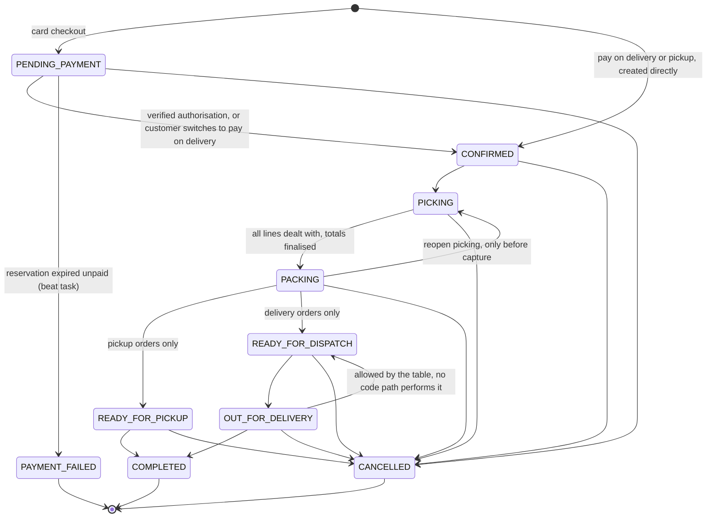

* Terminal: `COMPLETED`, `CANCELLED`, `PAYMENT_FAILED`.
* `READY_FOR_PICKUP` is valid only for `PICKUP` orders; `READY_FOR_DISPATCH` and `OUT_FOR_DELIVERY` only for `DELIVERY`.
* Customers can cancel only in `PENDING_PAYMENT` or `CONFIRMED`; staff with `orders.manage` can cancel any non-terminal
  order. Cancelling releases reservations, returns picked stock (`RETURN` movements), frees the slot, voids the coupon
  use, voids open payments and refunds any captured money through the idempotent refund path.
* A **failed or cancelled card payment does not change the order status.** The order stays `PENDING_PAYMENT` (its
  `payment_status` becomes `FAILED` or `UNPAID`) so the customer can retry until `reservation_expires_at`, after which the
  beat task moves it to `PAYMENT_FAILED`.
* `finish_picking` cancels the order itself when no line could be supplied.
* Timestamps set on entry: `confirmed_at`, `picking_started_at`, `ready_at`, `dispatched_at`, `completed_at`,
  `cancelled_at`; `packed_at` on `READY_FOR_*`.

### 7.2 Order item status

`apps/orders/fulfilment.py`; choices in `OrderItemStatus` (migration `orders/0003`).

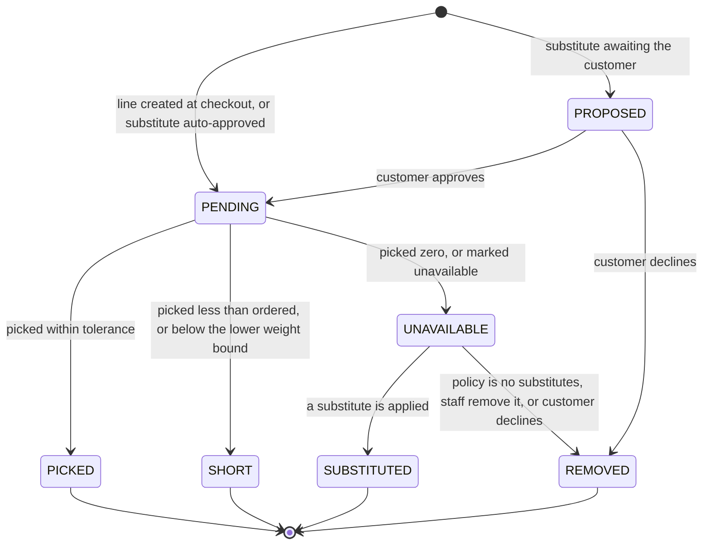

A weighed line (`is_variable_weight`) may be picked up to `ordered_qty × (1 + tolerance%)`; above that the picker needs an
override (`orders.manage`), and the customer is still charged only up to the tolerance. Below
`ordered_qty × (1 − tolerance%)` the line is `SHORT`.

### 7.3 Payment

`apps/payments/services.py`; `PaymentState`. `Order.payment_status` is a mirror maintained by `_sync_order` through
`ORDER_PAYMENT_STATUS`.

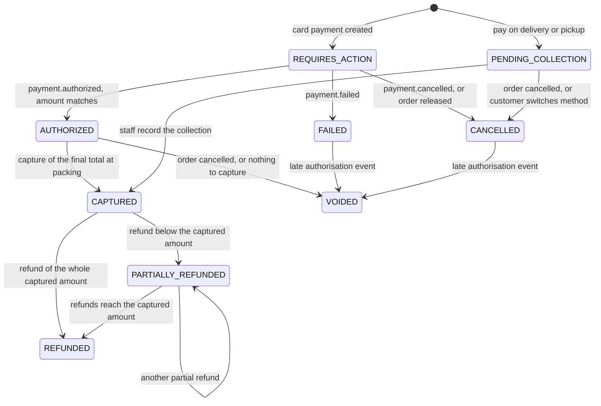

| `Payment.state` | `Order.payment_status` |
|---|---|
| `REQUIRES_ACTION` | `UNPAID` |
| `AUTHORIZED` | `AUTHORIZED` |
| `PENDING_COLLECTION` | `PENDING_COLLECTION` |
| `CAPTURED` | `PAID` |
| `FAILED` | `FAILED` |
| `CANCELLED` | `UNPAID` |
| `VOIDED` | `VOIDED` |
| `PARTIALLY_REFUNDED` | `PARTIALLY_REFUNDED` |
| `REFUNDED` | `REFUNDED` |

* An authorisation event for a payment that is no longer waiting (order already released or cancelled, or the payment
  already failed) is not applied: the provider hold is released and the payment becomes `VOIDED`
  (audited as `payment.late_authorization_voided`).
* An authorisation whose amount differs from `Payment.amount` is **not** applied (`outcome = ERROR`); the order stays
  unconfirmed.
* `FAILED`, `CANCELLED` and `VOIDED` are final for that row. A retry creates a new `Payment` (attempt + 1); the partial
  unique index allows it because the previous row is no longer open.
* A refund never changes state until the provider (or staff, for manual refunds) confirms money moved.

### 7.4 Refund

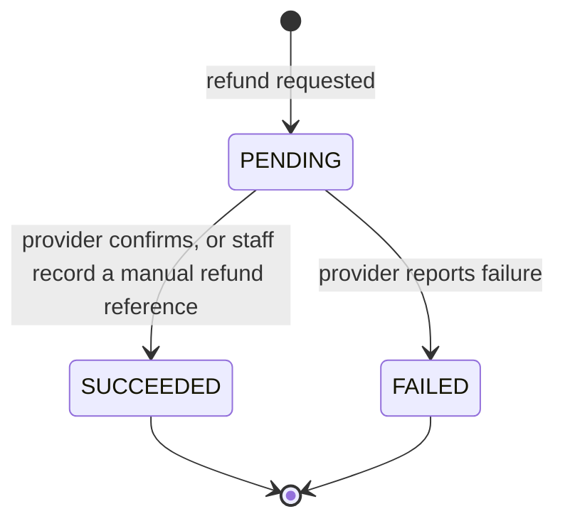

Cash-on-delivery payments, and any refund staff mark `manual`, start `PENDING` with `method = MANUAL` and finish only
when staff record the receipt reference (`complete_manual_refund`).

### 7.5 Substitution

`apps/orders/fulfilment.py: propose_substitution`, `decide_substitution`; `SubstitutionStatus`.

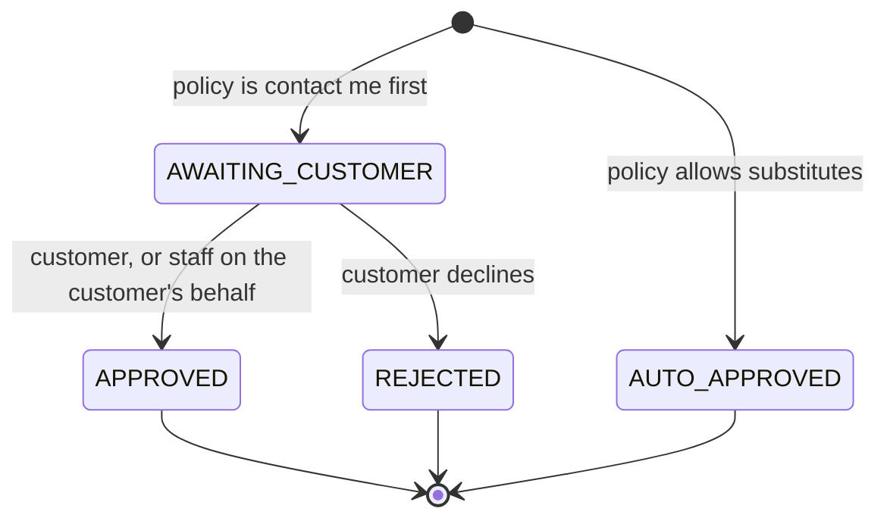

A proposal is refused (`SUBSTITUTION_NOT_ALLOWED`) when the effective policy for the line is `NONE`, and a line can have
only one open or accepted substitute. Rejection removes the original line (no charge) and releases the substitute's
reservation.

### 7.6 Purchase order

`apps/purchasing/services.py`; `POStatus`.

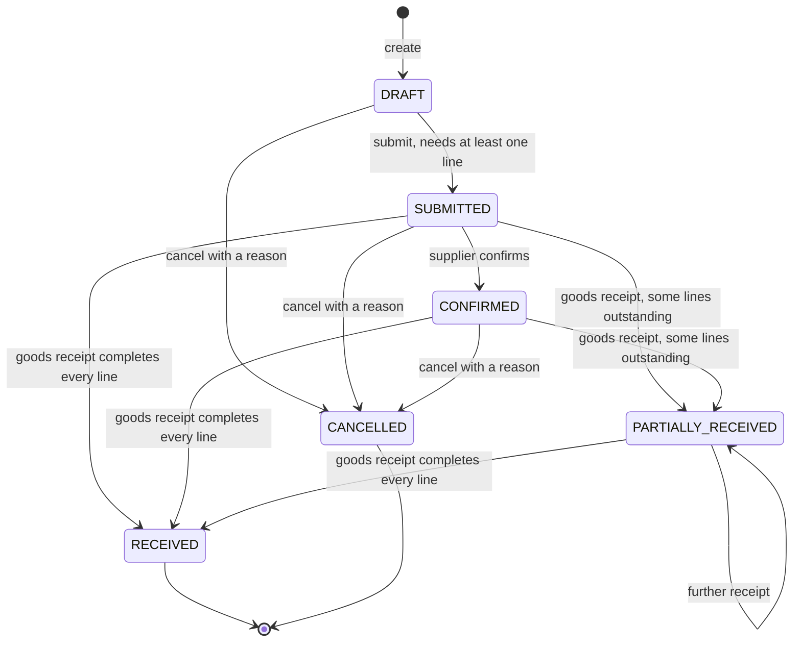

* Only `DRAFT` orders can have their lines edited.
* Cancelling is refused once any receipt exists, and the error says "close it instead", but **there is no close
  transition**: a partly received order stays `PARTIALLY_RECEIVED` until it is fully received ([§11](#11-not-implemented--known-gaps)).
* Receiving is allowed from `SUBMITTED` (confirmation is optional), up to 110 % of the outstanding quantity per line; the
  PO becomes `RECEIVED` when every line's `qty_received ≥ qty_ordered`.

### 7.7 Batch

`apps/inventory/services.py`, `apps/inventory/admin_api.py`; `BatchStatus`. `quality_status` (`PENDING`, `PASSED`,
`FAILED`) is an independent flag; a batch sells only when `ACTIVE` **and** `PASSED` and not past `sellable_until`.

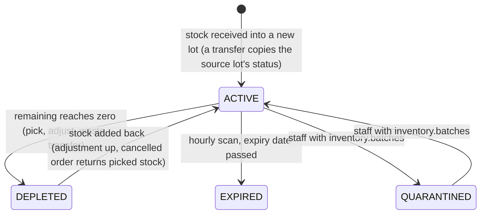

* Staff cannot move an `EXPIRED` or `DEPLETED` batch back to `ACTIVE`, but the API does accept `QUARANTINED` as a target
  from any state.
* The scan only expires `ACTIVE` batches; a `QUARANTINED` batch past its date stays quarantined.
* Expired or quarantined stock stays on hand until staff write it off (`WASTE` movement); a reservation sitting on a batch
  that stopped being sellable is re-allocated at pick time.

### 7.8 Allocation

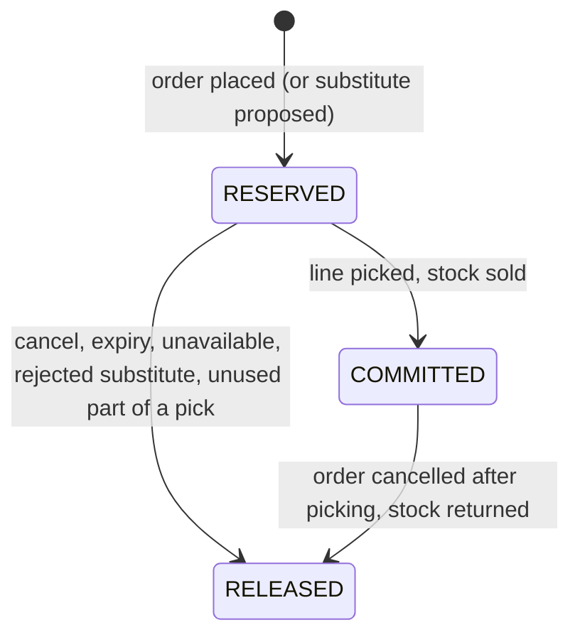

### 7.9 Support case

`apps/orders/admin_cases.py`.

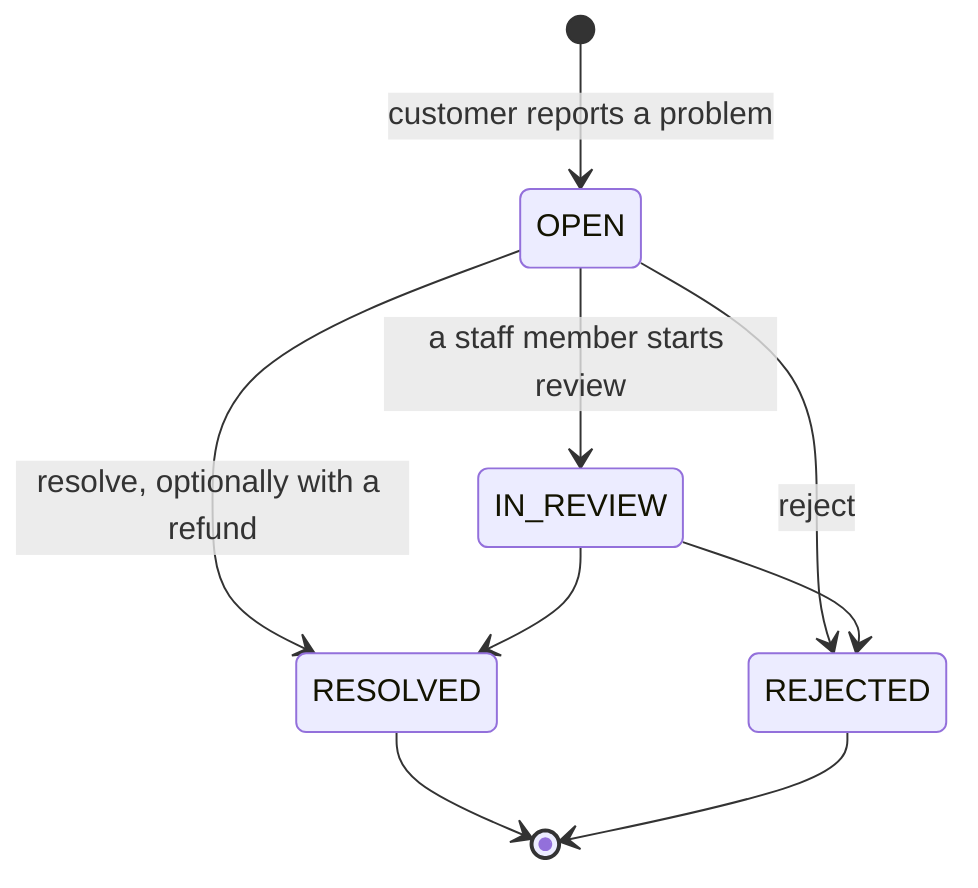

Resolving with a refund calls `request_refund` in the same transaction; if the provider rejects it the whole attempt rolls
back, the case stays open and a `case.refund_failed` audit entry is kept.

### 7.10 Smaller lifecycles

| Entity | Values and moves |
|---|---|
| `Cart.status` | `ACTIVE` → `CONVERTED` (checkout) or `MERGED` (guest cart folded into the user's cart at sign-in) |
| `Review.status` | `PENDING` → `APPROVED` or `REJECTED`; staff may later flip between the two (a repeated decision is a no-op) |
| `CouponRedemption.status` | `ACTIVE` → `VOID` when the order is cancelled or expires |
| `ContactMessage.status` | `NEW` → `HANDLED` |
| `Notification.channel` | `EMAIL_QUEUED` → `EMAIL_SENT` or `EMAIL_LOGGED` or `EMAIL_FAILED`; `EMAIL_FAILED` → re-sent within 24 h; `IN_APP` when no email is wanted |
| `Product.status` | `ACTIVE` ⇄ `INACTIVE` → `ARCHIVED` (staff-controlled, no enforced order) |

---

## 8. Migrations

`backend/apps/*/migrations`. All migrations are schema migrations except one. `makemigrations --check` is a CI step
(`.github/workflows/ci.yml`); the offline comparison is described in [§11](#11-not-implemented--known-gaps). There are no squashed migrations, no `RunSQL`, no custom functions and no triggers.

| App | Migrations | Content |
|---|---|---|
| `core` | `0001_initial` | `StoreSettings`, `AuditLog`, `IdempotencyRecord` |
| `accounts` | `0001_initial` | `User` (with `branches`, `groups`, `user_permissions`), `Address`; depends on `stores.0001` and `auth.0012` |
| `stores` | `0001_initial` | `Branch`, `BranchHours`, `BranchClosure`, `DeliveryZone`, `SlotTemplate`, `DeliverySlot` |
| `catalog` | `0001_initial` | **Extensions** `TrigramExtension()` and `UnaccentExtension()`, then all twelve models, GIN indexes and constraints |
| | `0002_reference_data` | **Data migration** (`RunPython`, reverse is a no-op): idempotent `update_or_create` of the 10 `SaleUnit` rows and 14 `Allergen` rows |
| | `0003_category_image_widths_product_rating_avg_and_more` | Adds `Category.image_widths`, `Product.rating_avg`, `Product.rating_count`, `ProductImage.image_widths` |
| `inventory` | `0001_initial` | Creates `StockLevel`, `StockMovement`, `Allocation`, `Batch`; depends on `orders.0001`, `catalog.0001`, `stores.0001` |
| | `0002_initial` | Adds the remaining foreign keys (`Batch.supplier`, `Allocation.batch`, and the product, branch and actor keys of `StockLevel` and `StockMovement`) and **all indexes and constraints** of the four tables; depends on `purchasing.0001` |
| `purchasing` | `0001_initial` | Six models; depends on `inventory.0001` (for `GoodsReceiptLine.batch`) |
| `promotions` | `0001_initial` | `Promotion`, `Coupon`, `CouponRedemption` and their M2M tables |
| `cart` | `0001_initial` | Six models |
| `orders` | `0001_initial` | `Order`, `OrderItem`, `OrderStatusHistory`, `Substitution`, `SupportCase` |
| | `0002_orderstatushistory_public_note_and_more` | Adds `OrderStatusHistory.public_note`; `note` help text |
| | `0003_alter_orderitem_status` | Adds `PROPOSED` to the `OrderItem.status` choices (a choices-only change; no SQL is emitted) |
| `payments` | `0001_initial` | `Payment`, `PaymentEvent`, `Refund` |
| `content` | `0001_initial` | `Banner`, `Page`, `Article`, `FAQ`, `NewsletterSubscriber` |
| | `0002_contact_messages_and_image_widths` | `ContactMessage`; `image_widths` on `Article` and `Banner` |
| `notifications` | `0001_initial` | `Notification` |
| `loyalty`, `reports` | — | Packages only; no models, no migrations |

**Reference-data seeding.** `apps/catalog/reference.py` holds the same `UNITS` and `ALLERGENS` lists as migration
`0002_reference_data` (the migration carries its own copy so it never imports application code) and exposes
`ensure_reference_data()`, an idempotent `update_or_create` used by the tests (a `transaction=True` test flushes the
tables, wiping the rows the migration inserted). On a fresh database `migrate` therefore yields a working catalog
vocabulary; no other table is populated by migrations. `StoreSettings` is created lazily (`get_or_create(pk=1)` in
`StoreSettings.load()` and the staff settings view).

**Demo data is not a migration.** `manage.py seed_demo` loads the deterministic demonstration store and refuses to run
with `DEBUG` off unless `--force` is given; see `docs/seed-data.md`.

**Operational notes.** `catalog/0001_initial` needs permission to `CREATE EXTENSION pg_trgm, unaccent`. The
`inventory` ⇄ `purchasing` model dependency is why `inventory` has two migrations: the order is `inventory.0001` →
`purchasing.0001` → `inventory.0002`. In Docker the one-shot `migrate` service applies everything before the application starts.

---

## 9. Verifying the schema with `psql`

Counts below come from the offline-generated DDL, not from a live database. PostgreSQL normalises stored expressions
(for example `price >= 0` is shown as `price >= 0::numeric`), so compare semantics, not text.

| Object | Expected count |
|---|---|
| Tables from project apps | 67 (10 are auto M2M link tables) |
| Named `CHECK` constraints declared in `Meta.constraints` | 50 |
| Named table-level `UNIQUE` constraints | 20 (one is `NULLS NOT DISTINCT`) |
| Named unique **indexes** (partial or expression) | 9 |
| Foreign-key constraints | 114 (all `DEFERRABLE INITIALLY DEFERRED`, none with `ON DELETE`) |

```sql
-- Named CHECK constraints (expect the names in §3; implicit Positive*Field checks end in "_check")
SELECT conrelid::regclass AS table_name, conname, pg_get_constraintdef(oid)
FROM pg_constraint
WHERE contype = 'c' AND connamespace = 'public'::regnamespace AND conname !~ '_check$'
ORDER BY 1, 2;

-- Named table-level UNIQUE constraints (all are called uniq_<something>)
SELECT conrelid::regclass, conname, pg_get_constraintdef(oid)
FROM pg_constraint
WHERE contype = 'u' AND connamespace = 'public'::regnamespace AND conname LIKE 'uniq\_%'
ORDER BY 1, 2;

-- Partial and expression unique indexes: uniq_* indexes that no constraint owns (these are NOT in pg_constraint)
SELECT i.tablename, i.indexname, i.indexdef
FROM pg_indexes i
WHERE i.schemaname = 'public' AND i.indexname LIKE 'uniq\_%'
  AND NOT EXISTS (SELECT 1 FROM pg_constraint c WHERE c.conname = i.indexname AND c.connamespace = 'public'::regnamespace)
ORDER BY 1, 2;

-- Search indexes
SELECT indexname, indexdef FROM pg_indexes WHERE tablename = 'catalog_product' AND indexname IN ('product_search_vector_gin', 'product_name_trgm');

-- Extensions
SELECT extname FROM pg_extension WHERE extname IN ('pg_trgm', 'unaccent');

-- Foreign keys are deferrable and have no ON DELETE action (confdeltype 'a' = NO ACTION)
SELECT count(*) FILTER (WHERE condeferrable AND condeferred AND confdeltype = 'a') AS ok, count(*) AS total
FROM pg_constraint WHERE contype = 'f' AND connamespace = 'public'::regnamespace AND conrelid::regclass::text ~ '^(core|accounts|stores|catalog|inventory|purchasing|promotions|cart|orders|payments|content|notifications)_';
```

The pattern selects project tables only (Django's own tables do not match), so `ok` and `total` should both be
114.

---

## 10. Appendix: every foreign key

Constraint names are Django's (`<table>_<column>_<hash>_fk_<referenced>`, truncated to 63 characters). Each also has a
btree index named like the constraint up to `_fk_`, except the three one-to-one columns.

<details>
<summary>All 114 foreign keys</summary>

| Table.column | References | Django `on_delete` | Constraint name |
|---|---|---|---|
| `accounts_address.user_id` | `accounts_user` | CASCADE | `accounts_address_user_id_c8c74ddf_fk_accounts_user_id` |
| `accounts_user_branches.branch_id` | `stores_branch` | CASCADE (auto M2M) | `accounts_user_branches_branch_id_e134a618_fk_stores_branch_id` |
| `accounts_user_branches.user_id` | `accounts_user` | CASCADE (auto M2M) | `accounts_user_branches_user_id_e71cebef_fk_accounts_user_id` |
| `accounts_user_groups.group_id` | `auth_group` | CASCADE (auto M2M) | `accounts_user_groups_group_id_bd11a704_fk_auth_group_id` |
| `accounts_user_groups.user_id` | `accounts_user` | CASCADE (auto M2M) | `accounts_user_groups_user_id_52b62117_fk_accounts_user_id` |
| `accounts_user_user_permissions.permission_id` | `auth_permission` | CASCADE (auto M2M) | `accounts_user_user_p_permission_id_113bb443_fk_auth_perm` |
| `accounts_user_user_permissions.user_id` | `accounts_user` | CASCADE (auto M2M) | `accounts_user_user_p_user_id_e4f0a161_fk_accounts_` |
| `cart_cart.branch_id` | `stores_branch` | SET_NULL | `cart_cart_branch_id_14730884_fk_stores_branch_id` |
| `cart_cart.user_id` | `accounts_user` | CASCADE | `cart_cart_user_id_9b4220b9_fk_accounts_user_id` |
| `cart_cartitem.cart_id` | `cart_cart` | CASCADE | `cart_cartitem_cart_id_370ad265_fk_cart_cart_id` |
| `cart_cartitem.product_id` | `catalog_product` | CASCADE | `cart_cartitem_product_id_b24e265a_fk_catalog_product_id` |
| `cart_comparisonitem.product_id` | `catalog_product` | CASCADE | `cart_comparisonitem_product_id_f8edc3d1_fk_catalog_product_id` |
| `cart_comparisonitem.user_id` | `accounts_user` | CASCADE | `cart_comparisonitem_user_id_e75e1096_fk_accounts_user_id` |
| `cart_favorite.product_id` | `catalog_product` | CASCADE | `cart_favorite_product_id_7bc91286_fk_catalog_product_id` |
| `cart_favorite.user_id` | `accounts_user` | CASCADE | `cart_favorite_user_id_12833bdd_fk_accounts_user_id` |
| `cart_shoppinglist.user_id` | `accounts_user` | CASCADE | `cart_shoppinglist_user_id_f64a5275_fk_accounts_user_id` |
| `cart_shoppinglistitem.shopping_list_id` | `cart_shoppinglist` | CASCADE | `cart_shoppinglistite_shopping_list_id_22f8c4d3_fk_cart_shop` |
| `cart_shoppinglistitem.product_id` | `catalog_product` | CASCADE | `cart_shoppinglistitem_product_id_5d409316_fk_catalog_product_id` |
| `catalog_category.parent_id` | `catalog_category` | PROTECT | `catalog_category_parent_id_f61bd017_fk_catalog_category_id` |
| `catalog_collectionitem.collection_id` | `catalog_collection` | CASCADE | `catalog_collectionit_collection_id_17cb7239_fk_catalog_c` |
| `catalog_collectionitem.product_id` | `catalog_product` | CASCADE | `catalog_collectionit_product_id_f2885192_fk_catalog_p` |
| `catalog_nutritionfact.product_id` | `catalog_product` | CASCADE | `catalog_nutritionfact_product_id_4f26ff9b_fk_catalog_product_id` |
| `catalog_product.brand_id` | `catalog_brand` | PROTECT | `catalog_product_brand_id_bb0c7890_fk_catalog_brand_id` |
| `catalog_product.category_id` | `catalog_category` | PROTECT | `catalog_product_category_id_35bf920b_fk_catalog_category_id` |
| `catalog_product.net_content_unit_id` | `catalog_saleunit` | PROTECT | `catalog_product_net_content_unit_id_5724c6e4_fk_catalog_s` |
| `catalog_product.sale_unit_id` | `catalog_saleunit` | PROTECT | `catalog_product_sale_unit_id_aa1d53ab_fk_catalog_saleunit_id` |
| `catalog_productallergen.allergen_id` | `catalog_allergen` | PROTECT | `catalog_productaller_allergen_id_7d236007_fk_catalog_a` |
| `catalog_productallergen.product_id` | `catalog_product` | CASCADE | `catalog_productaller_product_id_14494453_fk_catalog_p` |
| `catalog_productclaim.product_id` | `catalog_product` | CASCADE | `catalog_productclaim_product_id_1081f61d_fk_catalog_product_id` |
| `catalog_productclaim.verified_by_id` | `accounts_user` | SET_NULL | `catalog_productclaim_verified_by_id_c3ce696f_fk_accounts_` |
| `catalog_productimage.product_id` | `catalog_product` | CASCADE | `catalog_productimage_product_id_1f42dd8c_fk_catalog_product_id` |
| `catalog_review.product_id` | `catalog_product` | CASCADE | `catalog_review_product_id_e494243b_fk_catalog_product_id` |
| `catalog_review.user_id` | `accounts_user` | CASCADE | `catalog_review_user_id_743df0f5_fk_accounts_user_id` |
| `content_article_products.article_id` | `content_article` | CASCADE (auto M2M) | `content_article_prod_article_id_532f26b5_fk_content_a` |
| `content_article_products.product_id` | `catalog_product` | CASCADE (auto M2M) | `content_article_prod_product_id_00e6b732_fk_catalog_p` |
| `content_contactmessage.handled_by_id` | `accounts_user` | SET_NULL | `content_contactmessa_handled_by_id_9d961a14_fk_accounts_` |
| `core_auditlog.actor_id` | `accounts_user` | SET_NULL | `core_auditlog_actor_id_ab091f3c_fk_accounts_user_id` |
| `inventory_allocation.batch_id` | `inventory_batch` | PROTECT | `inventory_allocation_batch_id_fd4c334b_fk_inventory_batch_id` |
| `inventory_allocation.branch_id` | `stores_branch` | PROTECT | `inventory_allocation_branch_id_3d2a1003_fk_stores_branch_id` |
| `inventory_allocation.order_item_id` | `orders_orderitem` | CASCADE | `inventory_allocation_order_item_id_89113cca_fk_orders_or` |
| `inventory_allocation.product_id` | `catalog_product` | PROTECT | `inventory_allocation_product_id_ebd6652f_fk_catalog_product_id` |
| `inventory_batch.branch_id` | `stores_branch` | PROTECT | `inventory_batch_branch_id_f581cb84_fk_stores_branch_id` |
| `inventory_batch.product_id` | `catalog_product` | PROTECT | `inventory_batch_product_id_4a06f58c_fk_catalog_product_id` |
| `inventory_batch.supplier_id` | `purchasing_supplier` | SET_NULL | `inventory_batch_supplier_id_a1668333_fk_purchasing_supplier_id` |
| `inventory_stocklevel.branch_id` | `stores_branch` | CASCADE | `inventory_stocklevel_branch_id_17090616_fk_stores_branch_id` |
| `inventory_stocklevel.product_id` | `catalog_product` | CASCADE | `inventory_stocklevel_product_id_0fcddfdf_fk_catalog_product_id` |
| `inventory_stockmovement.product_id` | `catalog_product` | PROTECT | `inventory_stockmovem_product_id_4eccfd0a_fk_catalog_p` |
| `inventory_stockmovement.actor_id` | `accounts_user` | SET_NULL | `inventory_stockmovement_actor_id_debebb9d_fk_accounts_user_id` |
| `inventory_stockmovement.batch_id` | `inventory_batch` | PROTECT | `inventory_stockmovement_batch_id_8ca2b965_fk_inventory_batch_id` |
| `inventory_stockmovement.branch_id` | `stores_branch` | PROTECT | `inventory_stockmovement_branch_id_5655e8cf_fk_stores_branch_id` |
| `notifications_notification.order_id` | `orders_order` | CASCADE | `notifications_notification_order_id_4ee8e5c3_fk_orders_order_id` |
| `notifications_notification.user_id` | `accounts_user` | CASCADE | `notifications_notification_user_id_b5e8c0ff_fk_accounts_user_id` |
| `orders_order.assigned_to_id` | `accounts_user` | SET_NULL | `orders_order_assigned_to_id_e4866e32_fk_accounts_user_id` |
| `orders_order.branch_id` | `stores_branch` | PROTECT | `orders_order_branch_id_c857b51d_fk_stores_branch_id` |
| `orders_order.cancelled_by_id` | `accounts_user` | SET_NULL | `orders_order_cancelled_by_id_b6528c6d_fk_accounts_user_id` |
| `orders_order.customer_id` | `accounts_user` | SET_NULL | `orders_order_customer_id_0b76f6a4_fk_accounts_user_id` |
| `orders_order.slot_id` | `stores_deliveryslot` | PROTECT | `orders_order_slot_id_258459b2_fk_stores_deliveryslot_id` |
| `orders_order.zone_id` | `stores_deliveryzone` | SET_NULL | `orders_order_zone_id_516d59c0_fk_stores_deliveryzone_id` |
| `orders_orderitem.order_id` | `orders_order` | CASCADE | `orders_orderitem_order_id_fe61a34d_fk_orders_order_id` |
| `orders_orderitem.picked_by_id` | `accounts_user` | SET_NULL | `orders_orderitem_picked_by_id_a83a383a_fk_accounts_user_id` |
| `orders_orderitem.product_id` | `catalog_product` | PROTECT | `orders_orderitem_product_id_afe4254a_fk_catalog_product_id` |
| `orders_orderitem.substitute_for_id` | `orders_orderitem` | CASCADE | `orders_orderitem_substitute_for_id_13168e6b_fk_orders_or` |
| `orders_orderstatushistory.actor_id` | `accounts_user` | SET_NULL | `orders_orderstatushistory_actor_id_f3060964_fk_accounts_user_id` |
| `orders_orderstatushistory.order_id` | `orders_order` | CASCADE | `orders_orderstatushistory_order_id_bf09a0e1_fk_orders_order_id` |
| `orders_substitution.decided_by_id` | `accounts_user` | SET_NULL | `orders_substitution_decided_by_id_c9df62f5_fk_accounts_user_id` |
| `orders_substitution.order_item_id` | `orders_orderitem` | CASCADE | `orders_substitution_order_item_id_6229c40d_fk_orders_or` |
| `orders_substitution.proposed_by_id` | `accounts_user` | SET_NULL | `orders_substitution_proposed_by_id_5b064a18_fk_accounts_user_id` |
| `orders_substitution.substitute_item_id` | `orders_orderitem` | SET_NULL | `orders_substitution_substitute_item_id_200757af_fk_orders_or` |
| `orders_substitution.substitute_product_id` | `catalog_product` | PROTECT | `orders_substitution_substitute_product_i_8bd28b72_fk_catalog_p` |
| `orders_supportcase.customer_id` | `accounts_user` | SET_NULL | `orders_supportcase_customer_id_a17ab763_fk_accounts_user_id` |
| `orders_supportcase.handled_by_id` | `accounts_user` | SET_NULL | `orders_supportcase_handled_by_id_c71dc68f_fk_accounts_user_id` |
| `orders_supportcase.order_id` | `orders_order` | CASCADE | `orders_supportcase_order_id_ca31a9d6_fk_orders_order_id` |
| `orders_supportcase.order_item_id` | `orders_orderitem` | SET_NULL | `orders_supportcase_order_item_id_d1bd1cd6_fk_orders_or` |
| `payments_payment.order_id` | `orders_order` | PROTECT | `payments_payment_order_id_22c479b7_fk_orders_order_id` |
| `payments_paymentevent.payment_id` | `payments_payment` | SET_NULL | `payments_paymenteven_payment_id_1fde19d5_fk_payments_` |
| `payments_refund.order_id` | `orders_order` | PROTECT | `payments_refund_order_id_ae6ad322_fk_orders_order_id` |
| `payments_refund.payment_id` | `payments_payment` | PROTECT | `payments_refund_payment_id_a70693f7_fk_payments_payment_id` |
| `payments_refund.requested_by_id` | `accounts_user` | SET_NULL | `payments_refund_requested_by_id_bc87fa8f_fk_accounts_user_id` |
| `payments_refund.support_case_id` | `orders_supportcase` | SET_NULL | `payments_refund_support_case_id_136a5122_fk_orders_su` |
| `promotions_coupon_categories.category_id` | `catalog_category` | CASCADE (auto M2M) | `promotions_coupon_ca_category_id_3f7d162c_fk_catalog_c` |
| `promotions_coupon_categories.coupon_id` | `promotions_coupon` | CASCADE (auto M2M) | `promotions_coupon_ca_coupon_id_b94b6464_fk_promotion` |
| `promotions_coupon_excluded_products.coupon_id` | `promotions_coupon` | CASCADE (auto M2M) | `promotions_coupon_ex_coupon_id_c59f6653_fk_promotion` |
| `promotions_coupon_excluded_products.product_id` | `catalog_product` | CASCADE (auto M2M) | `promotions_coupon_ex_product_id_02579d34_fk_catalog_p` |
| `promotions_coupon_products.coupon_id` | `promotions_coupon` | CASCADE (auto M2M) | `promotions_coupon_pr_coupon_id_9519b9ec_fk_promotion` |
| `promotions_coupon_products.product_id` | `catalog_product` | CASCADE (auto M2M) | `promotions_coupon_pr_product_id_5f561e51_fk_catalog_p` |
| `promotions_couponredemption.coupon_id` | `promotions_coupon` | PROTECT | `promotions_couponred_coupon_id_189ea887_fk_promotion` |
| `promotions_couponredemption.order_id` | `orders_order` | CASCADE | `promotions_couponred_order_id_5de156bc_fk_orders_or` |
| `promotions_couponredemption.user_id` | `accounts_user` | SET_NULL | `promotions_couponred_user_id_5915c2e5_fk_accounts_` |
| `promotions_promotion_brands.brand_id` | `catalog_brand` | CASCADE (auto M2M) | `promotions_promotion_brand_id_ca8d3504_fk_catalog_b` |
| `promotions_promotion_brands.promotion_id` | `promotions_promotion` | CASCADE (auto M2M) | `promotions_promotion_promotion_id_316dbbd2_fk_promotion` |
| `promotions_promotion_categories.category_id` | `catalog_category` | CASCADE (auto M2M) | `promotions_promotion_category_id_797eb8b4_fk_catalog_c` |
| `promotions_promotion_categories.promotion_id` | `promotions_promotion` | CASCADE (auto M2M) | `promotions_promotion_promotion_id_d4013bb1_fk_promotion` |
| `promotions_promotion_products.product_id` | `catalog_product` | CASCADE (auto M2M) | `promotions_promotion_product_id_e430f42e_fk_catalog_p` |
| `promotions_promotion_products.promotion_id` | `promotions_promotion` | CASCADE (auto M2M) | `promotions_promotion_promotion_id_750e3e24_fk_promotion` |
| `purchasing_goodsreceipt.purchase_order_id` | `purchasing_purchaseorder` | PROTECT | `purchasing_goodsrece_purchase_order_id_d709bd69_fk_purchasin` |
| `purchasing_goodsreceipt.received_by_id` | `accounts_user` | SET_NULL | `purchasing_goodsrece_received_by_id_9ecbfa48_fk_accounts_` |
| `purchasing_goodsreceiptline.batch_id` | `inventory_batch` | SET_NULL | `purchasing_goodsrece_batch_id_d3c14b70_fk_inventory` |
| `purchasing_goodsreceiptline.po_line_id` | `purchasing_purchaseorderline` | PROTECT | `purchasing_goodsrece_po_line_id_5e20cdf0_fk_purchasin` |
| `purchasing_goodsreceiptline.receipt_id` | `purchasing_goodsreceipt` | CASCADE | `purchasing_goodsrece_receipt_id_9fee679d_fk_purchasin` |
| `purchasing_purchaseorder.created_by_id` | `accounts_user` | SET_NULL | `purchasing_purchaseo_created_by_id_20836023_fk_accounts_` |
| `purchasing_purchaseorder.supplier_id` | `purchasing_supplier` | PROTECT | `purchasing_purchaseo_supplier_id_a19ec07a_fk_purchasin` |
| `purchasing_purchaseorder.branch_id` | `stores_branch` | PROTECT | `purchasing_purchaseorder_branch_id_5ad6e832_fk_stores_branch_id` |
| `purchasing_purchaseorderline.product_id` | `catalog_product` | PROTECT | `purchasing_purchaseo_product_id_45170256_fk_catalog_p` |
| `purchasing_purchaseorderline.purchase_order_id` | `purchasing_purchaseorder` | CASCADE | `purchasing_purchaseo_purchase_order_id_d72a6e52_fk_purchasin` |
| `purchasing_supplierproduct.product_id` | `catalog_product` | CASCADE | `purchasing_supplierp_product_id_48986391_fk_catalog_p` |
| `purchasing_supplierproduct.supplier_id` | `purchasing_supplier` | CASCADE | `purchasing_supplierp_supplier_id_108dbeaa_fk_purchasin` |
| `stores_branchclosure.branch_id` | `stores_branch` | CASCADE | `stores_branchclosure_branch_id_ac5ad698_fk_stores_branch_id` |
| `stores_branchhours.branch_id` | `stores_branch` | CASCADE | `stores_branchhours_branch_id_2a725566_fk_stores_branch_id` |
| `stores_deliveryslot.branch_id` | `stores_branch` | CASCADE | `stores_deliveryslot_branch_id_442b9a40_fk_stores_branch_id` |
| `stores_deliveryslot.template_id` | `stores_slottemplate` | SET_NULL | `stores_deliveryslot_template_id_8befcb3c_fk_stores_sl` |
| `stores_deliveryslot.zone_id` | `stores_deliveryzone` | CASCADE | `stores_deliveryslot_zone_id_99d9a790_fk_stores_deliveryzone_id` |
| `stores_deliveryzone.branch_id` | `stores_branch` | CASCADE | `stores_deliveryzone_branch_id_984e0de8_fk_stores_branch_id` |
| `stores_slottemplate.branch_id` | `stores_branch` | CASCADE | `stores_slottemplate_branch_id_8bb235cd_fk_stores_branch_id` |
| `stores_slottemplate.zone_id` | `stores_deliveryzone` | CASCADE | `stores_slottemplate_zone_id_67f853ff_fk_stores_deliveryzone_id` |

</details>

---

## 11. Not implemented / known gaps

### Absent from the schema or code
* **`apps/loyalty`** has no models or migrations (the plan lists it as a stretch item).
* **No audit of fulfilment steps in `AuditLog`.** Picking, packing, dispatch and substitution steps are recorded in
  `orders_orderstatushistory` and the stock ledger. The plan (§9) says every consequential action writes an `AuditLog`
  row.
* **No cleanup of abandoned guest carts.** No task deletes `cart_cart` rows with `user_id IS NULL` and `status = 'ACTIVE'`.
* **No "close" transition for a partially received purchase order**, although the cancellation error message tells the user
  to close it.
* **`Payment.idempotency_key` is never written** (dead column).
* **Database-level append-only enforcement** (triggers or privileges) for `core_auditlog`, `inventory_stockmovement`,
  `payments_paymentevent`, `orders_orderstatushistory` ([§6](#6-immutability-and-append-only-rules)).
* **`unaccent`** is installed but unused; **`finance.refund`** capability is unused; `ErrorCode` values `BRANCH_CLOSED`,
  `INVALID_WEBHOOK` and `BATCH_BLOCKED` are never raised.
* **`Batch.expiry_kind` has no behavioural effect.** The plan says a `use_by` batch hard-blocks sale at its date while
  best-before uses a configurable buffer; the code applies `Product.sell_buffer_days` (default 1 day) to both kinds.

### Risks visible in the schema
* **A model change without a migration.** `SAFE_LINK` (the validator on `Banner.cta_link`, `apps/content/models.py`) was
  changed to reject `//host` links, but no migration records it. Validators are part of a field's deconstruction, so
  Django's autodetector reports `content: 0003_alter_banner_cta_link` as pending and the CI step
  `makemigrations --check --dry-run` would fail until that migration is added. The change has no SQL or schema effect.
* **Global `Order.checkout_key` uniqueness versus per-actor idempotency.** `uniq_order_checkout_key` is unique across all
  orders, while `IdempotencyRecord` is unique per (scope, actor, key). Two different actors presenting the same key would
  both pass the record check and the second would fail on the order index with an `IntegrityError` that is not translated
  (HTTP 500). Clients generate UUIDs, so this is theoretical; no test covers it.
* **Enumerations are unconstrained in the database** (§1): a bad status written by raw SQL or a bulk update is accepted.
* **`StoreSettings` singleton** has no constraint; a second row could be inserted with raw SQL.
* **Cached values that are only as fresh as their trigger**: `Product.search_vector` (signals; bulk writes bypass them),
  `Product.rating_*` (signal), `Product.popularity` (every 3 hours), `Order.payment_status` (written by `_sync_order`
  whenever a payment changes state, but a direct write to `payments_payment` would not update it).
* **Image paths in `OrderItem.image_path`** can dangle (§5).
* **Idempotency key retention.** `IdempotencyRecord` rows are purged after 7 days but `Order.checkout_key` stays on the
  order. A purged key no longer replays: it is treated as a new request, which normally ends in `CART_EMPTY` (the cart is
  already `CONVERTED`) and, with a fresh non-empty cart, would fail on `uniq_order_checkout_key` (derived from
  `checkout.place_order`; not tested).
