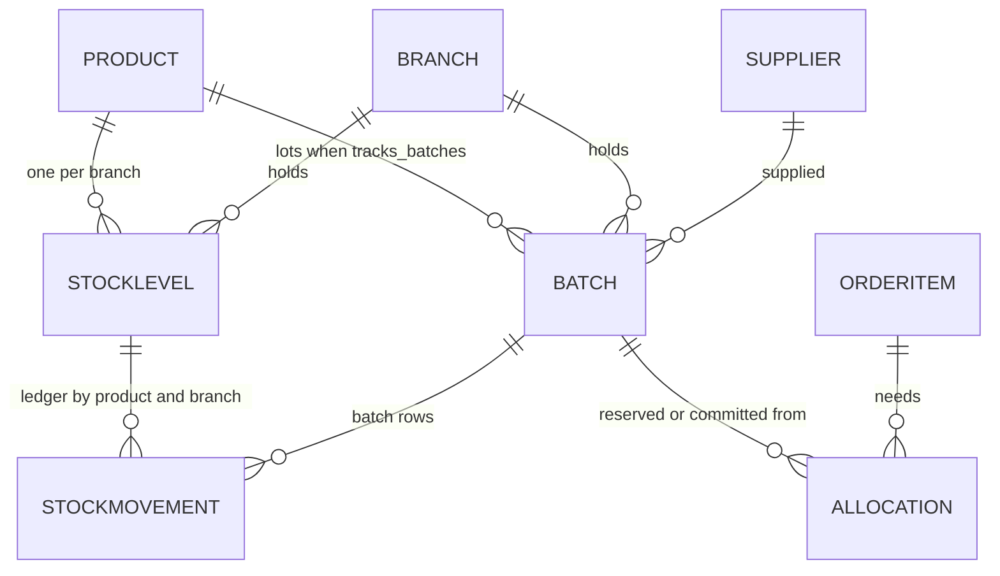
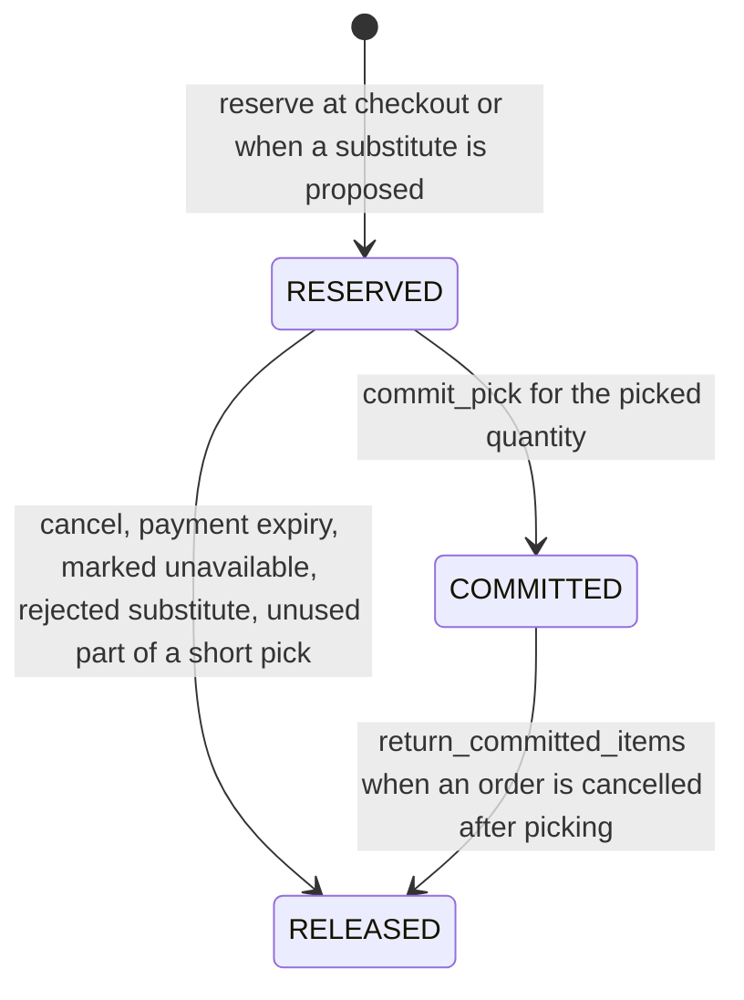
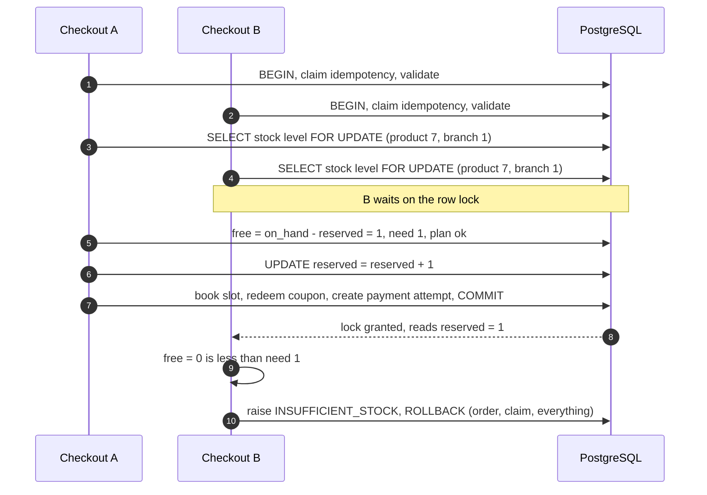
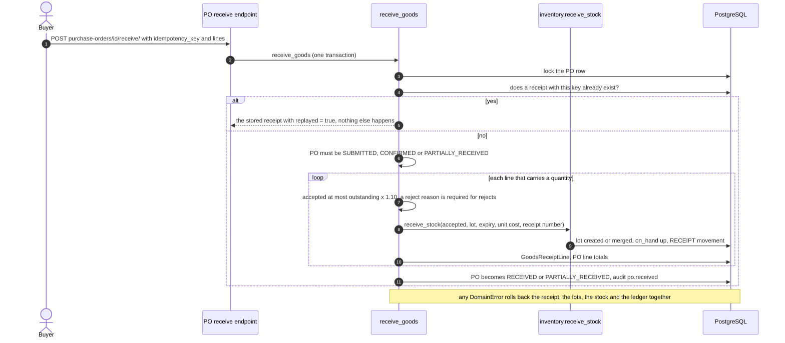
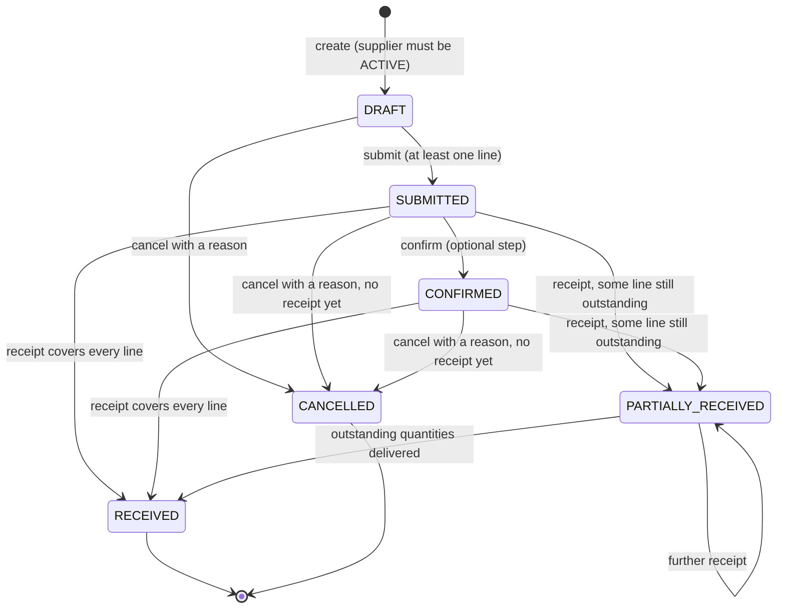
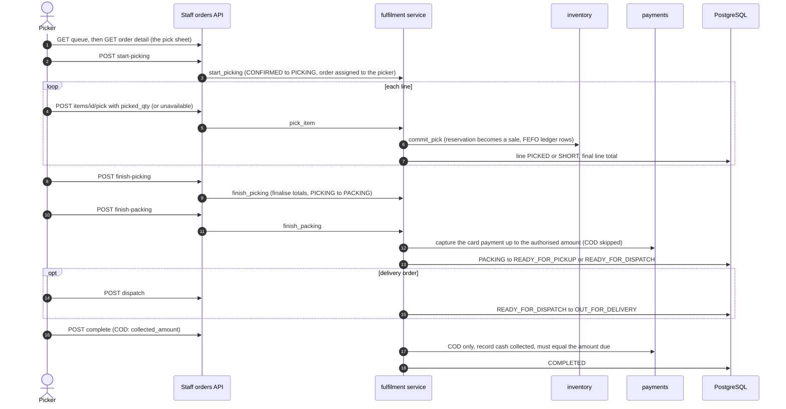
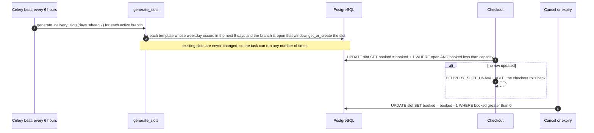

# Inventory and Fulfilment

> Scope: how stock is modelled, counted, reserved, received, written off and reconciled (`backend/apps/inventory`, `backend/apps/purchasing`), how
> an order is picked, packed and handed over (`backend/apps/orders/fulfilment.py`), and how delivery slots are generated and booked (`backend/apps/stores`).
> Pricing, checkout, payments and the order state machine are in the companion document [`commerce-workflows.md`](commerce-workflows.md); product intent is in
> [`implementation-plan.md`](implementation-plan.md). Where the code differs from the plan, this document follows the code and says so.

## 0. How to read this document

**Evidence.** Every statement was read from source in the repository at commit `47ded60` (2026-10-12). `file:line` citations refer to that commit; other workstreams were committing while this was written, so if lines have drifted, the function or test name is the stable reference. Where a test asserts a behaviour it is named as `file::Class::test_name`.
Three markers are used:

* **Not tested**: the behaviour exists but no test in `backend/tests/` asserts it.
* **Not implemented**: described somewhere (plan, docstring, message text) but absent from the code.
* **Unverified**: read from code only, never exercised, including by the author.

**What "tested" means.** The author did not run the suite (it needs the shared PostgreSQL database; the threaded tests need real transactions). A named test proves a behaviour only in the sense that
the test exists and asserts it; this document makes no claim about CI.

| Shortcut | Path under `backend/tests/` |
|---|---|
| `test_inventory.py` | `inventory/test_inventory.py` |
| `test_purchasing.py` | `purchasing/test_purchasing.py` |
| `test_inventory_purchasing_admin.py` | `admin/test_inventory_purchasing_admin.py` |
| `test_checkout.py`, `test_fulfilment.py` | `orders/test_checkout.py`, `orders/test_fulfilment.py` |
| `test_orders_admin.py`, `test_stores_admin.py`, `test_reports_admin.py`, `test_catalog_admin.py` | `admin/…` |
| `test_catalog.py` | `catalog/test_catalog.py` |
| `test_scheduled_tasks.py` | `tasks/test_scheduled_tasks.py` |
| `test_store_timezone.py` | `core/test_store_timezone.py` |

**Conventions.** Quantities are `Decimal(12,3)`, money `Decimal(12,2)` (`Decimal(10,4)` for unit costs). Every inventory function must run inside `transaction.atomic()`
(`_require_transaction` raises `RuntimeError` otherwise). "Today" means the **store's** date: `StoreTimezoneMiddleware` activates `StoreSettings.timezone` for every request and a Celery `task_prerun`
hook does the same for tasks, so `timezone.localdate()` is the store's day, not the server's (`apps/core/middleware.py`, `config/celery.py`;
`test_store_timezone.py::test_a_lot_selling_until_store_today_is_still_sellable_in_the_store_evening`).

---

## 1. The stock model

### 1.1 Records

| Model | One row per | Key fields | Purpose |
|---|---|---|---|
| `StockLevel` | product × branch | `on_hand`, `reserved`, `low_stock_threshold`, `reorder_quantity` | the counted position. `available = on_hand − reserved`. Rows are created lazily by `lock_levels` (`INSERT … ON CONFLICT DO NOTHING`) on first receipt/reservation |
| `Batch` | product × branch × lot code | `lot_code`, `received_on`, `expiry_date`, `expiry_kind`, `sellable_until`, `qty_received`, `qty_remaining`, `qty_reserved`, `unit_cost`, `status`, `quality_status`, `supplier` | a lot, only for products with `tracks_batches` |
| `StockMovement` | change to `on_hand` | `kind`, signed `qty_delta`, `on_hand_after`, `batch`, `unit_cost`, `reason_code`, `note`, `actor`, `ref_type`/`ref_id` | the append-only ledger |
| `Allocation` | order line × batch (or none) | `qty`, `state` (`RESERVED`/`COMMITTED`/`RELEASED`), `batch`, `branch` | stock set aside for a line |

Movement kinds: `RECEIPT`, `SALE` (a pick), `ADJUSTMENT`, `WASTE`, `TRANSFER_OUT`, `TRANSFER_IN`, `RETURN` (cancelled after picking). **Every change to `on_hand` writes exactly one movement per batch touched**,
so `Σ qty_delta = on_hand` for each product and branch. Changes to `reserved` are not ledgered; they live in allocations. Immutability of `StockMovement` is enforced in the model (`save` on an existing row and `delete` raise
`IntegrityError`, `test_inventory.py::TestPlainStock::test_movements_are_immutable`); bulk `QuerySet.update/delete` and direct SQL are not blocked.



### 1.2 Counting modes

| Product configuration | Counted | Lots | Availability comes from | Effect on reserve / commit |
|---|---|---|---|---|
| `stock_mode = TRACKED`, `tracks_batches = false` | yes | no | `StockLevel.on_hand − reserved` | allocation with no batch |
| `TRACKED` and `tracks_batches = true` | yes | **yes**: a lot code and an expiry date are mandatory on receipt | Σ `qty_remaining − qty_reserved` over **sellable** batches | FEFO allocation per batch |
| `stock_mode = MADE_TO_ORDER` (untracked) | no | no | none: always orderable, limited only by `qty_max` | `reserve` skips it, `commit_pick` returns at once, no `StockLevel` is created (`test_inventory.py::TestPlainStock::test_made_to_order_is_never_reserved`) |

`tracks_batches` requires `TRACKED` (`Product.clean`). Changing `tracks_batches`, `stock_mode` or the sale unit of a product that already has stock or orders is refused by the staff catalogue API
(`catalog/admin_api.py: _guard_stock_sensitive_changes`; `test_catalog_admin.py::TestCreateAndUpdate::test_cannot_change_the_counting_unit_once_stock_exists`).

### 1.3 What the database guarantees (CHECK and unique constraints)

| Constraint | Guarantees |
|---|---|
| `stock_on_hand_nonneg`, `stock_reserved_nonneg` | counts never go negative; a double release shows up as an error instead of silent drift |
| **`stock_reserved_le_on_hand`** | the database itself refuses a reservation larger than what is on hand: even if application logic were wrong, a row can never be oversold |
| `uniq_stock_product_branch` | one level per product per branch |
| `batch_received_pos`, `batch_remaining_nonneg`, `batch_reserved_nonneg`, `batch_reserved_le_remaining` | the same rules per lot |
| `uniq_batch_lot` | a lot code is unique per product and branch (a repeated code merges into the same batch, §4) |
| `allocation_qty_pos`, `movement_nonzero` | no empty allocations or ledger rows |
| `slot_not_overbooked` (stores) | `booked ≤ capacity` |

What the constraints do **not** know, and `check_invariants()` (§7) therefore verifies: that the ledger sums to `on_hand`; that batches sum to the level (`Σ qty_remaining = on_hand`, `Σ qty_reserved = reserved`);
that open allocations sum to `reserved`; that reservations sit only on sellable lots. For batch-tracked products `on_hand` includes lots that cannot be sold (expired, quarantined, failed inspection),
so `reserved ≤ on_hand` is a weaker guard there than the lot-level rules.

Tests: `test_inventory.py::TestPlainStock::test_db_constraints_back_up_the_service`.

---

## 2. What shoppers see: availability

Code: `apps/inventory/availability.py` (`annotate_availability`, `compute_availability`, `sellable_batch_q`), used by the catalogue serializers, the cart, checkout and substitution eligibility.
Stock is read from the authoritative tables inside the same query; nothing about stock is cached.

### 2.1 Quantity available

`annotate_availability(products, branch_id, on_date=today)` adds two columns:

| Case | `avail_qty` |
|---|---|
| no branch configured at all | `0` for tracked products, unlimited (`NULL`) for made-to-order |
| `MADE_TO_ORDER` | `NULL` = unlimited |
| `tracks_batches` | `Σ (qty_remaining − qty_reserved)` over the product's batches at that branch where `status = ACTIVE`, `quality_status = PASSED` and (`sellable_until` is null or `≥ on_date`); `0` if there are none |
| otherwise | `on_hand − reserved` of the level at that branch; `0` if the level row does not exist |

`low_threshold` = the level's `low_stock_threshold` (0 when there is no level).

### 2.2 Status and maximum orderable (`compute_availability`)

| Order of checks | Result |
|---|---|
| product not purchasable (`status != ACTIVE` or `is_available = false`) | `UNAVAILABLE`, max 0 |
| `avail_qty` is `NULL` (made to order) | `IN_STOCK`, `max_orderable = qty_max` (may be none) |
| `avail_qty < qty_min` | `OUT_OF_STOCK`, max 0. 0.3 kg available with a 0.5 kg minimum is out of stock |
| otherwise | `max_orderable = qty_min + k·qty_step` ≤ `min(avail_qty, qty_max)` (floored to the step); status `LOW_STOCK` when `low_threshold > 0` and `avail_qty ≤ low_threshold`, else `IN_STOCK` |

`can_order` = status is `IN_STOCK` or `LOW_STOCK`. The product card exposes `{status, max_orderable, can_order}`.

Which branch: `?branch=<id>` on catalogue calls, else the default branch (cached 5 minutes); the cart uses its own branch, else the default; checkout uses the branch that serves the address or the chosen pickup store.

Tests: `test_catalog.py::TestAvailability::test_reserved_stock_is_not_available`, `::test_no_stock_row_means_out_of_stock`, `::test_made_to_order_is_always_available`, `::test_max_orderable_respects_step_and_qty_max`,
`::test_batch_tracked_excludes_expired_quarantined_and_failed_qc`, `::test_stock_is_per_branch`; `test_catalog.py::TestListing::test_card_exposes_unit_pricing_quantity_rules_and_availability` (`LOW_STOCK`, `max_orderable` 3);
`test_purchasing.py::TestWorkflow4BatchExpiryEndToEnd::test_received_batches_drive_fefo_allocation_and_blocked_stock_is_never_sold` (30 sellable of 40 on hand).

### 2.3 `sellable_until` versus expiry

| Date | Computed | Used for |
|---|---|---|
| `expiry_date` | entered at receipt | the expiry worklist and risk buckets; `expire_batches` (flags a batch `EXPIRED` once `expiry_date < today`); reports |
| `sellable_until` | `expiry_date − product.sell_buffer_days` (default **1** day), computed **once at receipt** and stored | every sellability test: availability, FEFO allocation, pick-time re-allocation. A batch is sellable while `sellable_until ≥ date` |

So with a one-day buffer a lot expiring on the 20th stops being offered on the 20th (sellable through the 19th). Changing a product's `sell_buffer_days` later does **not** recompute existing lots.
Tests: `test_inventory.py::TestBatchesFEFO::test_sellable_until_applies_the_product_buffer`, `::test_expired_quarantined_and_failed_batches_are_never_allocated` (a lot expiring today is already unsellable with a 1-day buffer).

`expiry_kind` (`BEST_BEFORE` default, `USE_BY`) is stored, validated on the receipt API and displayed, but **no rule treats the two differently**: both use `expiry − sell_buffer_days`.
**Not implemented:** the plan's "`use_by` hard-blocks sale at the date" (`implementation-plan.md` §6). A `USE_BY` product with `sell_buffer_days = 0` is sellable on its expiry date.

### 2.4 Five meanings of "low stock"

| Where | Definition |
|---|---|
| Shopper (`LOW_STOCK`) | sellable `avail_qty ≤ low_stock_threshold`, threshold `> 0` |
| Staff stock list (`status` `LOW`/`OUT`) | `free = on_hand − reserved`; `OUT` if `free ≤ 0`; `LOW` if threshold `> 0` and `free ≤ threshold` |
| Replenishment suggestions (§8.3) | `free ≤ threshold`, threshold `> 0`, active product |
| Hourly scan (§6) | `on_hand ≤ threshold`, threshold `> 0` (ignores reservations) |
| Dashboard `stock_health` (`reports/queries.py`) | active tracked products; `out` = `free ≤ 0`, `low` = `0 < free ≤ threshold` |

For batch-tracked products the staff and replenishment figures count unsellable lots (expired, quarantined) as stock; the shopper figure does not. A threshold of 0 means "not monitored" everywhere (`test_scheduled_tasks.py::test_scan_counts_levels_at_or_below_their_threshold`).

---

## 3. Reserve, commit, release

Code: `apps/inventory/services.py`. Strategy: **reserve** when the order is placed, **commit** when the picker records the picked quantity, **release** on cancellation, expiry, short pick or a rejected substitute.



### 3.1 Reserve (`reserve(requests, branch_id, on_date)`)

1. Only `TRACKED` products with quantity `> 0` take part.
2. **Lock the stock levels** for all requested products in ascending `product_id` (`lock_levels`: missing rows are inserted `ON CONFLICT DO NOTHING`, then `SELECT … FOR UPDATE … ORDER BY product_id`).
3. Requests are processed in `(product_id, order item id)` order. Non-batch product: needs `on_hand − reserved − (already planned in this call) ≥ need`. Batch-tracked product: batches are locked (`SELECT … FOR UPDATE`) and walked in
   **FEFO order**: `sellable_until` ascending (no date last), then `received_on`, then `id`; only batches that are `ACTIVE`, `PASSED`, sellable on `on_date` and have free quantity. The plan takes from the earliest-expiring lot first and spills into the next.
4. A final cross-check refuses to oversell the aggregate if level and batches disagree.
5. **All or nothing**: every short line is collected and one `409 INSUFFICIENT_STOCK` is raised with `details.items[] {product_id, name, requested, available}`; nothing has been written yet.
6. Otherwise allocations are bulk-created `RESERVED`, `Batch.qty_reserved` and `StockLevel.reserved` are incremented with `UPDATE … F()`.

**`on_date`.** Checkout passes the **slot's date**, not today (`checkout.py: inventory.reserve(…, p.slot.date)`; substitutions pass the order's slot date), so a lot that will no longer be sellable on delivery day is not allocated.
The availability shown to shoppers and the checkout pre-check use *today*, so a basket can pass the pre-check and still fail reservation with `INSUFFICIENT_STOCK` when the stock expires before the slot. **Not tested.**

**Lock ordering (as written in the code).** The `StockLevel` row is the serialisation point for a product.
`reserve`, `receive_stock`, `adjust_stock`, `record_waste` and `transfer_stock` take the level lock first: levels in ascending product id (transfers: the two branches in ascending branch id), then batch rows
(FEFO order inside `reserve`, otherwise by id). `commit_pick`, `release_allocations` and `return_committed_items` first lock the order's own `Allocation` rows (ascending id), then the level, then batches by ascending id.
Concurrent checkouts therefore queue on the same level rows in the same order instead of deadlocking, and the CHECK constraint is the last line of defence. `set_batch_status` locks only the batch row.
Tested: concurrent reservations and checkouts (§12). **Not tested:** a pick or cancellation running concurrently with checkouts for the same product.

### 3.2 Commit (`commit_pick(order_item, picked_qty)`)

Inside the pick transaction (`fulfilment.pick_item`):

1. Lock the item's `RESERVED` allocations (none → `409 INVALID_STATE`, so a second commit is refused: `test_inventory.py::TestPlainStock::test_double_commit_is_rejected`), then the level, then the batches involved.
2. **Re-allocate blocked reservations.** Allocations sitting on a lot that is no longer sellable *today* (quarantined, failed inspection, expired, sell-by passed) are released and re-reserved from good lots (`test_inventory.py::TestBatchesFEFO::test_batch_blocked_after_reservation_is_reallocated_at_pick_time`).
3. **Picked more than reserved** (typical for weighed items, which are reserved at the ordered quantity): the difference is reserved from free stock at that moment, or the pick fails with `INSUFFICIENT_STOCK`
   (`test_fulfilment.py::TestVariableWeightProduce::test_picking_more_than_free_stock_fails_cleanly`).
4. **Consume FEFO**: allocations are consumed in order of their lot's `sellable_until`; each consumed lot gets `qty_remaining` reduced (to 0 → `DEPLETED`) and **one `SALE` movement per lot** with the lot attached and `on_hand_after` as a running value.
5. **Picked less than reserved**: the unused part is released: lot and level `reserved` drop by the whole original reservation, `on_hand` by the picked amount. Allocations are `COMMITTED` with `qty` overwritten to the committed amount, or `RELEASED` when nothing was taken from them.
   The original reserved quantity is therefore not kept on the allocation row.

Tests: `test_inventory.py::TestPlainStock::test_reserve_commit_cycle_moves_stock_and_writes_ledger`, `::test_short_pick_releases_unused_reservation`, `test_inventory.py::TestBatchesFEFO::test_commit_consumes_batches_in_fefo_order_and_writes_per_batch_movements`,
`test_fulfilment.py::TestVariableWeightProduce::test_stock_ledger_records_the_actual_weight`.

### 3.3 Release and return

* `release_allocations(allocs)` / `release_order(order)`: for the `RESERVED` allocations given, decrement lot and level `reserved`, mark `RELEASED`. Idempotent: a second call finds nothing (`test_inventory.py::TestPlainStock::test_release_is_idempotent`).
  Callers: order cancellation and payment expiry (`workflow._unwind`), "marked unavailable", a rejected substitute.
* `return_committed_items(order)`: for the order's `COMMITTED` allocations, add the quantity back to the lot (a `DEPLETED` lot becomes `ACTIVE` again) and to `on_hand`, write a `RETURN` movement, mark the allocation `RELEASED`.
  Only called when an order is cancelled after picking began (`test_fulfilment.py::TestFullFulfilment::test_staff_cancel_after_picking_returns_stock_and_refunds_captured_money`).

### 3.4 Sequence: two checkouts race for the last unit



Proven for 20 concurrent reservations by `test_inventory.py::TestConcurrency::test_twenty_shoppers_race_for_five_units_only_five_win` (5 succeed, 15 get `INSUFFICIENT_STOCK`, `reserved == 5`, invariants clean)
and for full checkouts by `test_checkout.py::TestConcurrency::test_stock_cannot_be_oversold_across_concurrent_checkouts`.

---

## 4. Receiving goods

Stock enters through exactly three routes: a **purchase-order receipt** (the only way to receive new goods), a **transfer in** from another branch, and a **positive adjustment**. There is no stand-alone "receive stock" endpoint;
`inventory.receive_stock` is called by `purchasing.receive_goods` (and by tests and the seed loader).

### 4.1 `inventory.receive_stock`

| Rule | Behaviour |
|---|---|
| Quantity | must be `> 0` (`400 INVALID_QUANTITY`) |
| Locking | the product's `StockLevel` is locked (created if missing) |
| Batch-tracked product | a **lot code and an expiry date are mandatory** (`400 VALIDATION_ERROR`, "needs a lot code and an expiry date") |
| New lot | `Batch` created: `sellable_until = expiry − sell_buffer_days`, `quality_status` (default **`PASSED`**), supplier, `unit_cost`, `received_on` = store today unless given |
| Existing lot (same product, branch, lot code) | allowed only with the **same expiry date** (else `400 VALIDATION_ERROR`); `qty_received` and `qty_remaining` increase. Supplier, cost, quality status, expiry kind **and status** of the existing lot are left unchanged |
| Non-batch product | lot code and expiry are ignored; no `Batch` row |
| Ledger | `level.on_hand += quantity`; one `RECEIPT` movement with the lot, `unit_cost`, `ref_type`/`ref_id` (a receipt number for PO receipts) |

Tests: `test_inventory.py::TestPlainStock::test_receive_creates_level_and_movement`, `::TestBatchesFEFO::test_batch_tracked_receipt_requires_lot_and_expiry`.

### 4.2 Purchase-order receipt (`purchasing.receive_goods`)

`POST /api/v1/admin/purchase-orders/<id>/receive/` (capability `purchasing.receive`: purchasing manager, admin; the PO's branch must be one the user may access).
Body: `idempotency_key` (8–80 characters), optional `delivery_note`, `notes`, and `lines[]` with `po_line_id`, `qty_accepted`, `qty_rejected`, `reject_reason`, `lot_code`, `expiry_date`, `expiry_kind` (`BEST_BEFORE` default or `USE_BY`).



| Rule | Behaviour |
|---|---|
| Idempotency | a receipt already stored for `(PO, key)` is returned (`replayed: true`) **before** the status check, so a retry after the PO reached `RECEIVED` still answers with the original receipt. Unique `(purchase_order, idempotency_key)`; the PO row lock serialises concurrent duplicates |
| PO status | `SUBMITTED`, `CONFIRMED` or `PARTIALLY_RECEIVED`. `RECEIVED` → `409 DUPLICATE_RECEIPT`; `DRAFT` or `CANCELLED` → `409 INVALID_STATE` |
| Lines | each `po_line_id` must belong to this PO (`400 VALIDATION_ERROR`); a line with accepted and rejected both 0 is skipped; no line with a quantity → `400 VALIDATION_ERROR` ("Nothing was received") |
| Over-receipt | `qty_accepted > outstanding × 1.10` (`OVER_RECEIPT_TOLERANCE`) → `409` (code `VALIDATION_ERROR`, `details.outstanding`): "If this delivery was already entered, don't enter it again." Up to 10 % over is accepted |
| Rejections | `qty_rejected > 0` needs a `reject_reason`; rejected goods are **not** added to stock and write no ledger row; they are kept on the receipt line and the PO line total |
| Batches | per line: lot code, expiry date and kind from the request; unit cost from the PO line; supplier from the PO. A later delivery of the same lot merges into the same batch |
| Quality status | **cannot be set at receipt**: every received lot is created `PASSED` and is immediately sellable. Inspection holds have to be applied afterwards with the batch status endpoint (§5.4) |
| Completion | `RECEIVED` when `qty_received ≥ qty_ordered` on **every** line, otherwise `PARTIALLY_RECEIVED`. Rejected quantity does not count as received |
| Audit | `po.received` with the receipt number; `GoodsReceipt` + `GoodsReceiptLine` rows keep what was accepted, rejected, lot and expiry |

Tests: `test_purchasing.py::TestReceiving::test_receiving_creates_batches_stock_and_ledger_with_expiry`, `::test_second_delivery_completes_the_order_and_merges_the_same_lot`, `::test_same_key_twice_is_a_noop`,
`::test_a_different_key_for_the_same_delivery_is_caught_by_the_outstanding_quantity`, `::test_over_receipt_beyond_ten_percent_is_refused`,
`::test_batch_products_need_lot_and_expiry_and_rejections_need_a_reason` (a failed receipt leaves no receipt, ledger row or PO progress), `::test_a_line_from_another_po_is_rejected`,
`::test_concurrent_double_submit_receives_once` (5 threads, one receipt, stock 20), `test_inventory_purchasing_admin.py::TestPurchasingApi::test_po_lifecycle_and_idempotent_receiving_via_api`,
`::test_inventory_managers_cannot_receive_but_purchasing_can_and_branch_scope_holds`.

**Observation (not tested): receiving into a used-up lot.** `receive_stock` adds to an existing lot without touching its `status`. If that lot is `DEPLETED` (all of an earlier delivery of the same lot was sold), the new units are counted in the ledger and
`on_hand` (so `check_invariants()` stays clean) but remain unsellable because only `ACTIVE` lots are offered; `adjust_stock` and `return_committed_items` do re-activate a `DEPLETED` lot, `receive_stock` and `transfer_stock` into an existing lot do not
(`inventory/services.py:406-413`, `:634-637`).

---

## 5. Adjustments, waste, transfers, quarantine

All endpoints are under `/api/v1/admin/inventory/`, require staff, and refuse branches the user cannot access (`403` for an explicit branch in the body; `404` for objects of other branches).

| Operation | Endpoint and capability | Rules | Ledger / state | Audit |
|---|---|---|---|---|
| **Adjust** (stock-take correction) | `POST adjust/` · `inventory.adjust` (store manager, inventory manager, admin) | send exactly one of `delta` (signed) or `target` (absolute count); a **reason is mandatory** (non-blank, ≤120 chars); batch-tracked products require `batch_id` and the change applies to that lot (`target` = that lot's count); the result may not fall below the quantity **reserved** (`409 INSUFFICIENT_STOCK`, `details.reserved`); a zero change writes nothing and answers `changed: false` | one `ADJUSTMENT` movement, note `"<reason>: <note>"`; a lot reaching 0 becomes `DEPLETED`, a `DEPLETED` lot gaining stock becomes `ACTIVE` | `stock.adjusted` |
| **Waste** | `POST waste/` · `inventory.waste` (same roles) | `quantity > 0`; `reason_code` is one of `EXPIRED`, `DAMAGED`, `SPOILED`, `QUALITY`, `OTHER`; batch-tracked products require `batch_id`; may not exceed the lot's remaining quantity or on-hand; may not cut into reserved quantity, **except** that a lot whose status is `EXPIRED` or `QUARANTINED` may be written off below its reserved quantity (floor 0, see §14.2) | one `WASTE` movement carrying the reason code; the movement has no `unit_cost` (reports fall back to the lot's cost); a lot reaching 0 while `ACTIVE` becomes `DEPLETED` (an `EXPIRED` or `QUARANTINED` lot keeps its status) | `stock.waste` |
| **Transfer** | `POST transfer/` · `inventory.transfer` (same roles) | different branches; the user needs access to **both** (`403` otherwise); immediate, there is no in-transit state; non-batch: `on_hand − reserved ≥ quantity`; batch-tracked: `batch_id` required and the lot's unreserved quantity must cover it | `TRANSFER_OUT` at the source and `TRANSFER_IN` at the destination (`ref_type = transfer`, `ref_id` = the other branch). The destination lot is created with the same lot code, expiry, `sellable_until`, status, quality, supplier and cost (`received_on` = today), or merged by lot code (expiry and status of an existing destination lot are not compared) | `stock.transferred` |
| **Quarantine / release / inspection** | `POST batches/<id>/status/` · `inventory.batches` (store manager, inventory manager, **purchasing manager**, admin) | `status` may be set to `ACTIVE` or `QUARANTINED`; `quality_status` to `PENDING`, `PASSED` or `FAILED`; an `EXPIRED` or `DEPLETED` lot cannot be set `ACTIVE` (`409`) | no ledger row (the stock stays on hand); takes effect at once: the lot disappears from availability and from new allocations. Reservations already on it stay until the order is picked, then are re-allocated (§3.2) | `batch.status` with before/after |
| **Thresholds** | `PATCH stock/<level id>/thresholds/` · `inventory.adjust` | `low_stock_threshold`, `reorder_quantity` ≥ 0 | none | `stock.thresholds` |

Tests: `test_inventory.py::TestAdjustWasteTransfer::test_adjustment_requires_reason_and_cannot_go_below_reserved`, `::test_waste_is_a_negative_movement_with_reason`, `::test_transfer_moves_stock_and_batches_between_branches`,
`TestBatchesFEFO::test_adjusting_batch_tracked_product_needs_a_batch`, `::test_expired_stock_can_be_written_off_and_reconciles`;
`test_inventory_purchasing_admin.py::TestStockAndMovements::test_role_matrix_for_reading_and_changing_stock`, `::test_adjustment_requires_reason_is_audited_and_cannot_cross_branches`, `::test_negative_stock_and_reserved_stock_are_protected`,
`::test_waste_and_transfer` (transfer needs both branches), `::test_fulfilment_staff_cannot_change_stock`,
`TestBatchesAndExpiry::test_quarantine_blocks_sale_and_is_audited_but_expired_cannot_be_revived`, `::test_writing_off_expired_stock_through_the_api_clears_the_worklist`.
**Not tested:** writing off or adjusting a lot that still carries reservations (§14.2), transferring a lot into a destination that already has that lot code, partial waste of a batch-tracked lot.

**Expiry worklist.** `GET expiry/` (read: `inventory.read`, branch-scoped) groups lots with stock (any status except `DEPLETED`; at most 500 rows) and an expiry within 7 days, plus anything already past, by days to expiry: `expired` (< 0), `today_tomorrow` (≤ 1), `within_3`, `within_7`, with batch counts and value at cost (lots without a cost are not valued).
`GET batches/` filters: `expired` (stock left and expiry date before today), `expiring_within` (N days, not yet expired), `on_hand`, `status`, product, branch, `search`. Test: `test_inventory_purchasing_admin.py::TestBatchesAndExpiry::test_expiry_worklist_groups_batches_by_urgency_with_value`, `::test_batch_filters_detail_and_scoping`.

---

## 6. Scheduled maintenance

Celery beat (`config/settings/base.py: CELERY_BEAT_SCHEDULE`, UTC clock; each task activates the store timezone first):

| Task | Schedule | What it does | Safe to repeat |
|---|---|---|---|
| `apps.inventory.tasks.expiry_and_low_stock_scan` | hourly | `expire_batches()`; counts levels with `low_stock_threshold > 0` and `on_hand ≤ threshold`; writes one `inventory_scan` log line; returns `{expired_batches, low_stock_levels}` | yes |
| `apps.stores.tasks.generate_delivery_slots` | every 6 hours | slots for the next 7 days (today plus 7) for every active branch (§10.2) | yes |
| `apps.orders.tasks.release_expired_reservations` | every 60 seconds | releases unpaid card orders past their reservation window (stock, slot, coupon) | yes |
| `apps.notifications.tasks.requeue_stalled_emails` | every 10 minutes | re-queues emails recorded as queued but not sent | yes |
| `apps.core.tasks.cleanup_idempotency_keys` | daily | deletes idempotency records older than 7 days | yes |
| `apps.catalog.tasks.refresh_popularity` | every 3 hours | recomputes `Product.popularity` = ordered quantity over the last 30 days on orders that are not `CANCELLED`, `PAYMENT_FAILED` or `PENDING_PAYMENT`, substitute lines excluded; if there were no such sales at all it changes nothing | yes |

`apps/inventory/tasks.py` contains **one** task, `expiry_and_low_stock_scan`.

**`expire_batches(today)`**: `UPDATE batch SET status = EXPIRED WHERE status = ACTIVE AND expiry_date < today`. Notes:

* strict "before today": a lot is flagged on the day **after** its expiry date; `QUARANTINED` lots are never flagged;
* flagged lots **stay on hand** until staff write them off as waste (that keeps the ledger honest);
* the flag does not make a lot unsellable, since `sellable_until` already excluded it (usually days earlier). The flag drives the staff worklist and the "can't be revived" rule;
* nothing is sent to staff: the scan only logs. **Not implemented:** expiry or low-stock alerts (the plan's architecture lists them; the code logs a count).

Tests: `test_scheduled_tasks.py::test_scan_flags_expired_batches_but_keeps_them_on_hand`, `::test_scan_is_idempotent`, `::test_scan_counts_levels_at_or_below_their_threshold`, `test_inventory.py::TestBatchesFEFO::test_expired_stock_can_be_written_off_and_reconciles`.
**Not tested:** the beat schedule itself (configuration), a lot expiring on the exact boundary day through the task.

---

## 7. `check_invariants()`

`inventory.services.check_invariants() -> list[str]` returns one human-readable string per inconsistency; an empty list means consistent. It is **read-only**.

For **every `StockLevel` row** (including ones with a zero threshold) it checks:

| # | Check | Message format |
|---|---|---|
| 1 | `Σ StockMovement.qty_delta` for the product and branch equals `on_hand` | `SKU@branch: ledger X != on_hand Y` |
| 2 | batch-tracked only: `Σ Batch.qty_remaining` equals `on_hand` | `SKU@branch: batches hold X but on_hand is Y` |
| 3 | batch-tracked only: `Σ Batch.qty_reserved` equals the level's `reserved` | `SKU@branch: batches reserve X but level reserves Y` |
| 4 | `Σ qty` of `RESERVED` allocations for the product and branch equals `reserved` | `SKU@branch: open allocations X != reserved Y` |

It does **not** check: per-lot `qty_reserved` against the allocations on that lot; allocations or movements of products that have no level row; that `COMMITTED` quantities match `SALE` movements; that reservations sit only on sellable lots; that each movement's
`on_hand_after` is the running total; or **delivery-slot `booked` counts against orders** (nothing verifies those). Negative values and `reserved > on_hand` are prevented by the constraints, not checked here.

Where it is used: the test suite (assertions in `test_inventory.py`, `test_checkout.py`, `test_fulfilment.py`, `test_purchasing.py`, `test_inventory_purchasing_admin.py`). **There is no management command, no endpoint and no scheduled run**; an operator must call it from a shell (§14.1).
It issues two to three aggregate queries per stock level (ledger, lots for batch-tracked products, allocations) plus one to list the levels, so it is a maintenance tool rather than something to run per request.

---

## 8. Purchasing

Code: `apps/purchasing/{models,services,admin_api}.py`. Endpoints are under `/api/v1/admin/`.

### 8.1 Suppliers

| Item | Behaviour |
|---|---|
| Record | `Supplier`: `code` (unique slug), name, contact details, `status` (`ACTIVE`, `ON_HOLD`, `INACTIVE`), `lead_time_days` (default 2), notes |
| Product links | `SupplierProduct` (supplier, product, supplier SKU, unit cost). `PUT suppliers/<id>/products/` **replaces** the whole list (needs `purchasing.write`); duplicates in the request are ignored; negative cost refused |
| Who | read `purchasing.read` (store manager, inventory manager, purchasing manager, admin); write `purchasing.write` (purchasing manager, admin) |
| Deleting | refused (`409 INVALID_STATE`) once the supplier has purchase orders or batches; set it inactive instead |
| Scoping | **not branch-scoped**: suppliers and their performance figures are global |

### 8.2 Purchase-order lifecycle



| Step | Rules (`purchasing/services.py`) | Capability |
|---|---|---|
| Create | supplier `ACTIVE`; destination branch must be one the user may access (`403`); number `PO-yymmdd-xxxx`; `expected_date` defaults to today + supplier lead time; lines optional at creation | `purchasing.write` |
| Edit lines | **only while `DRAFT`** (`409 INVALID_STATE` after); the line list is replaced; a product may appear once; quantity `> 0`, cost `≥ 0`. Notes and expected date remain editable after submission | `purchasing.write` |
| Submit | needs at least one line; stamps `submitted_at` | `purchasing.write` |
| Confirm | `SUBMITTED → CONFIRMED`; receiving works with or without it | `purchasing.write` |
| Cancel | reason required; only from `DRAFT`/`SUBMITTED`/`CONFIRMED`; **refused once any receipt exists** | `purchasing.write` |
| Receive | §4.2 | `purchasing.receive` |

Every step writes an audit row (`po.created`, `po.updated`, `po.submitted`, `po.confirmed`, `po.cancelled`, `po.received`). Total cost = Σ `qty_ordered × unit_cost`.
Tests: `test_purchasing.py::TestPurchaseOrderLifecycle::test_create_edit_submit_confirm`, `::test_invalid_lines_and_inactive_supplier`, `::test_cancel_only_before_goods_arrive`;
`test_inventory_purchasing_admin.py::TestPurchasingApi::test_role_matrix`, `::test_po_lifecycle_and_idempotent_receiving_via_api`.

**Not implemented: closing a purchase order short.** A `PARTIALLY_RECEIVED` order can be neither cancelled nor closed; it only completes when `qty_received ≥ qty_ordered` on every line, and rejected goods do not count as received. The cancel error message says
"Close it instead of cancelling" (`purchasing/services.py:131`), but no close operation exists.

### 8.3 Replenishment suggestions

`GET /api/v1/admin/purchasing/replenishment/?branch=<id>` (`purchasing.read`; `400` without a branch, `403` for a branch the user cannot access). It is advisory: it creates nothing.

**Which products appear.** `StockLevel` rows of that branch with `low_stock_threshold > 0`, product `ACTIVE`, and `free = on_hand − reserved ≤ low_stock_threshold`, lowest `free` first.

**What is reported for each** (`replenishment_suggestions(branch_id, velocity_days = 30)`):

| Field | Definition |
|---|---|
| `available` | `free` as above |
| `threshold` | `low_stock_threshold` |
| `avg_daily_sales` | `abs(Σ qty_delta of SALE movements at this branch in the last 30 days) / 30`; `null` when there were no sales |
| `days_of_cover` | `round(free / avg_daily_sales, 1)`; `null` when there is no velocity |
| **`suggested_qty`** | **`max(reorder_quantity, 2 × low_stock_threshold − free)`** (3 decimals) |
| `on_order` | `Σ (qty_ordered − qty_received)` over this product's lines on this branch's `SUBMITTED`/`CONFIRMED`/`PARTIALLY_RECEIVED` orders. **Shown, not subtracted** from `suggested_qty` |
| `suppliers` | active suppliers linked through `SupplierProduct`, with link cost and `lead_time_days` |

Worked example from the test: threshold 12, `reorder_quantity` 40, 30 on hand, 24 picked → `free` 6; `2 × 12 − 6 = 18`; `max(40, 18) = 40`. Sold 24 in 30 days → 0.8 per day → 7.5 days of cover.
Tests: `test_purchasing.py::TestReplenishmentAndSupplierStats::test_suggestions_use_measured_sales_and_open_orders`, `::test_no_sales_history_means_no_invented_velocity`,
`test_inventory_purchasing_admin.py::TestPurchasingApi::test_replenishment_suggestions_endpoint_is_branch_scoped`.

Limits: velocity is always spread over 30 days even if the product was stocked for less; only `SALE` movements count (returns after cancellation are not netted); there is no safety-stock or supplier-lead-time term;
for batch-tracked products `free` counts expired and quarantined lots; open purchase orders do not reduce the suggestion.

### 8.4 Supplier performance

`GET /api/v1/admin/suppliers/<id>/performance/?since=YYYY-MM-DD` (`purchasing.read`). Measured from receipts only; a metric is `null` when there is no data.

| Metric | Definition (`supplier_performance`) |
|---|---|
| Population | the supplier's purchase orders excluding `DRAFT` and `CANCELLED`; with `since`, only those whose `submitted_at` date is on or after it |
| `orders` | number of those orders |
| `receipts` | number of `GoodsReceipt` rows on them |
| `fill_rate` | `Σ qty_received / Σ qty_ordered × 100` over **all lines of those orders**, 1 decimal. Orders still in flight count as ordered but not yet received, so the figure is understated until deliveries land. Only accepted quantity counts as received |
| `rejection_rate` | `Σ qty_rejected / (Σ qty_received + Σ qty_rejected) × 100`, 1 decimal |
| `on_time_rate` | share of **receipts** (not orders) created on or before the order's `expected_date`, 1 decimal. A partial delivery counts as its own receipt; a receipt on an order with no `expected_date` counts as late. The receipt date is the UTC date of `created_at` compared with a local `expected_date` (unverified effect near midnight) |

`lead_time_days` shown beside these in the supplier report is the quoted figure, not a measured one. The same function feeds `report_suppliers` (all suppliers, not branch-scoped).
Tests: `test_purchasing.py::TestReplenishmentAndSupplierStats::test_supplier_performance_is_computed_from_receipts_only` (100 ordered, 90 accepted, 10 rejected → fill 90.0, rejection 10.0, on time 100.0),
`test_inventory_purchasing_admin.py::TestPurchasingApi::test_supplier_with_history_cannot_be_deleted_and_products_link_roundtrips` (no data → `null`).
**Not tested:** the `since` filter, a late receipt, multiple suppliers.

---

## 9. Fulfilment

Code: `apps/orders/fulfilment.py` (services) and `apps/orders/admin_api.py` (`OrderAdminViewSet`). The rules for weights, substitutions, totals and capture are in [`commerce-workflows.md`](commerce-workflows.md) §4.6 and §6; this section covers the floor workflow and its stock effects.

### 9.1 Sequence



### 9.2 Endpoints and who may call them

| Action | Endpoint (`/api/v1/admin/orders/…`) | Capability |
|---|---|---|
| Queue, list, detail, substitute candidates | `queue/`, `?filters`, `<number>/`, `<number>/items/<id>/substitutes/` | `orders.read` (fulfilment staff, store manager, customer support, admin) |
| Start / finish picking, reopen picking, finish packing, dispatch, complete | `start-picking/`, `finish-picking/`, `reopen-picking/`, `finish-packing/`, `dispatch/`, `complete/` | `orders.fulfil` (fulfilment staff, store manager, admin) |
| Pick a line, mark unavailable, propose a substitute, remove a line | `items/<id>/pick/`, `…/unavailable/`, `…/substitute/`, `…/remove/` | `orders.fulfil` |
| Weight-tolerance override (`override: true`) | `items/<id>/pick/` | `orders.fulfil` **and** `orders.manage` |
| Record a customer's substitution answer; assign; cancel | `substitutions/<id>/decide/`, `assign/`, `cancel/` | `orders.manage` (store manager, customer support, admin) |
| Refunds | `refund/`, `refunds/<id>/complete/` | `orders.refund` |

Every route is branch-scoped: staff only see orders of their branches and get `404` for others; an item id from another order in the URL is `404`.
Tests: `test_orders_admin.py::TestAccessAndScoping::*`, `::TestFulfilmentThroughTheApi::test_items_must_belong_to_the_order_in_the_url`.

### 9.3 Picking queue

`GET queue/` lists orders in `CONFIRMED`, `PICKING`, `PACKING`, `READY_FOR_PICKUP`, `READY_FOR_DISPATCH`, `OUT_FOR_DELIVERY` (up to 300), grouped by slot start time and ordered by slot start then placement time. By default only orders whose slot starts before `now + 2 days` are included (so overdue orders stay visible);
`?date=` selects one day. Each group carries per-order `lines` (lines still counted: not removed, substituted-away or proposed) and `lines_done` (picked or short), `is_late` (slot already started and the order still `CONFIRMED`/`PICKING`), `awaiting_customer`, `assigned_to`, and the response has `counts` per status.
The list endpoint filters by `status`, `branch`, `fulfilment_type`, `payment_status`, `placed_from`/`placed_to`, `slot_date`, `mine`, `needs_attention` (awaiting a substitution answer or payment failed) and `search` (number, name, email, phone). Unknown orderings fall back to newest first.
Tests: `test_orders_admin.py::TestListsQueueAndDetail::test_queue_groups_by_window_and_flags_late_orders`, `::test_filters_and_search`, `::test_list_query_count_is_bounded` (≤ 8 queries for 8 orders).

### 9.4 Pick sheet

There is no separate print route: the **order detail** is the pick sheet. Items are ordered by **storage type** (`AMBIENT`, then `CHILLED`, then `FROZEN`, so cold items are picked last), then category name, then item name.
Each line shows ordered quantity and unit, estimated price, substitution preference, picker note, and for batch-tracked products the **lots the system reserved, in FEFO order** (lot code, expiry date, quantity, `RESERVED`/`COMMITTED`); weighed lines also show the allowed `min`/`max` weight. The order-level
substitution policy, customer note, delivery address and slot window are on the same response.
Each line also carries the product's `qty_min` and `qty_step` so a picking UI can step quantities correctly, and each order row carries `customer_id` (null for a guest).
Tests: `test_orders_admin.py::TestListsQueueAndDetail::test_pick_sheet_orders_ambient_then_chilled_then_frozen_and_shows_fefo_lots`, `test_orders_admin.py::TestStaffPayloadHelpsTheUi::test_rows_carry_the_customer_id_and_items_the_quantity_rules`.

### 9.5 Per-line pick: stock effects

`pick_item` runs in one transaction with the order locked (`PICKING` only) and the line `PENDING`.

| Outcome | Rules | Stock |
|---|---|---|
| Picked in full | counted lines: exactly the ordered quantity; weighed lines: inside the tolerance band (rules in commerce §6.1) | reservation → sale: one `SALE` movement per lot taken, FEFO |
| Short (counted lines fewer than ordered; weighed lines below the band) | line `SHORT`, charged for what was picked | picked quantity sold; the rest of the reservation released |
| Zero, or "mark unavailable" | line `UNAVAILABLE`, reservation released; policy `NONE` removes it, otherwise a substitute is proposed or the line removed | reservation released |
| Weighed line heavier than reserved | within tolerance (or manager override up to the actual weight) | the extra is taken from free stock, or `INSUFFICIENT_STOCK` |
| Reserved lot became unsellable since checkout | transparent to the picker | reservation moved to a good lot first (§3.2) |

### 9.6 Shortages and substitution proposals

* The picker marks a line unavailable (`unavailable/`), then either proposes a substitute (`substitute/`, the candidate list comes from `items/<id>/substitutes/`) or removes the line (`remove/`) — see commerce §6.2–6.4 for policies, eligibility and the price cap.
* A proposed substitute's stock is **reserved immediately** at the order's slot date (so it cannot be sold elsewhere while the customer decides) and released if the customer declines.
* `finish_picking` refuses while any line is still `PENDING`, `PROPOSED` or `UNAVAILABLE`, or while a substitution awaits the customer (`SUBSTITUTION_REQUIRES_APPROVAL`). If **no** line could be supplied the order is cancelled instead of packed, the card hold is voided and the customer is notified.

### 9.7 Packing, dispatch, handover

| Step | What the code does |
|---|---|
| `finish_picking` | `finalize_totals` stores `final_total = min(recomputed, authorized_amount)`; order → `PACKING` ("Picked — now packing your order") |
| `reopen_picking` | `PACKING → PICKING`, only while no payment is `CAPTURED`. It does not reopen any line |
| `finish_packing` | requires `final_total`. **Card orders: captures `min(final_total, authorised)` now**; a missing authorised payment raises `409 PAYMENT_FAILED` ("no authorised card payment to capture") unless the total is 0. Order → `READY_FOR_PICKUP` (pickup) or `READY_FOR_DISPATCH` (delivery); customer notified with the final total |
| `dispatch` | delivery orders only: `READY_FOR_DISPATCH → OUT_FOR_DELIVERY`; a pickup order gets `409 INVALID_ORDER_TRANSITION` |
| `complete` | `READY_FOR_PICKUP`/`OUT_FOR_DELIVERY → COMPLETED`. **COD:** `collected_amount` is required and must equal the amount due (`final_total`), else `400 VALIDATION_ERROR` with `details.due`; the payment becomes `CAPTURED` with the optional `reference`. Card orders need nothing at this step |

Capture therefore happens when packing ends, before dispatch. Nothing else is recorded at handover besides the actor, timestamp and (COD) amount and reference.
**Not implemented:** packaging records (bags, crates, temperature zones), driver assignment and routing (`assign` sets the picking owner only), proof of delivery or collection checks.
Tests: `test_fulfilment.py::TestFullFulfilment::test_confirmed_to_completed_with_consistent_stock_money_and_history`, `::test_pickup_order_goes_ready_for_pickup_then_completed`, `::test_cannot_finish_packing_or_picking_out_of_order`,
`TestVariableWeightProduce::test_cod_final_total_must_match_the_amount_collected`, `test_orders_admin.py::TestFulfilmentThroughTheApi::test_full_cod_delivery_via_endpoints`.

---

## 10. Delivery slots

Code: `apps/stores/{models,services,tasks,views,admin_api}.py`.

### 10.1 Records

| Model | Key fields | Notes |
|---|---|---|
| `Branch` | `prep_minutes` (default 120), `timezone` (blank = store timezone), `offers_delivery`, `offers_pickup`, `is_default`, `is_active` | `BranchHours` per weekday (`opens < closes` or closed), `BranchClosure` per date |
| `DeliveryZone` | `postcode_prefixes[]` (normalised upper-case, no spaces), `areas[]` (lower-case), `delivery_fee`, `free_delivery_threshold`, `min_order_value`, `priority` (lower wins), `is_active` | an address matches when its postcode starts with a prefix **or** its area equals an area name |
| `SlotTemplate` | branch, zone (required for delivery), `kind`, `weekday`, `start_time`, `end_time`, `capacity > 0`, optional `fee` | weekly pattern |
| `DeliverySlot` | branch, zone (none for pickup), `kind`, `date`, times, `capacity`, `booked`, `fee`, `is_open`, `template` | unique `(branch, zone, kind, date, start_time)` with nulls treated as equal, so two pickup slots (no zone) cannot collide either; CHECK `booked ≤ capacity` and `start < end` |

### 10.2 Generation



* **Beat task** `generate_delivery_slots(days_ahead = 7)` runs every 6 hours for every active branch. **Staff** can run it on demand: `POST /api/v1/admin/slots/generate/ {branch_id, days_ahead}` (`slots.manage`: store manager, admin; `days_ahead` clamped to 1–28; audit `slot.generated`; returns `{created}`).
* For each day from the branch's local today to `today + days_ahead` and each active template of that weekday: skip if the branch has a **closure** that date, no hours row, a closed day, or the window is not inside the day's opening hours (`opens ≤ start` and `end ≤ closes`); otherwise `get_or_create` on `(branch, zone, kind, date, start_time)` with the template's end time, capacity, fee and a link to the template.
* **Fee**: the template's `fee` if set; else for delivery the zone's `delivery_fee`; pickup 0.
* **Existing slots are never updated.** Editing a template's capacity or times, or changing opening hours, does not change slots already generated; staff must edit or close those slots. A zone fee change does update future slots that have no template fee override.
  Closing a branch day (a `BranchClosure`) sets that day's open slots to closed, but is refused (`409`) if any slot that day has bookings ("Move or cancel those orders") — and there is no way to move an order to another slot (commerce §9.1).
* Slots are never created by hand (`POST slots/` is 405).
* Branches, closures, zones, templates and slots are edited through `AdminViewSet`, whose create and update turn a unique-constraint race (`IntegrityError`) into `409 INVALID_STATE` ("That conflicts with an existing record") with no audit row, instead of a 500 (`core/admin_api.py`; `test_stores_admin.py::TestConcurrentDuplicates::test_a_unique_constraint_race_is_a_409_not_a_500_and_leaves_no_audit_entry`, which simulates the race by making `ModelSerializer.save` raise `IntegrityError` for a branch, so it is not a threaded test).

Tests: `test_stores_admin.py::TestZonesAndSlots::test_generation_respects_hours_and_closures_and_is_idempotent` (hours, closure, second run creates 0), `::test_template_rules`, `::test_zone_normalises_and_requires_coverage`,
`::test_changing_the_zone_fee_updates_future_slots_without_their_own_override`, `::test_capacity_cannot_drop_below_bookings_and_booked_slots_cannot_be_deleted`, `::test_closing_a_branch_day_closes_open_slots_unless_customers_booked_them`.
**Not tested:** the Celery task `generate_delivery_slots` itself, pickup-slot fees, slots when a template changes after generation.

### 10.3 What shoppers can book

`GET /api/v1/delivery-slots/?kind=DELIVERY|PICKUP&postal_code=…|area=…|branch=<id>&days=<1–14, default 7>` (`stores/services.available_slots`):

* delivery: the address must fall in an active zone of an active, delivery-offering branch (else `400 ADDRESS_NOT_SERVICEABLE`); pickup: `branch` must be active and offer pickup (else `400 VALIDATION_ERROR`);
* a slot is offered when it is open, `booked < capacity`, belongs to that zone (delivery), falls within the window, and **starts at or after `now + branch.prep_minutes`** in the branch's timezone;
* each slot reports `remaining` and `scarce` (`remaining ≤ 3`).

`GET /api/v1/delivery/check/?postal_code=…|area=…` answers whether a postcode or area is served. **Not tested** at the backend level (no test calls either endpoint); the checkout-time equivalents are tested (commerce §3.7).

### 10.4 Capacity, atomic booking and release

* **Checkout pre-check** (`_check_slot`): the slot matches kind, branch and zone, is open, has room and starts late enough → else `409 DELIVERY_SLOT_UNAVAILABLE`.
* **Booking** (`stores.book_slot`, inside the checkout transaction, after stock is reserved): re-checks identity and the lead time, then runs
  `UPDATE deliveryslot SET booked = booked + 1 WHERE id = … AND is_open AND booked < capacity`. **Zero rows updated means the place is gone**: `DELIVERY_SLOT_UNAVAILABLE` ("just filled up") and the whole checkout rolls back, stock included. The conditional `UPDATE` is the capacity guard;
  two concurrent bookings of the last place cannot both succeed, and `slot_not_overbooked` backs it up in the database. The race loser's HTTP status is 400, the pre-check's 409 (commerce §3.3 note).
* **Release** (`release_slot`): `UPDATE … SET booked = booked − 1 WHERE booked > 0`, called from `workflow._unwind` when an order is cancelled or its payment window expires. A place is held for the card payment window (15 minutes by default) and given back by the expiry task.
* Capacity edits cannot drop below `booked`; booked slots cannot be deleted; closing is the alternative.

Tests: `test_checkout.py::TestConcurrency::test_last_slot_place_is_won_by_exactly_one_checkout` (8 threads, capacity 1 → one order, `booked == 1`), `test_checkout.py::TestValidation::test_full_slot_closed_slot_and_slot_too_soon`, `::test_slot_must_match_branch_zone_and_kind`,
`TestCancellation::test_customer_can_cancel_before_picking_and_everything_is_released` and `TestPaymentFailureAndRecovery::test_expired_reservation_releases_everything_and_late_payment_is_voided` (booked back to 0).

---

## 11. Branch scoping and permissions

| Rule | Detail (`apps/core/permissions.py`, `apps/core/rbac.py`, `apps/core/admin_api.py`) |
|---|---|
| Unrestricted users | roles `SUPER_ADMIN` and `ADMIN`, and any staff user whose `all_branches` flag is set |
| Everyone else | limited to the branches assigned to them (`user.branches`). A staff user with no branch sees **nothing** (empty lists) |
| Querysets | `scope_by_branch(queryset, user, field)` filters by the allowed branch ids, so another branch's objects simply do not exist for that user: detail, update and action routes answer **404** |
| Explicit branch in a request | `ensure_branch_access(user, branch_id)` answers **403** (stock adjustment, waste, transfer, PO creation, replenishment, slot generation). A transfer needs access to **both** branches |
| Customers | no branch scoping; the branch comes from the delivery zone or the chosen pickup store |

What is scoped: orders (and through the order: payments, refunds, support cases), stock levels, movements, batches and the expiry worklist, purchase orders and receipts, replenishment, slots, templates, closures, zones, the reconciliation report and the dashboards.
What is **not**: suppliers and supplier performance (global); the catalogue; creating or editing branches and zones needs `branches.manage` (admin roles only), while slot templates, slots and closures need `slots.manage` (store manager and admin).

Capabilities for the operations in this document (yes = granted; `ADMIN` and `SUPER_ADMIN` have everything):

| Role | `inventory.read` | adjust, waste, transfer | batch status | `purchasing.read` | `purchasing.write` | `purchasing.receive` | `orders.fulfil` | `slots.manage` |
|---|---|---|---|---|---|---|---|---|
| Store manager | yes | yes | yes | yes | | | yes | yes |
| Inventory manager | yes | yes | yes | yes | | | | |
| Purchasing manager | yes | | yes | yes | yes | yes | | |
| Fulfilment staff | yes | | | | | | yes | |
| Customer support | | | | | | | | |
| Marketing manager | | | | | | | | |

Tests: `test_inventory_purchasing_admin.py::TestStockAndMovements::test_role_matrix_for_reading_and_changing_stock`, `::test_stock_list_filters_and_branch_scoping`, `TestBatchesAndExpiry::test_batch_filters_detail_and_scoping`,
`TestPurchasingApi::test_role_matrix`, `::test_inventory_managers_cannot_receive_but_purchasing_can_and_branch_scope_holds`, `::test_replenishment_suggestions_endpoint_is_branch_scoped`;
`test_stores_admin.py::TestAccessControl::*`, `::TestBranchScoping::*`; `test_orders_admin.py::TestAccessAndScoping::*`; every admin route for anonymous visitors and customers: `security/test_route_sweep.py` (added by another workstream; not run).

---

## 12. Concurrency guarantees and the tests that prove them

All threaded tests are marked `concurrency`, use `@pytest.mark.django_db(transaction=True, serialized_rollback=True)` (real commits on PostgreSQL), start workers behind a `threading.Barrier`, give each thread its own connection, and check `check_invariants()` afterwards where stock is involved.

| Guarantee | Mechanism | Test |
|---|---|---|
| **20 shoppers racing for 5 units: exactly 5 win**, 15 get `INSUFFICIENT_STOCK`, `on_hand = reserved = 5`, invariants clean | `StockLevel` row lock + free-quantity check, CHECK `reserved ≤ on_hand` | `test_inventory.py::TestConcurrency::test_twenty_shoppers_race_for_five_units_only_five_win` |
| A lot is never over-allocated: 6 threads asking 2 units each from lots of 3 + 3 → 3 succeed; no lot has `qty_reserved > qty_remaining` | level lock, FEFO plan under batch locks, CHECK `batch_reserved_le_remaining` | `test_inventory.py::TestConcurrency::test_batch_tracked_race_never_over_allocates_a_batch` |
| Concurrent **checkouts** cannot oversell: 9 threads, 3 units → 3 orders, `on_hand = reserved = 3`, 3 `RESERVED` allocations, `booked = 3` | same, inside the checkout transaction | `test_checkout.py::TestConcurrency::test_stock_cannot_be_oversold_across_concurrent_checkouts` |
| The last delivery-slot place goes to one checkout: 8 threads, capacity 1 → one order, `booked = 1`, the seven losers leave no stock reserved | conditional `UPDATE … WHERE booked < capacity`, CHECK `slot_not_overbooked`, whole checkout rolls back | `test_checkout.py::TestConcurrency::test_last_slot_place_is_won_by_exactly_one_checkout` |
| A coupon with `usage_limit = 1` is redeemed once | coupon row lock in `redeem` | `test_checkout.py::TestConcurrency::test_coupon_usage_limit_holds_under_concurrency` |
| A double-click creates one order | idempotency claim on a unique index | `test_checkout.py::TestConcurrency::test_double_click_double_submit_creates_one_order` |
| A double-submitted goods receipt counts once: 5 threads, one receipt, stock 20 | PO row lock + unique `(purchase_order, idempotency_key)` | `test_purchasing.py::TestReceiving::test_concurrent_double_submit_receives_once` |

**No concurrency test exists for:** a pick or cancellation racing a checkout on the same product; two adjustments or a waste racing a reservation; two transfers; simultaneous duplicate webhook events; two refunds with different keys on one payment;
concurrent slot generation; the expiry task overlapping a payment arriving.

---

## 13. Not implemented / not tested / looks wrong

Statements about commit `47ded60` (2026-10-12); re-check them before relying on them.

### 13.1 Not implemented

| Item | Where it is described | What the code does |
|---|---|---|
| `use_by` hard-blocks sale at the date | `implementation-plan.md` §6 | `expiry_kind` is stored and shown only; both kinds use `expiry − sell_buffer_days` (§2.3) |
| Expiry and low-stock alerts to staff | plan §3 and §11 name an "expiry/low-stock alert" scan | `expiry_and_low_stock_scan` logs a count; nothing is sent |
| Quality inspection hold at receipt | `QualityStatus.PENDING` exists | every received lot is created `PASSED`; the hold has to be applied afterwards (§4.2) |
| Receiving without a PO, or reversing a receipt | | stock enters via PO receipt, transfer in or positive adjustment; a receipt cannot be voided |
| Closing a purchase order short | message in `purchasing/services.py:131` ("Close it instead") | no close operation (§8.2) |
| Recomputing `sellable_until` when a product's buffer changes | | computed once at receipt (§2.3) |
| In-transit transfers | | transfers are immediate (§5) |
| An operator entry point for `check_invariants()` | | no command, endpoint or schedule; shell only (§7) |
| A check that `DeliverySlot.booked` matches the orders holding a place | | nothing verifies it (§7) |
| Creating purchase orders from suggestions | | suggestions are advice only (§8.3) |
| Moving an order to another slot | | see commerce §9.1 |
| Driver assignment, packaging records, proof of delivery | | see §9.7 |
| Correcting a recorded pick | | see commerce §6.2 |

### 13.2 Not tested

* Availability: the pick-time versus slot-date mismatch (shopper sees stock that expires before the slot); a changed `sell_buffer_days`; `USE_BY` lots.
* Stock operations: waste or adjustment on a lot that still carries reservations; transfer into an existing destination lot (expiry/status mismatch); receiving or transferring into a `DEPLETED` lot; partial waste of a batch-tracked lot;
  `return_committed_items` for batch-tracked products; `set_batch_status` effects on lots with reservations through the API.
* `check_invariants()` detecting a problem: every test asserts it returns `[]`; none builds an inconsistent state and expects a message.
* Scheduling: the beat entries and the `generate_delivery_slots` task; a lot expiring on the boundary day.
* Slots: the public `GET /delivery-slots/` and `GET /delivery/check/` endpoints; pickup-slot fees; edits to templates after generation.
* Purchasing: `supplier_performance` with `since`, late receipts and several suppliers; replenishment with batch-tracked products; PO notes/expected-date edits after submission.
* Concurrency: the combinations listed in §12.

### 13.3 Code that looks wrong or inconsistent (none verified by running it)

| # | Observation | Where | Effect |
|---|---|---|---|
| 1 | **Writing off an `EXPIRED`/`QUARANTINED` lot below its reserved quantity desynchronises allocations.** `record_waste` allows it (floor 0) and then clamps the lot's `qty_reserved` and the level's `reserved`, but the `RESERVED` allocation rows stay. Later, `commit_pick`/`release_allocations` subtract the allocation quantity again from counters that were already reduced, which the CHECK constraints (`batch_reserved_nonneg`, `stock_reserved_nonneg`) would reject | `inventory/services.py:514-545` against `:187-189` (`release_allocations`) and `:312`, `:337` (`commit_pick`) | `check_invariants()` reports "open allocations … != reserved …" at once; picking or cancelling the affected order is expected to fail with a database error until engineering fixes the rows. The code comment says these reservations "are re-allocated at pick time", which only holds if the counters still include them |
| 2 | Receiving into (or transferring into) an existing lot does not re-activate a `DEPLETED` lot | `inventory/services.py:406-413`, `:634-637` | the units are on hand and in the ledger but never offered for sale; `check_invariants()` stays clean |
| 3 | `commit_pick`'s docstring says weighed lines are reserved "with the tolerance buffer"; checkout reserves the ordered quantity | `inventory/services.py:238` against `orders/checkout.py:462-465` | a heavier pick needs free stock |
| 4 | A transfer into a destination that already has the lot code adds to it without comparing expiry date or status; `receive_stock` refuses a different expiry | `inventory/services.py:611-637` against `:406-410` | a destination lot can silently mix dates |
| 5 | Substitute reservations use `order.slot_starts_at.date()`, the **UTC** date of an aware datetime, while checkout uses the slot's local `date` | `orders/fulfilment.py:388` against `orders/checkout.py:465` | for evening slots in a zone west of UTC the substitute's sellability is judged one day late (unverified) |
| 6 | The PO cancel message points to a "close" operation that does not exist | `purchasing/services.py:131` | a partly received PO cannot be finished off |
| 7 | "Low stock" has five definitions (§2.4), and the replenishment view counts unsellable lots as stock | see §2.4 | dashboards, staff list and shopper view can disagree |
| 8 | `supplier_performance` compares the UTC date of a receipt with a local `expected_date` | `purchasing/services.py:313-315` | on-time rate may be off for receipts near midnight (unverified) |

---

## 14. Operational runbook

Preconditions: the staff user has the capability named at each step and access to the branch. Examples use paths under `/api/v1/admin/`. Nothing below has been executed by the author; the endpoints and error behaviour are taken from the code and tests cited in §4, §5 and §7.

### 14.1 `check_invariants()` reports a problem

**Run it** (read-only; two to three queries per stock level, so avoid peak trading hours on a large catalogue):

```bash
# Docker Compose stack
docker compose exec backend python manage.py shell -c "from apps.inventory.services import check_invariants; print('\n'.join(check_invariants()) or 'OK')"
# local development
cd backend && .venv/bin/python manage.py shell -c "from apps.inventory.services import check_invariants; print('\n'.join(check_invariants()) or 'OK')"
```

**Read the message** (`SKU@branch-code: …`):

| Message | Meaning | Look at |
|---|---|---|
| `ledger X != on_hand Y` | the movements do not add up to the counted quantity | `GET inventory/movements/?product=<id>&branch=<id>` (is the latest `on_hand_after` equal to `on_hand`?); `GET inventory/stock/?search=<sku>` |
| `batches hold X but on_hand is Y` | lot quantities differ from the level (batch-tracked product) | `GET inventory/batches/?product=<id>&branch=<id>`: sum `qty_remaining` |
| `batches reserve X but level reserves Y` | lot reservations differ from the level's `reserved` | the same list: sum `qty_reserved` |
| `open allocations X != reserved Y` | reservations recorded on order lines differ from the level's `reserved` | which orders hold `RESERVED` allocations (read-only shell snippet below); recent write-offs of expired or quarantined lots on that product |

Read-only snippet to list the open allocations behind a product (unrun):

```bash
docker compose exec backend python manage.py shell -c "
from apps.inventory.models import Allocation
for a in Allocation.objects.filter(product__sku='SKU-HERE', branch__code='BRANCH-CODE', state='RESERVED').select_related('order_item__order', 'batch'):
    print(a.id, a.order_item.order.number, a.order_item.order.status, a.batch.lot_code if a.batch else '-', a.qty)
"
```

**What to do.** There is **no repair tool** in the code base.

1. Do not "fix" it with a stock adjustment: `adjust` changes `on_hand`, the lot and the ledger by the same amount, so a mismatch between them persists, and an adjustment would hide the cause.
2. Record the output, the time, and recent stock actions on that product (movements, waste, batch status changes; the audit log has `stock.*` and `batch.status` entries).
3. If the message is `open allocations … != reserved …` and a recent write-off touched an expired or quarantined lot, treat the orders holding those allocations as at risk: their picks may fail with a database error (§13.3 #1). Warn the pickers; do not cancel them (cancelling releases the same allocations).
4. Escalate to engineering with the evidence. The correction is a reviewed data fix (release or recreate the allocation rows, or compensate the ledger) followed by another `check_invariants()` run.
5. After the fix, re-run the check until it prints `OK`.

### 14.2 Write off an expired batch

1. **Find it.** `GET inventory/expiry/?branch=<id>`: lots under `groups.expired` (or `GET inventory/batches/?expired=true&branch=<id>`). Note `id`, `lot_code`, `qty_remaining`, **`qty_reserved`**, `status`. Lots are flagged `EXPIRED` the day after their expiry date; a lot past its sell-by date but not yet flagged is `ACTIVE` and already unsellable.
2. **Decide the quantity.**
   * `qty_reserved = 0`: write off the whole `qty_remaining`.
   * `qty_reserved > 0`: write off at most **`qty_remaining − qty_reserved`** now. The reserved part is still promised to orders; when each order is picked, `commit_pick` moves its reservation to a sellable lot, `qty_reserved` falls to 0, and the rest can be written off. If no sellable lot exists those lines will fail to pick with
     `INSUFFICIENT_STOCK` and are handled as ordinary shortages (mark unavailable and follow the customer's substitution policy). The API would accept a larger write-off for an `EXPIRED` lot, but that is the situation in §13.3 #1.
3. **Record the write-off** (`inventory.waste`):

   ```http
   POST /api/v1/admin/inventory/waste/
   {"product_id": 12, "branch_id": 1, "batch_id": 345, "quantity": "6", "reason_code": "EXPIRED", "note": "lot Y-1012 past date"}
   ```

   Reasons: `EXPIRED`, `DAMAGED`, `SPOILED`, `QUALITY`, `OTHER`. Success: `{"movement_id": …, "on_hand_after": "…"}`. Errors: `409 INSUFFICIENT_STOCK` (more than the lot holds, or cuts into reserved quantity of an `ACTIVE` lot), `400 VALIDATION_ERROR` (no `batch_id` for a batch-tracked product, unknown reason), `403` (branch).
4. **Verify.** The lot leaves the expiry worklist (quantity 0; it stays `EXPIRED`, it does not become `DEPLETED`); `GET inventory/movements/?kind=WASTE&product=<id>` shows the negative movement with your reason code; run `check_invariants()` (§14.1). The loss is valued at the lot's unit cost in the waste/expiry-loss reports (`report_expiry_losses`); lots received without a cost show up under "movements without cost".

### 14.3 Correct a count (stock-take)

1. **Read the position.** `GET inventory/stock/?branch=<id>&search=<sku>` gives `on_hand`, `reserved`, `available`. For a batch-tracked product use `GET inventory/batches/?product=<id>&branch=<id>&on_hand=true` and count **per lot**.
2. **Compare the shelf with `on_hand`, not `available`.** Reserved quantity is still physically there until it is picked.
3. **Post the correction** (`inventory.adjust`):

   ```http
   POST /api/v1/admin/inventory/adjust/
   {"product_id": 12, "branch_id": 1, "batch_id": 345, "target": "18", "reason": "stock take", "note": "2 torn bags"}
   ```

   Send either `target` (the counted quantity; for a batch-tracked product, **that lot's** count) or a signed `delta`, never both. `reason` is mandatory. Success: `{"movement_id": …, "changed": true, "on_hand_after": "18"}`; if the count already matches, `changed: false` and nothing is written.
4. **Errors.** `409 INSUFFICIENT_STOCK` with `details.reserved`: the counted quantity is below what is promised to orders. Resolve the orders first (pick them, or record shortages with "mark unavailable"), then adjust. `400`: missing reason, both or neither of `delta`/`target`, or a batch-tracked product without `batch_id`.
5. **Verify.** `GET inventory/movements/?kind=ADJUSTMENT&product=<id>` shows the movement with your reason; the audit log has `stock.adjusted`. A lot that reaches 0 becomes `DEPLETED`; a `DEPLETED` lot that gains stock becomes `ACTIVE` again.
6. Use **waste**, not adjustment, when the loss has a known cause (expired, damaged), so the reports can attribute it. An adjustment cannot change `reserved`; if the reserved figure itself looks wrong, run §14.1.

### 14.4 A goods receipt failed

A receipt is **all-or-nothing**: an error response means no receipt, lot, stock or ledger row was written (`test_purchasing.py::TestReceiving::test_batch_products_need_lot_and_expiry_and_rejections_need_a_reason`).

1. **First establish whether it really failed.** `GET purchase-orders/<id>/`: check `receipts[]` and each line's `qty_received`. A timeout or lost response may hide a success.
2. **Not sure? Retry with the same `idempotency_key`.** If the first attempt committed you get the stored receipt back with `receipt.replayed: true` and nothing is added. **Do not invent a new key before step 1**: with a new key a partial delivery can be entered twice, because the outstanding-quantity check only stops quantities above `outstanding × 1.10`.
3. **Fix the cause and resend**, with a key that is new only if step 1 showed no receipt:

   | Response | Cause | Fix |
   |---|---|---|
   | `400 VALIDATION_ERROR` "needs a lot code and an expiry date" | batch-tracked product without lot/expiry | add `lot_code` and `expiry_date` |
   | `400 VALIDATION_ERROR` "Lot … already exists with a different expiry date" | the lot code was received before with another date | use the existing date, or a new lot code |
   | `400 VALIDATION_ERROR` "Give a reason for the rejected …" | `qty_rejected` without `reject_reason` | add the reason |
   | `400 VALIDATION_ERROR` "A received line doesn't belong to this purchase order" / "Nothing was received" | wrong `po_line_id`, or every quantity is 0 | correct the lines |
   | `409` (code `VALIDATION_ERROR`) "… more than the … still outstanding" | accepted quantity above outstanding × 1.10, or the delivery was already entered | check step 1; if genuinely over-delivered, receive up to the tolerance and reject the rest with a reason |
   | `400 VALIDATION_ERROR` on field `idempotency_key` | key missing, shorter than 8 or longer than 80 characters (the request serializer rejects it before the service runs) | send a key of 8 to 80 characters |
   | `409 DUPLICATE_RECEIPT` | the PO is already `RECEIVED` | nothing to do; check the receipts |
   | `409 INVALID_STATE` | the PO is `DRAFT` or `CANCELLED` | submit it first, or raise a new PO |
   | `403` / `404` | missing `purchasing.receive`, or the PO belongs to another branch | use a user with the capability and branch access |

4. **A receipt that was accepted but is wrong** (quantity, lot, expiry): there is no reversal and lot data cannot be edited through the API. Correct the quantity of the lot with `adjust` (§14.3) and put the receipt number in the note. The PO line's received total stays as entered, and supplier metrics keep it. A wrong lot code or expiry needs engineering.
5. **Rejected goods** are recorded on the receipt line (`qty_rejected`, reason) and are not added to stock. The PO stays `PARTIALLY_RECEIVED` until the outstanding quantity is delivered; it cannot be closed short (§8.2).

### 14.5 Quarantine a recalled lot

1. `POST inventory/batches/<id>/status/ {"status": "QUARANTINED", "note": "supplier recall notice"}` (`inventory.batches`). The lot disappears from availability and from new reservations at once; the stock stays on hand and in the ledger.
2. Orders that already hold a reservation on the lot keep it until they are picked; `commit_pick` then moves the reservation to a sellable lot. If none exists, those lines are shortages.
3. When the lot is cleared: `{"status": "ACTIVE", "quality_status": "PASSED"}`. A lot that was `EXPIRED` or `DEPLETED` cannot be reactivated. When it is condemned: write it off as `QUALITY` (§14.2, observing the reserved-quantity rule).
4. Audit: `batch.status` with before and after. Tests: `test_inventory_purchasing_admin.py::TestBatchesAndExpiry::test_quarantine_blocks_sale_and_is_audited_but_expired_cannot_be_revived`, `test_inventory.py::TestBatchesFEFO::test_batch_blocked_after_reservation_is_reallocated_at_pick_time`.

### 14.6 Other things that block the floor

| Situation | Action |
|---|---|
| An order cannot be packed: a substitute is awaiting the customer | the customer answers on the order page, or a user with `orders.manage` records the answer by phone (`substitutions/<id>/decide/` with a note). There is no timeout (commerce §6.2) |
| A line was picked wrongly | there is no correction operation; cancel and refund (`orders.manage`, `orders.refund`) or involve engineering (commerce §6.2) |
| A refund shows `PENDING` after a provider outage | it will not be retried automatically; see commerce §4.9 and the `REFUND_PENDING` entry of the reconciliation report |
| A delivery day must be closed but customers have booked | the closure is refused until those orders are cancelled; there is no move-to-another-slot operation (§10.2) |
